# GitHub 项目研究集

记录日常发现的优秀 GitHub 项目：从理解原理、运行验证，到改造实践与 Web 演示。

这里是研究总入口。每个子项目都有固定编号、独立说明和图片；按编号从小到大展示，方便持续积累和查找。

[在线索引页](https://yydshly.github.io/1020_codex_project/) · [项目索引](#项目索引) · [新增研究项目](docs/project-guide.md) · [Web 部署指南](docs/deployment.md) · [研究模板](templates/project/README.md)

## 项目索引

<!-- PROJECTS:START -->
| 编号 | 项目 | 摘要 | 状态 | 入口 |
| --- | --- | --- | --- | --- |
| 001 | cyber-xiaowan · AI 女友的过渡阶段参考 | 以宿主 Agent 为能力底座，用图片情绪包、预设台词和状态事件构成有情绪表达的桌宠；对我们而言，是 AI 女友从图片陪伴逐步走向 3D 的过渡阶段参考。 | 研究中 | [在线研究页](https://yydshly.github.io/1020_codex_project/projects/001-evening-companion/) · [研究说明](projects/001-evening-companion/README.md) · [cyberxiaowan/cyber-xiaowan](https://github.com/cyberxiaowan/cyber-xiaowan) |
| 002 | 六个 AI 内容工具的原理与实践 | 六个开源项目分别解决语音合成、本地内容检索、资料转播客、素材混剪、长视频选段和循环研究，重点看清模型判断与程序执行的分工。<br>**Kokoro**：语音合成模型及推理库，将文字转为音素，结合音色条件预测时长与韵律并生成语音波形。<br>**DigUp**：本地内容检索工具，将文件分片编码为语义向量并结合关键词索引，按描述返回文件及页码或时间位置。<br>**Podcastfy**：播客制作工作流，先提取资料并由语言模型改写成分角色对话，再调用语音后端配音合并。<br>**Short Video Factory**：自动混剪工具，以配音时长为目标随机截取已有素材，再叠字幕、合成音乐并导出视频。<br>**AI YouTube Shorts Generator**：长视频切片工具，让大模型读取带时间的语音转录来选段，再截取原画面与原声并按需裁切画幅。<br>**Local Deep Research**：深度研究编排工具，通过固定轮次或模型工具调用循环搜索和读取资料，最后综合为带引用的研究报告。 | 研究中 | [在线研究页](https://yydshly.github.io/1020_codex_project/projects/002-ai-content-toolkit/) · [研究说明](projects/002-ai-content-toolkit/README.md) · [hexgrad/kokoro](https://github.com/hexgrad/kokoro) · [ARahim3/DigUp](https://github.com/ARahim3/DigUp) · [souzatharsis/podcastfy](https://github.com/souzatharsis/podcastfy) · [YILS-LIN/short-video-factory](https://github.com/YILS-LIN/short-video-factory) · [Anil-matcha/AI-Youtube-Shorts-Generator](https://github.com/Anil-matcha/AI-Youtube-Shorts-Generator) · [LearningCircuit/local-deep-research](https://github.com/LearningCircuit/local-deep-research) |
| 003 | 动效提示词研究 · 从长流程到清晰意图 | 模型越能自主完成通用步骤，流程提醒的增益可能越小。通过原提示词、真实成片与同预算盲评，提炼简化方向：压缩重复步骤，保留受众目标、情绪、风格、氛围、动画目的及验收标准；跨代趋势仍待验证。 | 研究中 | [在线研究页](https://yydshly.github.io/1020_codex_project/projects/003-motion-prompt-lab/) · [研究说明](projects/003-motion-prompt-lab/README.md) · [yydshly/1020_codex_project](https://github.com/yydshly/1020_codex_project) |
| 004 | 数字人技术图谱 · 从素材口型到实时生成 | 研究低成本、动作自然且可实时交互的数字人：比较素材口型、单图驱动、离线与流式生成、3D、NeRF/3DGS、Live2D 和视频编辑八条路线。以优质动作素材 + MuseTalk 为当前主线，明确模型、成本与控制边界，并探索陪伴、客服导览、教学训练、虚拟直播及可插拔服务。 | 研究中 | [在线研究页](https://yydshly.github.io/1020_codex_project/projects/004-digital-human-atlas/) · [研究说明](projects/004-digital-human-atlas/README.md) · [TMElyralab/MuseTalk](https://github.com/TMElyralab/MuseTalk) |
| 005 | 角色与故事工坊 · 从定制角色到短片 | 以「定制角色＋故事」为核心，通过分镜、场景视觉、图生视频与配音剪辑，把情绪转成可观看的短片，积累可延续的角色、经历与素材。阿灯样例已验证制作路线；原帖底层技术仍未确认。 | 已完成 | [在线研究页](https://yydshly.github.io/1020_codex_project/projects/005-stickman-story-lab/) · [研究说明](projects/005-stickman-story-lab/README.md) · [原帖来源](https://x.com/Jason23818126/status/2112030757724340314) |
| 006 | 独立站实践手册 · 从需求到第一位用户 | 从“找新词建站”转向“为具体用户解决重复任务”：先发现需求、找到用户与渠道，再比较竞品、验证样例，完成最小产品和低预算部署，最终用真实交付、复用与付费检验价值。完整引导图帮助个人安排投入、判断下一步；部署有成熟路线，产品与获客仍待验证。 | 研究中 | [在线研究页](https://yydshly.github.io/1020_codex_project/projects/006-independent-site-playbook/) · [研究说明](projects/006-independent-site-playbook/README.md) · [yydshly/1020_codex_project](https://github.com/yydshly/1020_codex_project) |
| 007 | 图生 3D 探索 · 从参考图到可漫游街区 | 验证图生 3D：设计三档图片入口，选最简单的预算版，用 Codex 理解图片，通过 Python/bpy 在 Blender 重建可编辑的几何、材质与灯光，再导出 GLB 接入网页漫游。探索 V1–V5 的构图对齐与湿面反光、镜头外补景、猫的走跑和 SPACE01–11 街区扩展，并保留源帖与我们的真实效果。结论是图生 3D 原型路线成立，但高保真还原与真实体感仍需资产、空间设计和反复验收；可用于快速搭景与自动化编辑，持续精修的投入回报会下降。未实跑 DSH/MCP，也未做模型公平比较。 | 已归档 | [在线研究页](https://yydshly.github.io/1020_codex_project/projects/007-canal-blender-test/) · [研究说明](projects/007-canal-blender-test/README.md) · [yydshly/1020_codex_project](https://github.com/yydshly/1020_codex_project) |
| 008 | 产品发现平台图谱 · 从发布到选择 | 研究六个产品发现与创业交流平台：Product Hunt 用新品发布、榜单、评论和长期产品主页连接创作者与用户，帮助找灵感、看竞品和组织发布；Uneed 提供工具目录、排期与滚动榜单，增加产品被发现的机会；BetaList 筛选早期项目，帮助招募注册者和测试用户；AlternativeTo 按软件替代关系与属性辅助选型，帮助比较竞品和寻找差异；Indie Hackers 分享创业过程、获客与定价经验，帮助减少经营试错；新趣集支持中文产品发布、发现与交流，降低表达和反馈的语言成本。结合六个平台的参与方式、费用、语言和使用阶段，以生成的总览图串起找方向、看竞品、找人试用、发布交流与学习经营，并用真实任务、主动复用、付费和成本判断价值；平台热度不等于市场成立。 | 已完成 | [在线研究页](https://yydshly.github.io/1020_codex_project/projects/008-product-platform-atlas/) · [研究说明](projects/008-product-platform-atlas/README.md) · [Product Hunt · 研究起点](https://www.producthunt.com/) |
| 010 | AI 信息工作台 · 从来源到证据与判断 | 以少数派、小众软件、V2EX、Buzzing、NewsNow、今日热榜、SoPilot 为入口，按需补充产品官网/更新日志、Issues 和 Show HN；读原文、追溯出处、合并同源转载、保留独立实测与反例，互补核验并沉淀证据。支持工具选型、工作流优化、更新跟踪、简报问答、趋势与选题、需求/竞品研究；可继续探索团队采用、垂直站、研究订阅和自动助手。目标是减少重复调研与遗漏，让判断可追溯、可更新、可复用。沿用已生成全景图；自动化与业务方向尚待实跑验证。 | 研究中 | [在线研究页](https://yydshly.github.io/1020_codex_project/projects/010-ai-evidence-workbench/) · [研究说明](projects/010-ai-evidence-workbench/README.md) · [原帖来源](https://x.com/shenxiankk/status/2107493081146691700) |
| 011 | Jev Ultrafast · 从网页选项到自动执行 | 把网页 DOM/ARIA 控件转成候选操作，由 Jev 结合目标、当前状态与历史选择，程序检查后驱动浏览器并循环观察。价值是复用动态网页 Agent 的观察、执行、重试与调试骨架，可用于查询筛选、导航和普通表单原型；可继续开发其他模型适配、复杂控件支持、任务恢复、业务验收与对比评测。扩展属于待实现方向，DONE 仍需独立核验。 | 研究中 | [在线研究页](https://yydshly.github.io/1020_codex_project/projects/011-jev-browser-agent-study/) · [研究说明](projects/011-jev-browser-agent-study/README.md) · [browser-use/jev-ultrafast](https://github.com/browser-use/jev-ultrafast) |
| 012 | 入库之间 · C1 科二科三 3D 练车与复盘 | 以驾驶位观察、自己判断和纠错重练为主线，把倒库原型扩展为 C1 科二五项与科三17章教学串联：先用全景说明路线和完成要求，再通过前方、内外镜与盲区辨认车身、库线及道路变化；191段真实 MiniMax 配合分步示范、自动切镜与操作提示，支持接手驾驶、风险分类提醒、轨迹对照、错误改法和出错前重练。探索重点是让新手理解看到什么、为何操作，区分前轮回中、车身朝向与偏边，并按车辆几何、观察时机和完整过程判断。沿用生成的项目引导图，保留倒库专项；整科实时带练、风险判断题、因果复盘、实车标定、完整C1操控、记录保存和弱设备优化待继续完善。当前为工程教学原型，非当地考线或官方评分，自动测试不代替实车验收。 | 研究中 | [在线研究页](https://yydshly.github.io/1020_codex_project/projects/012-parking-lab/) · [研究说明](projects/012-parking-lab/README.md) · [灵感原帖](https://x.com/RyanSael/status/2113306254647120334) |
| 013 | AI 开发架构手册 · 代码是基石，需求是目标 | 代码是基石，需求是目标：探索如何持续把控 AI 实现。按六类问题理解 DDD、分层、垂直切片、六边形、整洁、洋葱、模块化单体、微服务、插件式、事件驱动、CQRS、事件溯源的场景与组合，将选择落实为规则归属、代码边界、自动检查和交付证据。一图速览建立全貌，详细手册帮助实践。 | 研究中 | [在线研究页](https://yydshly.github.io/1020_codex_project/projects/013-ai-architecture-compass/) · [研究说明](projects/013-ai-architecture-compass/README.md) · [架构参考起点](https://martinfowler.com/bliki/DomainDrivenDesign.html) |
| 014 | 可编程世界 · 从海岸航拍到自己的作品 | 原作以代码生成完整海岸；我们完成老街窗景、独立船坞和漓江晨航，沉淀“确认约束→固定模板→有界求解→独立验证”的场景制作流程。研究与演示已收口，完整自动管线尚未实现。源库技术图为后续扩展提供复用指导。<br>**原作效果**：Na Pali：程序地形、侵蚀、森林、海浪、天空与光照；本机完整实时控制，在线保留参考与来源。<br>**我们的效果**：老街窗景的停留观察、独立船坞的呼船靠泊、漓江的航拍与自由驾驶；三处不同空间。<br>**制作流程**：确认参考与范围约束，固定模板和素材版本，在有界参数及预算内迭代，以独立机位、连续操作和性能验证。 | 已完成 | [在线研究页](https://yydshly.github.io/1020_codex_project/projects/014-programmable-worlds/) · [研究说明](projects/014-programmable-worlds/README.md) · [Leonxlnx/napali](https://github.com/Leonxlnx/napali) · [yydshly/1020_codex_project](https://github.com/yydshly/1020_codex_project) |
| 015 | 江山时序 · 在地图上读中国历史 | 源库以SVG矢量地图与晕渲底图呈现山河，把年份解析为阶段疆域快照，并用地点、人物与事件联动地图、时间轴和内容卡；可看疆域演变、查城池沿革、沿人物或诗词路线读史及落针寻址。015直接本地集成原作，新增六个入口、源码方法与指令手册，另用自研时间核心做非历史数据实验。可扩展地方史、人物专题、文化行旅和其他地图叙事；展示、直接复用与自研边界分开记录。 | 研究中 | [在线研究页](https://yydshly.github.io/1020_codex_project/projects/015-jiangshan-atlas/) · [研究说明](projects/015-jiangshan-atlas/README.md) · [DeanChensj/jiangshan-map](https://github.com/DeanChensj/jiangshan-map) |
| 016 | 山河行记 · 历史时空地图 | 直接复用江山时序54份历史引擎与资料输入，新增Three.js现代高程地形、疆域与行迹叠加、2D/3D同状态切换及2–20站路线编辑。用户可旋转山河、切年份、点城池和人物经历，地图、路线与说明同步变化；真三维为我们新增，现代DEM不代表古地貌复原。可继续拆分投影、图层、标注与镜头接口，用于地方史、行旅或铁路网络；现仍与历史控制器耦合，不能只换JSON视为通用地图引擎。 | 研究中 | [在线研究页](https://yydshly.github.io/1020_codex_project/projects/016-dongpo-journey/) · [研究说明](projects/016-dongpo-journey/README.md) · [DeanChensj/jiangshan-map](https://github.com/DeanChensj/jiangshan-map) |
| 017 | 深蓝航迹 · 深海科考交互档案 | 独立实现热液与峡谷两条各11章深海教学航次：程序化Three.js场景、设备与原理动画、MiniMax预生成本地讲解、同类采水对照、导演播放、自由驾驶与镜头，并汇总源库效果、探索修正、九个自研纯核心及验收。时间和实体状态组织视图，音频时间驱动对应提示；海域与读数为教学设计。可扩展设备教学、实验操作、巡检培训等流程作品；地图叙事迁移仍待第二实例验证。中国铁路网络演进保留为后续地图目标，暂不启动。 | 已归档 | [在线研究页](https://yydshly.github.io/1020_codex_project/projects/017-abyss-expedition/research.html) · [研究说明](projects/017-abyss-expedition/README.md) · [DeanChensj/jiangshan-map](https://github.com/DeanChensj/jiangshan-map) |

### 001 · cyber-xiaowan · AI 女友的过渡阶段参考

<a href="https://yydshly.github.io/1020_codex_project/projects/001-evening-companion/"></a>

从赛博小晚到我们的 AI 女友：原库的 Agent 与图片状态展示，以及先陪伴、再动效、按需升级 3D 的分阶段路线。图中角色为结构示意。

以宿主 Agent 为能力底座，用图片情绪包、预设台词和状态事件构成有情绪表达的桌宠；对我们而言，是 AI 女友从图片陪伴逐步走向 3D 的过渡阶段参考。

### 002 · 六个 AI 内容工具的原理与实践

<a href="https://yydshly.github.io/1020_codex_project/projects/002-ai-content-toolkit/">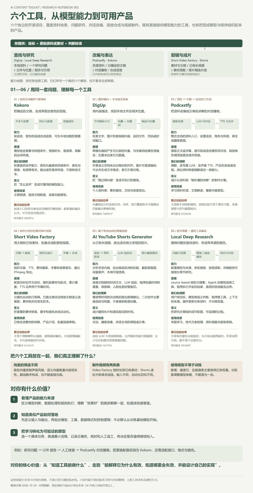</a>

六个工具，从模型能力到可用产品：汇总每个工具的能力、原理、我们的理解、意义与使用场景，以及对学习和构建产品的价值。

六个开源项目分别解决语音合成、本地内容检索、资料转播客、素材混剪、长视频选段和循环研究，重点看清模型判断与程序执行的分工。

### 003 · 动效提示词研究 · 从长流程到清晰意图

<a href="https://yydshly.github.io/1020_codex_project/projects/003-motion-prompt-lab/">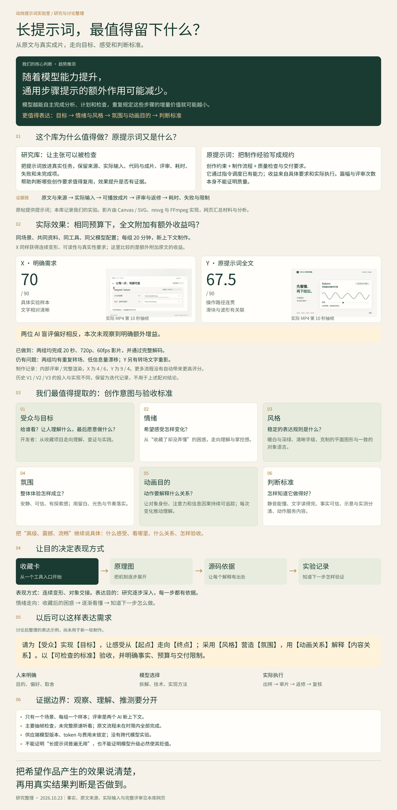</a>

长提示词研究总图：库的价值与原文规约、真实成片与同预算盲评、目标情绪风格氛围动画目的和验收标准，以及模型能力提升时通用步骤提示增益可能减少的判断与证据边界。

模型越能自主完成通用步骤，流程提醒的增益可能越小。通过原提示词、真实成片与同预算盲评，提炼简化方向：压缩重复步骤，保留受众目标、情绪、风格、氛围、动画目的及验收标准；跨代趋势仍待验证。

### 004 · 数字人技术图谱 · 从素材口型到实时生成

<a href="https://yydshly.github.io/1020_codex_project/projects/004-digital-human-atlas/">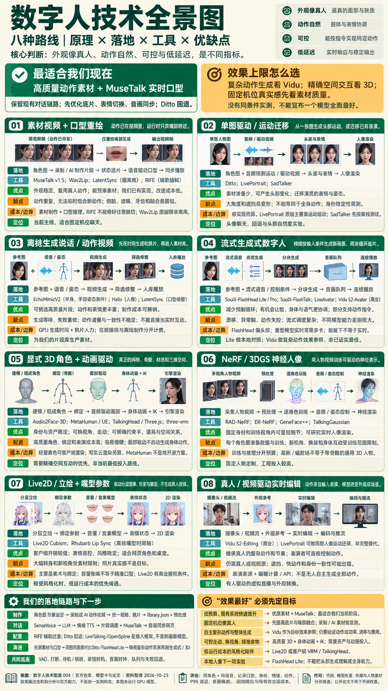</a>

八种数字人技术全景长图：原理、代表库、落地步骤与优缺点；推荐当前采用优质动作素材 + MuseTalk，区分复杂生成效果与 3D 空间控制。人物缩略图为机制示意。

研究低成本、动作自然且可实时交互的数字人：比较素材口型、单图驱动、离线与流式生成、3D、NeRF/3DGS、Live2D 和视频编辑八条路线。以优质动作素材 + MuseTalk 为当前主线，明确模型、成本与控制边界，并探索陪伴、客服导览、教学训练、虚拟直播及可插拔服务。

### 005 · 角色与故事工坊 · 从定制角色到短片

<a href="https://yydshly.github.io/1020_codex_project/projects/005-stickman-story-lab/">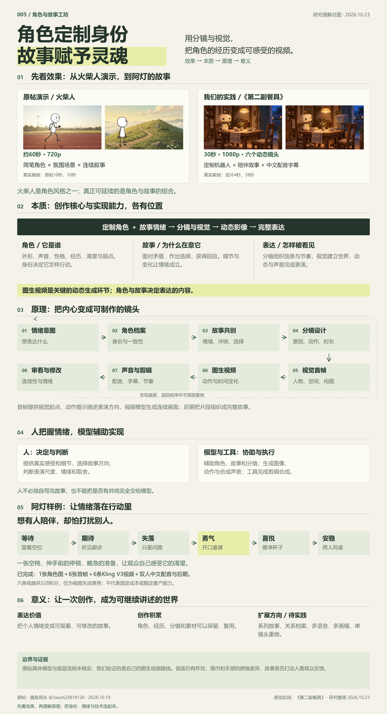</a>

角色与故事工坊中文研究总图：对照原帖火柴人动画与原创阿灯短片，梳理定制角色与故事的本质、分镜到图生视频及后期的实现流程、创作价值、扩展方向和验证边界。

以「定制角色＋故事」为核心，通过分镜、场景视觉、图生视频与配音剪辑，把情绪转成可观看的短片，积累可延续的角色、经历与素材。阿灯样例已验证制作路线；原帖底层技术仍未确认。

### 006 · 独立站实践手册 · 从需求到第一位用户

<a href="https://yydshly.github.io/1020_codex_project/projects/006-independent-site-playbook/">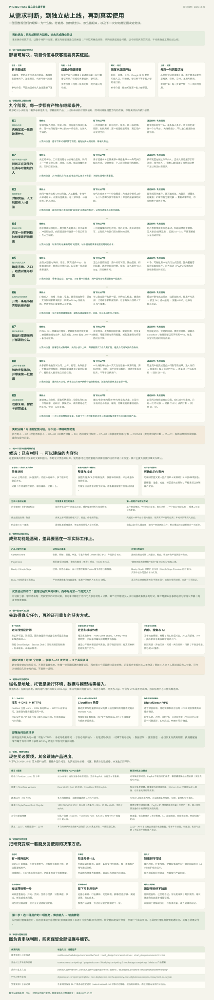</a>

独立站完整引导图：九阶段串联目标约束、需求与渠道、竞争与价值、样例、市场形态、开发、采购部署、首批使用、复用收费；每阶段列动作、产物、通过条件、失败回路与个人参考价值，并补充案例、预算与证据边界。

从“找新词建站”转向“为具体用户解决重复任务”：先发现需求、找到用户与渠道，再比较竞品、验证样例，完成最小产品和低预算部署，最终用真实交付、复用与付费检验价值。完整引导图帮助个人安排投入、判断下一步；部署有成熟路线，产品与获客仍待验证。

### 007 · 图生 3D 探索 · 从参考图到可漫游街区

<a href="https://yydshly.github.io/1020_codex_project/projects/007-canal-blender-test/">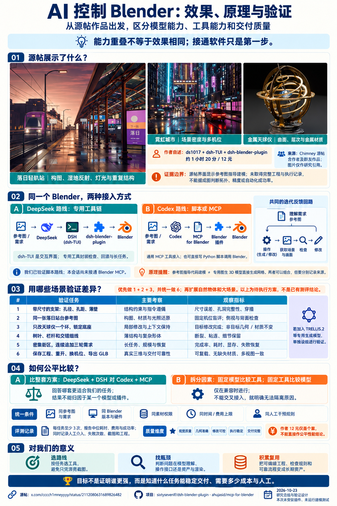</a>

专门生成的《AI 控制 Blender：效果、原理与验证》完整概述图：源帖场景示意、DeepSeek/DSH 与 Codex 脚本/MCP 两条控制路线、验证场景、公平比较方法和研究意义。作为引导图保留原件；本次实际图生 3D 过程、三档入口与后续结论见研究网页，不把图中的设想当作全部已实测。

验证图生 3D：设计三档图片入口，选最简单的预算版，用 Codex 理解图片，通过 Python/bpy 在 Blender 重建可编辑的几何、材质与灯光，再导出 GLB 接入网页漫游。探索 V1–V5 的构图对齐与湿面反光、镜头外补景、猫的走跑和 SPACE01–11 街区扩展，并保留源帖与我们的真实效果。结论是图生 3D 原型路线成立，但高保真还原与真实体感仍需资产、空间设计和反复验收；可用于快速搭景与自动化编辑，持续精修的投入回报会下降。未实跑 DSH/MCP，也未做模型公平比较。

### 008 · 产品发现平台图谱 · 从发布到选择

<a href="https://yydshly.github.io/1020_codex_project/projects/008-product-platform-atlas/">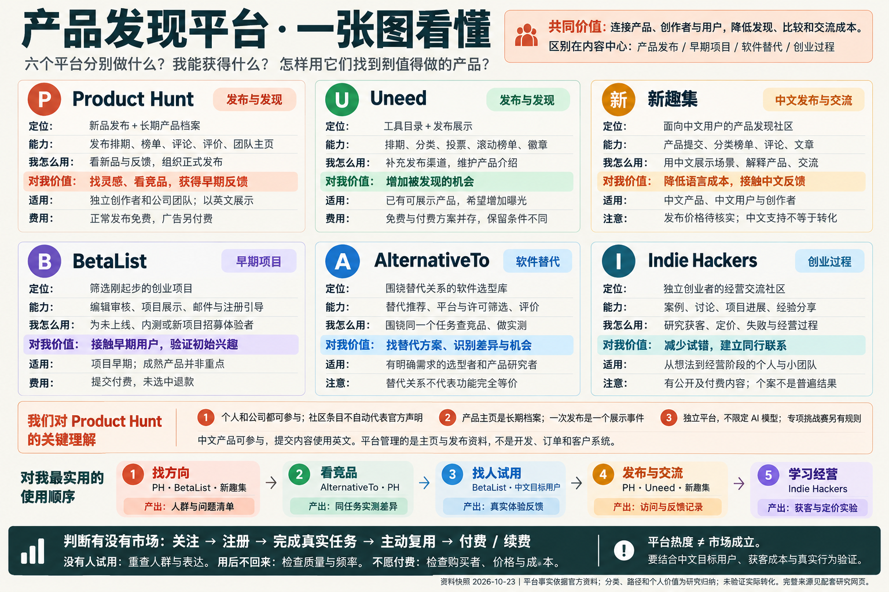</a>

六个平台一图总览：定位、核心能力、我怎么用、对我价值、适用对象和参与条件；Product Hunt 的关键理解、实际使用顺序与市场验证依据。

研究六个产品发现与创业交流平台：Product Hunt 用新品发布、榜单、评论和长期产品主页连接创作者与用户，帮助找灵感、看竞品和组织发布；Uneed 提供工具目录、排期与滚动榜单，增加产品被发现的机会；BetaList 筛选早期项目，帮助招募注册者和测试用户；AlternativeTo 按软件替代关系与属性辅助选型，帮助比较竞品和寻找差异；Indie Hackers 分享创业过程、获客与定价经验，帮助减少经营试错；新趣集支持中文产品发布、发现与交流，降低表达和反馈的语言成本。结合六个平台的参与方式、费用、语言和使用阶段，以生成的总览图串起找方向、看竞品、找人试用、发布交流与学习经营，并用真实任务、主动复用、付费和成本判断价值；平台热度不等于市场成立。

### 010 · AI 信息工作台 · 从来源到证据与判断

<a href="https://yydshly.github.io/1020_codex_project/projects/010-ai-evidence-workbench/">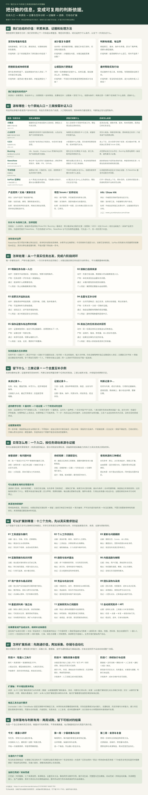</a>

AI 与效率工具信息体系全景图：六项价值、七个原始来源与三类补证入口、六阶段处理闭环、证据结构与去重示例、日常提示词、十二类应用方向、系统演进、两周起步与验证边界。

以少数派、小众软件、V2EX、Buzzing、NewsNow、今日热榜、SoPilot 为入口，按需补充产品官网/更新日志、Issues 和 Show HN；读原文、追溯出处、合并同源转载、保留独立实测与反例，互补核验并沉淀证据。支持工具选型、工作流优化、更新跟踪、简报问答、趋势与选题、需求/竞品研究；可继续探索团队采用、垂直站、研究订阅和自动助手。目标是减少重复调研与遗漏，让判断可追溯、可更新、可复用。沿用已生成全景图；自动化与业务方向尚待实跑验证。

### 011 · Jev Ultrafast · 从网页选项到自动执行

<a href="https://yydshly.github.io/1020_codex_project/projects/011-jev-browser-agent-study/">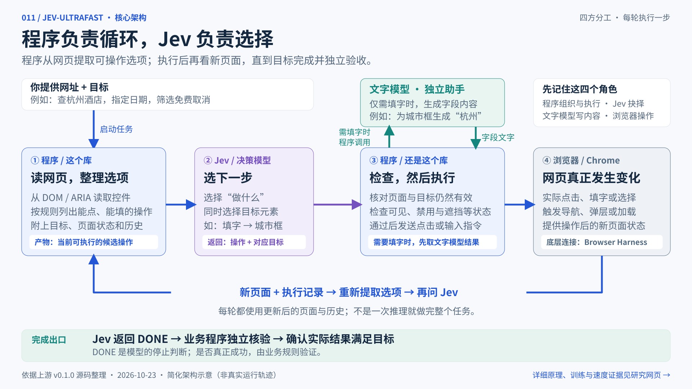</a>

Jev Ultrafast 核心架构与执行循环横图：业务定义目标与独立验收，库从当前网页抽取操作和状态，Jev结合上下文选操作与目标，浏览器执行并重新观察；填字时调用文字助手，模型DONE后业务校验结果。

把网页 DOM/ARIA 控件转成候选操作，由 Jev 结合目标、当前状态与历史选择，程序检查后驱动浏览器并循环观察。价值是复用动态网页 Agent 的观察、执行、重试与调试骨架，可用于查询筛选、导航和普通表单原型；可继续开发其他模型适配、复杂控件支持、任务恢复、业务验收与对比评测。扩展属于待实现方向，DONE 仍需独立核验。

### 012 · 入库之间 · C1 科二科三 3D 练车与复盘

<a href="https://yydshly.github.io/1020_codex_project/projects/012-parking-lab/">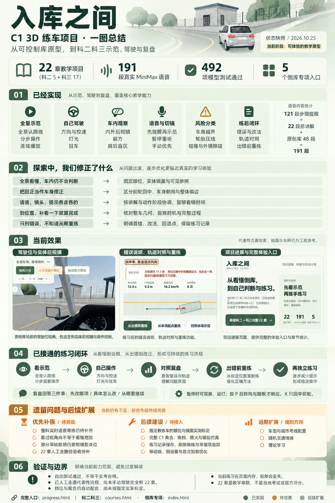</a>

入库之间项目引导图：汇总22章教学、191段MiniMax语音、五个倒库专项与492项模型测试，串联五个探索转变、代表性界面效果、练习与复盘闭环，以及待完善的实时带练、判断训练、实车标定、C1操控和记录保存。图为基于现有实现与截图生成的视觉摘要，非实车标定或官方评分。

以驾驶位观察、自己判断和纠错重练为主线，把倒库原型扩展为 C1 科二五项与科三17章教学串联：先用全景说明路线和完成要求，再通过前方、内外镜与盲区辨认车身、库线及道路变化；191段真实 MiniMax 配合分步示范、自动切镜与操作提示，支持接手驾驶、风险分类提醒、轨迹对照、错误改法和出错前重练。探索重点是让新手理解看到什么、为何操作，区分前轮回中、车身朝向与偏边，并按车辆几何、观察时机和完整过程判断。沿用生成的项目引导图，保留倒库专项；整科实时带练、风险判断题、因果复盘、实车标定、完整C1操控、记录保存和弱设备优化待继续完善。当前为工程教学原型，非当地考线或官方评分，自动测试不代替实车验收。

### 013 · AI 开发架构手册 · 代码是基石，需求是目标

<a href="https://yydshly.github.io/1020_codex_project/projects/013-ai-architecture-compass/">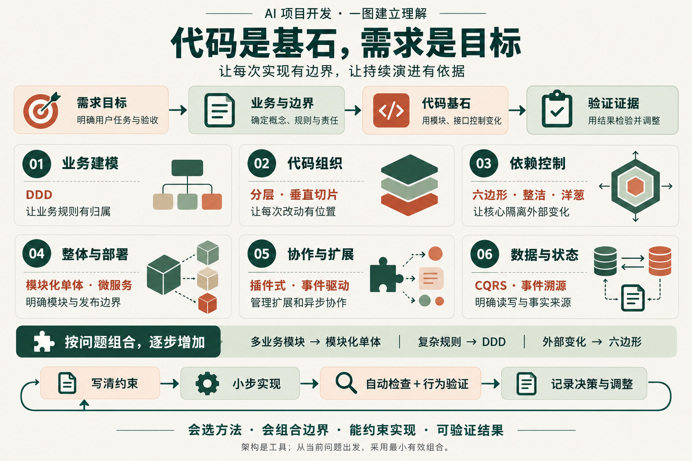</a>

AI 开发架构一图速览：代码是基石，需求是目标；六类问题与十二种方法，选择与组合，以及从目标、边界、实现到检查证据的持续把控。

代码是基石，需求是目标：探索如何持续把控 AI 实现。按六类问题理解 DDD、分层、垂直切片、六边形、整洁、洋葱、模块化单体、微服务、插件式、事件驱动、CQRS、事件溯源的场景与组合，将选择落实为规则归属、代码边界、自动检查和交付证据。一图速览建立全貌，详细手册帮助实践。

### 014 · 可编程世界 · 从海岸航拍到自己的作品

<a href="https://yydshly.github.io/1020_codex_project/projects/014-programmable-worlds/">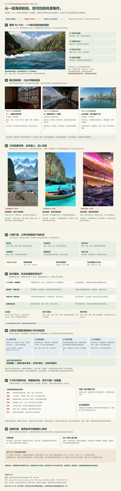</a>

可编程世界完整引导总览图：原作效果与原理、三处实践、三种扩展参考、六类方向、技术路线、约束与模板、有界求解与独立验证、下次任务单和价值边界；1800×7280完整图。

原作以代码生成完整海岸；我们完成老街窗景、独立船坞和漓江晨航，沉淀“确认约束→固定模板→有界求解→独立验证”的场景制作流程。研究与演示已收口，完整自动管线尚未实现。源库技术图为后续扩展提供复用指导。

#### 源库算法与扩展指导图

这张图将 Claude Code 驱动开发后形成的地形、生态、水体、光照、镜头与输出能力整理为可复用技术地图，可为我们的场景和交互扩展提供指导。先复现原作基线，选择并保留成熟模块，再在有限的结构、参数与镜头改动中验收画面和性能。

<a href="https://yydshly.github.io/1020_codex_project/projects/014-programmable-worlds/source-implementation.html">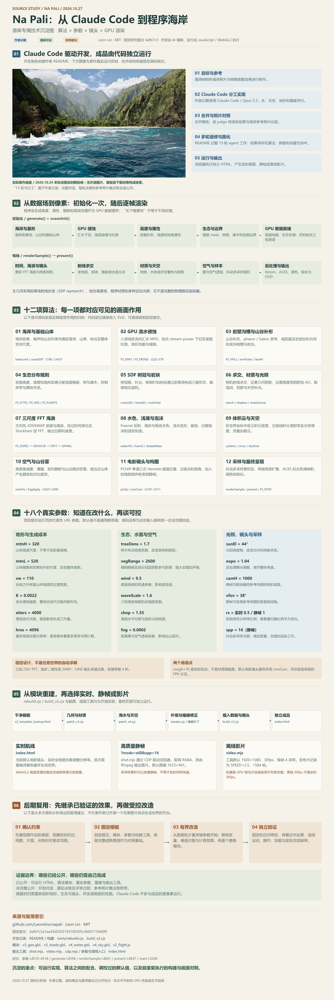</a>

### 015 · 江山时序 · 在地图上读中国历史

<a href="https://yydshly.github.io/1020_codex_project/projects/015-jiangshan-atlas/">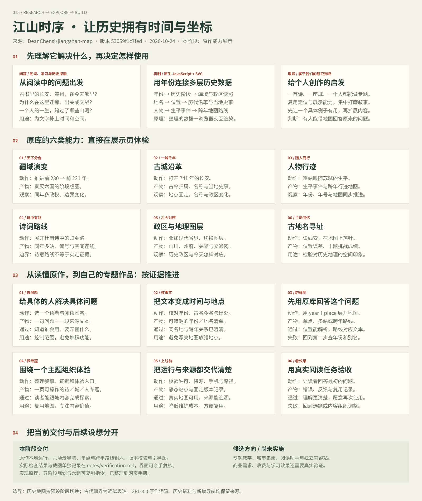</a>

江山时序完整引导图：历史地理问题、数据与地图原理、六类原作能力、个人参考价值、六步专题流程，以及配套实现与指令手册的交付范围。

源库以SVG矢量地图与晕渲底图呈现山河，把年份解析为阶段疆域快照，并用地点、人物与事件联动地图、时间轴和内容卡；可看疆域演变、查城池沿革、沿人物或诗词路线读史及落针寻址。015直接本地集成原作，新增六个入口、源码方法与指令手册，另用自研时间核心做非历史数据实验。可扩展地方史、人物专题、文化行旅和其他地图叙事；展示、直接复用与自研边界分开记录。

### 016 · 山河行记 · 历史时空地图

<a href="https://yydshly.github.io/1020_codex_project/projects/016-dongpo-journey/">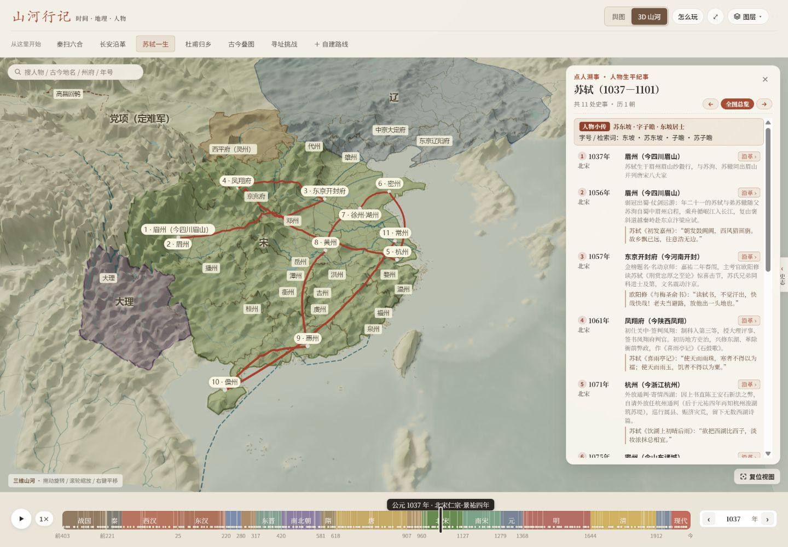</a>

山河行记历史地图实际运行：真实高程三维地形、历史疆域、城池与时间轴联动

直接复用江山时序54份历史引擎与资料输入，新增Three.js现代高程地形、疆域与行迹叠加、2D/3D同状态切换及2–20站路线编辑。用户可旋转山河、切年份、点城池和人物经历，地图、路线与说明同步变化；真三维为我们新增，现代DEM不代表古地貌复原。可继续拆分投影、图层、标注与镜头接口，用于地方史、行旅或铁路网络；现仍与历史控制器耦合，不能只换JSON视为通用地图引擎。

### 017 · 深蓝航迹 · 深海科考交互档案

<a href="https://yydshly.github.io/1020_codex_project/projects/017-abyss-expedition/research.html">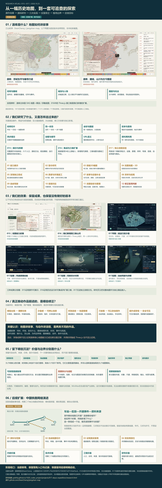</a>

源库研究与完整探索总览：源库SVG地图能力与原理、015—017实际效果、研究与修正、复用边界及铁路网络后续目标；当前阶段归档，铁路暂不启动。

独立实现热液与峡谷两条各11章深海教学航次：程序化Three.js场景、设备与原理动画、MiniMax预生成本地讲解、同类采水对照、导演播放、自由驾驶与镜头，并汇总源库效果、探索修正、九个自研纯核心及验收。时间和实体状态组织视图，音频时间驱动对应提示；海域与读数为教学设计。可扩展设备教学、实验操作、巡检培训等流程作品；地图叙事迁移仍待第二实例验证。中国铁路网络演进保留为后续地图目标，暂不启动。
<!-- PROJECTS:END -->

## 仓库结构

```text
projects/                 按编号组织的研究子项目
  001-evening-companion/  cyber-xiaowan 研究与公开页面
    project.json         名称、简介、来源、状态、图片和演示配置
    README.md            研究说明与结论
    assets/              封面、截图、流程图
    notes/               调研笔记、实验记录
    src/                 独立实现或改造代码
    web/                 可选：准备发布的静态 Web 文件
templates/project/       研究说明模板
docs/                    项目维护与部署说明
scripts/projects.py      新建项目、同步索引、校验和打包演示
.github/workflows/       自动校验与手动 Pages 部署
```

## 新增研究项目

需要 Python 3.10 或以上版本，无第三方 Python 依赖。

```bash
python scripts/projects.py new example-project --name "项目名称" --repo "https://github.com/owner/repo" --summary "一句话说明研究价值"
```

命令会创建 `projects/001-example-project/`，并更新本页索引。随后填写子项目 README，将截图放入 `assets/`，在 `project.json` 中配置 `cover` 和图片说明 `cover_alt`。

```bash
python scripts/projects.py sync
python scripts/projects.py check
```

## 维护约定

- **编号固定**：使用三位及以上编号，从 `001` 起递增；已发布编号不改动、不复用。归档项目保留记录。
- **先有来源，再有结论**：保留原仓库地址、研究时的版本或 commit、运行步骤和实际验证结果。
- **摘要留在首页，细节放进子项目**：首页展示简介、状态、封面和入口，研究过程写在子项目 README 与 `notes/`。
- **完整引导图**：用一张图串联核心理解、来源带来的思考、执行流程与个人参考价值，尽量保留细节、判断条件和证据边界；遵循[完整引导图要求](docs/research-guide-map.md)，提供放大查看与原图下载。
- **各项目独立运行**：依赖及启动命令在各自目录声明，避免互相干扰。
- **尊重上游许可**：引用、复制或修改上游代码时，保留其许可证与署名。当前仓库尚未指定统一开源许可证。

GitHub Pages 已开启：[访问在线索引页](https://yydshly.github.io/1020_codex_project/)。后续子项目的 Web 演示发布到 `/1020_codex_project/projects/编号-slug/`；操作步骤见[部署指南](docs/deployment.md)。
