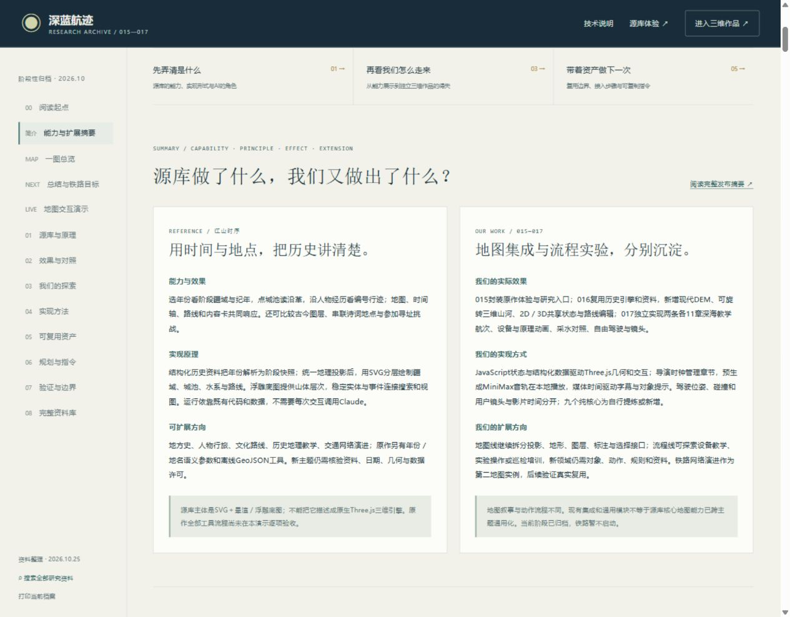
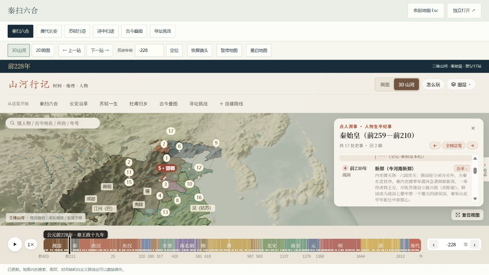
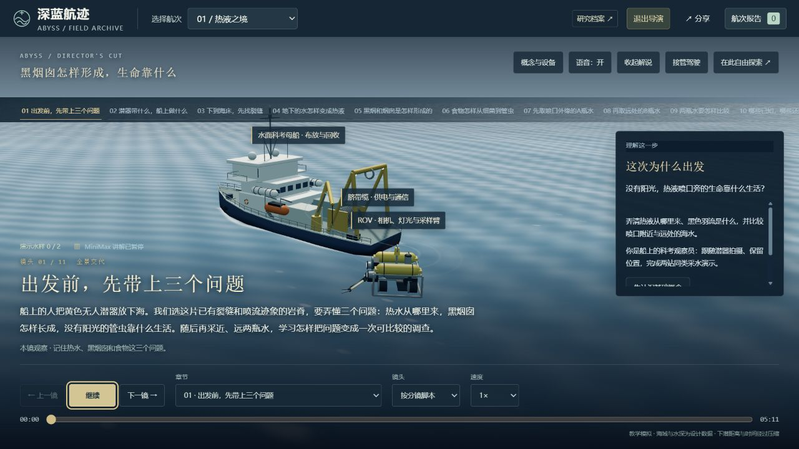

# 地图研究与深海探索：阶段归档发布

2026-10-25。发布范围为015、016、017三项目及相应目录入口。保留源库和第三方许可，不把其他本地未提交项目纳入本次提交。

## 能力、原理、效果与扩展

- 源库江山时序用结构化历史资料、年份阶段快照、统一地理投影与SVG分层绘制，使时间轴、疆域、城池、人物行迹和内容卡联动；浮雕底图提供山体层次。可扩展地方史、人物行旅、文化路线与交通网络叙事，另有语义参数和离线GeoJSON工具。
- 015保留完整原作本地体验，增加六个入口、研究与指令；016直接复用历史引擎和资料，新增现代DEM、Three.js真三维、共享状态与路线编辑。现代高程不等于古地貌复原。
- 017是独立深海流程实验：两条各11章教学航次、设备与原理动画、采水对照、导演、MiniMax本地音轨、自由驾驶和镜头。可作为设备教学、实验操作与巡检流程的候选基础，新领域仍需对象、规则、资料与适配。
- 地图叙事与动作流程分开评价。九个纯核心为自行提炼或新增；完整包集成、共用时间轴或Three.js不能证明源库核心地图能力已经通用化。
- 中国铁路网络演进保留为后续第二地图实例，先核验有限线路、年代、几何与许可，当前阶段归档，暂不启动。

## 发布入口

- 研究摘要：https://yydshly.github.io/1020_codex_project/projects/017-abyss-expedition/research.html#capability-summary
- 一图总览：https://yydshly.github.io/1020_codex_project/projects/017-abyss-expedition/overview.html
- 深海作品：https://yydshly.github.io/1020_codex_project/projects/017-abyss-expedition/
- 历史地图：https://yydshly.github.io/1020_codex_project/projects/016-dongpo-journey/
- 原作体验：https://yydshly.github.io/1020_codex_project/projects/015-jiangshan-atlas/

## 发布前验证

- 目录入口支持web_entry，017从站点目录进入research.html；旧项目默认入口兼容。10项目录测试通过。
- 跨项目链接支持独立本地端口、统一预览和Pages仓库子路径；历史正文链接在点击时映射，原文与代码不批量改写。
- 运行必需Three.js文件明确纳入版本控制；三项目哈希载荷保留原始字节，避免Windows/Linux换行转换造成清单失配。
- 本地研究档案、资料库、地图包和交付资源检查通过。固定上游、集成派生、语音、图片与素材来源分别保留。

## 已完成的部署与公网核验

- 发布提交：`46754b275b196abd87b95eb8aecb247cc65362ba`。
- [Deploy Pages工作流](https://github.com/yydshly/1020_codex_project/actions/runs/40174179267)已成功；同提交的[Check projects](https://github.com/yydshly/1020_codex_project/actions/runs/40174137426)通过。
- 线上587项页面与资源全部返回200并通过核对：586项项目文件与发布产物逐字节一致；总目录index.html按Windows CRLF与Linux LF差异归一后完全一致。初始严格比较与修正依据保留在[资源报告](map-research-20261025-resources.json)，不把换行差异写成资源丢失。
- 浏览器实际检查：公开研究摘要载入40份资料、发布摘要可打开，reader内跨项目链接没有回到8015—8017；公开内嵌3D地图显示地形，并从秦始皇前230年第4站推进到前228年第5站。
- 深海作品公开入口完成Three.js r180画面载入，母船、潜器、章节与任务说明显示；导演音轨元数据可载入并切换播放/暂停。本轮没有重新完整播放两条航次，不用本轮部署检查替代既有完整实播记录。
- 公开总览图载入尺寸2600×7825，PNG/SVG下载URL正确，图片与发布产物哈希一致；页脚已使用公开研究地址。
- 819份Web/资产在Git暂存时与工作文件字节相同，六份必需Three.js构建文件已入库。其他本地项目的未提交内容没有混入本次发布。

## 线上画面证据

当前阶段仍为已归档；中国铁路网络演进保留后续规划，暂不启动。
