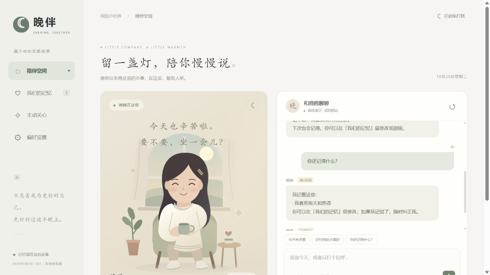
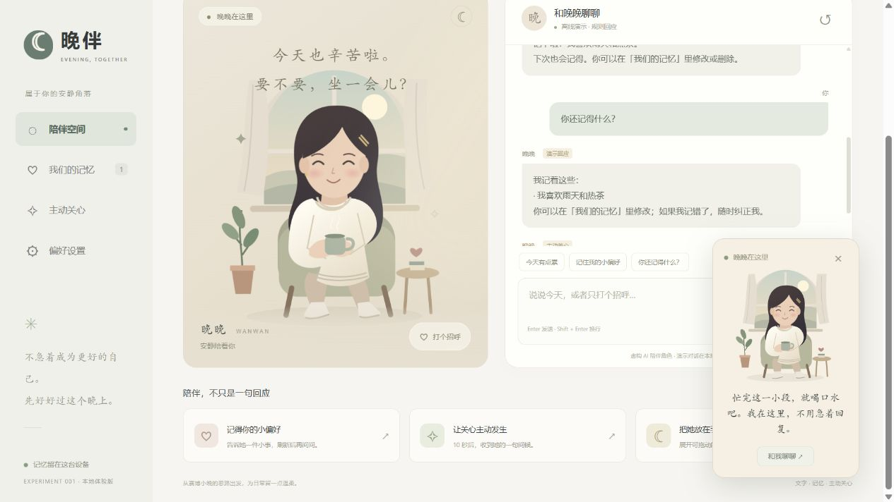

# 早期改造原型记录（不代表上游原库效果）

用户已明确要求先体验上游原版。这份记录仅保留先前独立制作的「晚伴」原型，原库入口见 [项目说明](../README.md)。

> 先体验角色、对话、记忆与主动关心，再决定如何发展成桌面应用。

| 项目资料 | 内容 |
| --- | --- |
| 上游 | [cyberxiaowan/cyber-xiaowan](https://github.com/cyberxiaowan/cyber-xiaowan) |
| 研究版本 | 2.2.0 / `19496aaba767bc6b594d1e32f51eda3ee038ef5a` |
| 研究日期 | 2026-10-20 |
| 当前阶段 | 研究中，v0.1 浏览器交互原型已完成 |
| 技术 | HTML、CSS、JavaScript、Node.js 22.15+，无第三方运行时依赖 |
| 许可边界 | 上游 package.json 声明 MIT；真人图片另有限制，本项目未复制上游代码或图片 |

## 项目预览





## 立即体验

在 PowerShell 中运行：

```powershell
cd F:\codex_project\1020_codex_project\projects\001-evening-companion
npm start
```

打开 [本地预览](http://127.0.0.1:4317)。默认没有模型配置，使用明确标注的**离线演示**。无需安装依赖或填写密钥即可体验。

建议依次体验：

1. 点击「今天有点累」：查看规则演示回应。
2. 输入「叫我小林」或「记住：我喜欢雨天」：保存一条真实本地记忆。
3. 刷新，再问「你还记得什么？」：确认记忆仍在。
4. 在「我们的记忆」里编辑、删除或新增记忆。
5. 点击「让关心主动发生」：保持页面打开，10 秒后出现关心消息。
6. 开启免打扰，再安排提醒：到期后仍等待，关闭免打扰才送达。
7. 点击「把她放在手边」：拖动网页内的迷你卡片。
8. 在偏好设置里选择朗读、导出记录或清除本地数据。

## 哪些能力是真的，哪些仍是原型

| 能力 | v0.1 状态 |
| --- | --- |
| 原创人物、日夜氛围、打招呼互动 | 已实现 |
| 无配置文字聊天 | 规则演示，不是大模型理解 |
| 自由聊天 | 已实现兼容 Chat Completions 的服务端接口；需配置自己的模型 |
| 多轮上下文 | 模型模式发送最近 20 条消息 |
| 长期记忆 | 浏览器 localStorage；明确语句提取、增删改、刷新保留 |
| 语义记忆检索 | 未实现；离线回忆列出记忆，模型接口最多使用前 30 条 |
| 定时主动关心 | 已实现本页计时、免打扰暂缓、到期补发、避免重复 |
| 闲置主动问候 | 可选；页面可见、闲置 3 分钟，最少间隔 30 分钟 |
| 朗读 | 浏览器 Speech Synthesis；取决于浏览器和系统音色 |
| 语音输入 / 口型同步 | 未实现 |
| 网页悬浮卡片 | 已实现 |
| Windows 桌面常驻 / 系统置顶 / 托盘 | 未实现；下一阶段接入桌面外壳 |
| 关闭页面后主动关心 | 不运行；重开补发 24 小时内到期事项，过期更久的略过 |

## 接入真实模型

将 `.env.example` 复制成 `.env`，在本机编辑：

```dotenv
COMPANION_BASE_URL=https://你的兼容接口/v1
COMPANION_API_KEY=在本机填写
COMPANION_MODEL=你的模型名称
PORT=4317
```

重启 `npm start`。界面会显示「模型已连接」，实际可用性以发送结果为准。`BASE_URL` 是接口前缀，服务会追加 `/chat/completions`；模型需支持 `messages` 和 `max_tokens` 参数。

密钥仅在本地 Node 服务中使用，未写入网页、localStorage 或静态发布目录。`.env` 已被根目录 Git 忽略规则排除。模型模式会将最近对话及选中的记忆发给配置的模型服务。离线模式不调用模型。

当前是普通 JSON 完整回复，尚未实现流式输出。模型连接失败会显示错误，不会悄悄把规则回应冒充模型回答。

## 原理与结构

```text
src/
  server.mjs          本地静态服务、模型配置状态、模型调用代理
  build.mjs           复制可公开的静态文件到 web/
  ui/
    index.html        四个页面：陪伴、记忆、关心、偏好
    style.css         响应式布局、角色氛围、迷你卡片
    character.svg     原创矢量人物，不含上游真人照片
    core.mjs          记忆提取、持久化恢复、提醒选择、演示回应
    app.mjs           UI 交互、消息展示、调度和浏览器存储
tests/
  core.test.mjs       记忆与提醒的状态行为测试
  server.test.mjs     本地服务到模拟模型服务的集成测试
web/                  静态构建产物，可供仓库 Pages 打包
assets/               实际预览截图
notes/verification.md 实测记录与限制
```

聊天输入经过明确记忆语句检测；命中则更新本地记忆，否则走规则演示或模型接口。提醒以绝对到期时间保存，页面每秒检查，免打扰或正在回复时暂缓。触发前先标为完成并保存，降低刷新重复送达的风险。

输入内容均通过 `textContent` 渲染，不执行用户输入中的 HTML。模型没有 shell、文件读取或浏览器控制工具。服务监听 `127.0.0.1`，校验 Host / Origin，只提供明确列出的静态文件。

## 构建和检查

```powershell
npm test
npm run build
```

仓库根目录：

```powershell
python scripts/projects.py sync
python scripts/projects.py check
python -m unittest discover -s tests
```

`web/` 可以公开托管。静态托管仅支持离线演示、浏览器本地记忆和页面内提醒，不提供模型代理；不要将 `.env` 放进去。此次只创建本地原型与静态产物，未发布到线上。

## 结论与后续

本轮验证的是“把角色展示、真实本地记忆、主动提醒连接成可体验应用”。它不是上游作者本人的数字分身，也不是已经完成的原生桌面女友。

后续优先级：

1. 接入用户选择的真实模型，验证自由对话质量与延迟。
2. 将记忆迁移到本地数据库，补充相关性检索、来源、更新和冲突处理。
3. 用桌面外壳提供系统级透明置顶窗口、托盘和后台提醒。
4. 结合用户反馈改人物外观、互动语气，再加入语音输入与口型。

浏览器数据不是加密保险箱；多窗口并发修改、跨设备同步、账号系统、打包安装器均未实现。语音朗读是否联网由浏览器及选中的系统声音决定。

## 来源与署名

- [上游能力与边界](https://github.com/cyberxiaowan/cyber-xiaowan/blob/19496aaba767bc6b594d1e32f51eda3ee038ef5a/SKILL.md)
- [上游桌宠说明与图片许可](https://github.com/cyberxiaowan/cyber-xiaowan/blob/19496aaba767bc6b594d1e32f51eda3ee038ef5a/pet/README.md)

本项目借鉴上游“温暖、证据边界、状态驱动人物展示”的思路，应用代码、文字和角色插画为本次独立实现，没有安装上游 Skill，也没有复制其真人素材。本仓库尚未指定统一开源许可证。

[返回总索引](../../../README.md)
