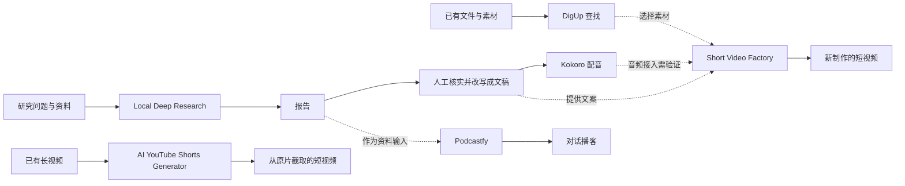

# 002 · 六个 AI 内容工具的原理与实践

这六个项目覆盖素材查找、资料研究、语音合成、视频制作和播客制作。理解它们的关键是区分两件事：**每个工具负责哪一步，以及它依赖什么才能完成这一步。** 可以根据任务选用其中一两个，无需先把六个全部安装。

本研究源于 [G哥的工具推荐帖](https://x.com/goan999999/status/2111807626329965049)。研究日期为 **2026-10-20**，状态为 **研究中**。已核对六个官方仓库的文档、版本与部分关键代码；安装体验、中文效果、运行速度和实际费用尚未实测。

[打开研究网页](web/index.html) · [Kokoro 深入讲解](web/index.html#/tool/kokoro) · [DigUp 深入讲解](web/index.html#/tool/digup) · [能力对照](web/index.html#/compare) · [网页验证记录](notes/08-web-verification.md)

[在线研究页](https://yydshly.github.io/1020_codex_project/projects/002-ai-content-toolkit/) · [在线一图总览](https://yydshly.github.io/1020_codex_project/projects/002-ai-content-toolkit/#/summary)

新增[一图总览](web/index.html#/summary)：先看六个工具的总体作用，再逐一梳理能力、原理、理解、意义、场景与边界，最后总结对学习和构建产品的价值。[高清长图 JPG](assets/six-tools-summary.jpg) · [可放大矢量图 SVG](assets/six-tools-summary.svg)。六个项目各自独立，组合示例是设计思路，不表示已完成集成。

新增 [Kokoro 声音基础 · 图解试听](web/index.html#/tool/kokoro/basics)：波形、音高与音色、256 维声音风格条件、编码器训练与克隆边界。包含可调波形与两秒短音、训练对比图，以及四段 MiniMax 中文讲解（约 2 分 45 秒）。教学音频不计入 Kokoro 本机实测。

第二篇 [DigUp · 内容怎样变成可查找的索引](web/index.html#/tool/digup/principles) 已加入四类效果案例、文件分片图、索引与查询流程、语义和关键词混合排序推演，以及 Windows 与中文检索边界。交互数据为教学示例，不是 DigUp 的实测结果。

原理页另有三张语义空间图解：不同模态的编码入口、可切换的跨模态对齐示意，以及“先生成描述”与“直接向量检索”的路线对照。CLIP 作为训练机制示例，与 EmbeddingGemma 2 已公开的训练信息分开说明。

第三篇 [Podcastfy · 资料怎样变成对话播客](web/index.html#/tool/podcastfy) 已加入朗读与改编对照、角色标签与音色区别、两种配音路径、长文上下文流程，以及分阶段审稿与中文验证计划。交互使用人工编写的教学内容，尚未生成实际播客。

第四篇 [Short Video Factory · 素材怎样组成成片](web/index.html#/tool/video-factory) 于 2026-10-23 完成深入补充：模型与渲染分工、随机选片边界、字幕像素流程和可拖动时间轴。沿用固定版本代码，未安装或渲染实测；更新了此前对字幕功能的概览。

第五篇 [AI YouTube Shorts Generator · 长视频怎样选出短片](web/index.html#/tool/shorts) 于 2026-10-23 完成深入补充：原片转录、LLM 选段、时间戳定位与最大人脸裁切的分工，附可切换候选示例和三张图解。沿用固定版本，区分本地与 API 路径，记录长视频分块的静态时间坐标风险；尚未运行生成短片。

第六篇 [Local Deep Research · 问题怎样变成可核查的报告](web/index.html#/tool/ldr) 于 2026-10-23 完成深入补充：按轮次与 Agent 策略对照、搜索和阅读分工、停止条件、引用来源，以及可切换研究过程与证据练习。六篇均已有深入讲解，本机实测仍未开展。

[](assets/six-tools-summary.jpg)

## 每个工具的一句话：本质能力与原理

| 实际工具与源仓库 | 一句话摘要 | 详细笔记 |
| --- | --- | --- |
| [Kokoro](https://github.com/hexgrad/kokoro) | 语音合成模型及推理库，将文字转为音素，结合音色条件预测时长与韵律并生成语音波形。 | [声音生成](notes/03-kokoro.md) |
| [DigUp](https://github.com/ARahim3/DigUp) | 本地内容检索工具，将文件分片编码为语义向量并结合关键词索引，按描述返回文件及页码或时间位置。 | [内容检索](notes/01-digup.md) |
| [Podcastfy](https://github.com/souzatharsis/podcastfy) | 播客制作工作流，先提取资料并由语言模型改写成分角色对话，再调用语音后端配音合并。 | [对话改编](notes/06-podcastfy.md) |
| [Short Video Factory](https://github.com/YILS-LIN/short-video-factory) | 自动混剪工具，以配音时长为目标随机截取已有素材，再叠字幕、合成音乐并导出视频。 | [素材混剪](notes/04-short-video-factory.md) |
| [AI YouTube Shorts Generator](https://github.com/Anil-matcha/AI-Youtube-Shorts-Generator) | 长视频切片工具，让大模型读取带时间的语音转录来选段，再截取原画面与原声并按需裁切画幅。 | [长视频选段](notes/05-youtube-shorts.md) |
| [Local Deep Research](https://github.com/LearningCircuit/local-deep-research) | 深度研究编排工具，通过固定轮次或模型工具调用循环搜索和读取资料，最后综合为带引用的研究报告。 | [研究循环](notes/02-local-deep-research.md) |

这些摘要依据各工具已核对的固定版本；每份笔记末尾有版本与源码。模型提供生成、编码或语义判断能力，产品还要组织资料、接口、执行规则和质量检查；声音向量、语义索引、工作流和 Agent 循环是不同层次的机制。理解这些分工，才能选择合适的工具、定位失败原因，并设计自己的实现。

## 六个工具之间是什么关系

下面是**可设计的协作方式**，不是已经打通的官方集成。虚线表示需要人工交接或另写适配代码。



有三种不同任务：

1. **从资料创作新内容**：研究问题，核实报告，再改写成文章、视频文案或播客。
2. **从已有长视频提取片段**：保留原视频内容，筛选值得单独呈现的一段。
3. **在素材库里找东西**：帮助前两种任务定位文件，本身不承担写作或剪辑。

Kokoro 可以提供语音能力，但短视频工厂和 Podcastfy 已有自己的语音方案。替换成 Kokoro 是一个集成任务，并非本次查阅已确认的开关选项。

## 帖子中需要补充的条件

| 容易形成的印象 | 本次核对后的理解 |
| --- | --- |
| DigUp 只能在 Mac 上使用 | 当前文档也提供 Windows/Linux beta；不同系统的格式和文字识别能力有差别。 |
| 开源意味着使用全程免费 | 代码许可、模型运行、云端 API 和人工复核是不同成本。费用取决于实际配置。 |
| 软件在本机运行就是全程离线 | 短视频工厂的 Edge TTS 会访问网络；切片工具的 local 模式仍调用云端 LLM。 |
| 输入一句话就能无素材生成短视频 | 短视频工厂的主要工作流需要视频分镜素材，重点是组合与剪辑。 |
| 转录出字幕就等于成片已有字幕 | 切片工具会缓存 SRT，但已检查的本地裁切模块没有字幕烧录步骤；最终字幕呈现需实测。 |
| 六个工具能直接顺次串起来 | 它们有不同输入输出，且视频与播客是分支。自动交接需要格式约定和错误处理。 |

证据分别见 [DigUp](notes/01-digup.md)、[短视频工厂](notes/04-short-video-factory.md)、[切片工具](notes/05-youtube-shorts.md) 和 [Podcastfy](notes/06-podcastfy.md) 笔记。

## 推荐的理解顺序

按用户确定的“从简单到复杂”顺序推进，难度指理解所需的概念与环节，不是安装难度：

1. **Kokoro**：单一模型，理解文稿如何变成声音。已完成第一篇深入拆解，附官方音频入口与模型计算过程。
2. **DigUp**：检索系统，理解内容如何变成索引，查询怎样找回文件。已完成第二篇深入拆解与混合检索交互推演。
3. **Podcastfy**：内容流水线，先把资料改写成对话，再生成声音。已完成第三篇深入拆解与图解。
4. **Short Video Factory**：多媒体工作流，增加视频素材、字幕与时间同步。已完成第四篇深入拆解和时间轴教学。
5. **AI YouTube Shorts Generator**：多模型协作，组合转录、片段判断与画面裁切。已完成第五篇深入拆解与候选选段图解。
6. **Local Deep Research**：研究 Agent，理解搜索、证据收集与决定下一步动作的循环。

六篇均已完成基于固定版本的深入讲解、代码入口与实验计划。六个工具的本机实测尚未开展；网页教学示例不替代真实效果验证。

先读懂每份笔记里的例子，再按照 [小实验与验收记录](notes/07-experiments.md) 逐项试用。每次只验证一个核心能力，记录成功与失败样例。

## 环境与成本速查

| 工具 | 当前文档或配置中的运行入口 | 需要另外考虑的资源 |
| --- | --- | --- |
| DigUp | 桌面应用；Windows/Linux 为 beta | 模型下载、首次索引时间、磁盘和算力 |
| Local Deep Research | Docker 或 Python Web 应用；当前源码要求 Python `>=3.12,<3.15` | LLM、搜索后端，按配置需要网络或 API |
| Kokoro | Python 库；当前源码要求 Python `>=3.10,<3.14` | 权重、语言依赖、CPU/GPU |
| Short Video Factory | Windows/macOS/Linux 桌面应用 | 视频素材、文案模型端点、网络配音、渲染时间 |
| AI YouTube Shorts Generator | Python 3.10+，命令行或 Python API | 默认 MuAPI；local 模式需 FFmpeg、转录依赖与云端 LLM |
| Podcastfy | Python 3.11+，命令行或 Python API | 文稿模型、TTS 后端与音频处理依赖 |

这些是研究版本的入口条件，不是六个工具共用的安装环境。实际试用时分别创建环境，避免依赖相互影响。具体收费不在本次文档研究中估算。

## 研究记录与来源

- [版本与证据清单](notes/sources.json)：六个仓库的完整 commit、许可证标识与已检查文件。
- [小实验与验收记录](notes/07-experiments.md)：预期输入、检查方法、待填写的实际结果。
- `assets/tool-map.svg`：本研究原创的关系示意图，不是上游应用截图。
- `src/`：网页源码与结构化研究内容；`web/`：可直接打开的静态网页产物。

元数据的 `repo` 字段按现有索引规范填入 Local Deep Research，作为代表入口；本研究范围包含上表全部六个仓库。许可证分别记录，不将它们视为同一许可的代码合集。

## 网页维护与预览

网页使用原生 HTML/CSS/JavaScript，无需安装 npm 依赖。六库内容位于 `src/content.mjs`，固定版本证据来自 `notes/sources.json`。修改后在本子项目目录执行：

```powershell
npm run build
npm test
npm run preview
```

预览地址为 `http://127.0.0.1:8022/`。也可直接用系统浏览器打开 `web/index.html`；官方音频与外部来源需要网络，文章与交互不调用 AI 服务。阅读进度仅保存到浏览器，不代表研究完成或实验通过。

声音基础的交互源码在 `src/kokoro-learning.js`，中文旁白原稿在 `src/narration.json`。`assets/audio/` 保存已生成的 MP3 与来源清单，构建时复制到 `web/audio/`，播放无需 API 密钥。需要重新生成时，运行 `python scripts/generate_narration.py --env-file <项目外的配置文件>`；这会调用 MiniMax，同一请求与已验证音频会复用，配置文件不应放入网页目录。

页面支持六库详情、可点击流程、对照筛选、实验模板下载、名词解释与手机布局。发布使用本仓库的 GitHub Pages 手动工作流，入口见页首；`web: true` 仅表示纳入静态打包，部署成功状态以 Actions 记录为准。发布步骤沿用[仓库部署指南](../../docs/deployment.md)。

DigUp 的教学交互源码在 `src/digup-learning.js`；它使用人工设定的分数演示排序，不读取用户文件、不下载模型、不调用 API。

Local Deep Research 的“底层原理”页补充了理解与代码的六项差异，以及可点击的 source-based / Agent 流程图，说明循环、分工和结束条件；交互源码在 `src/ldr-learning.js`。这些图按固定版本代码整理，不执行真实研究。

总图与阅读版共用 `src/summary.mjs` 的内容，`src/summary-page.js` 负责阅读页面。构建生成 `six-tools-summary.svg` 与用于导出的 `summary-poster.html`；JPG 是审核后的整页导出快照，修改内容后需要重新导出并同步到 `assets/` 与 `web/`。

工具的一句话摘要以 `src/content.mjs` 为源；构建同步到 `project.json` 的六个仓库及 `tool_summaries`，再在仓库根目录运行 `python scripts/projects.py sync`，保持网页与总索引一致。

---

[返回总索引](../../README.md)
