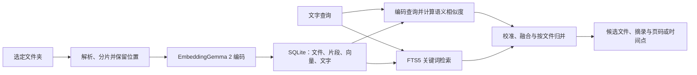

# DigUp 如何按内容找回本地文件

想象你记得“有张海边的狗的照片”，却忘了文件名。DigUp 的作用是根据内容描述找回素材，并可定位到 PDF 页或音视频片段。它适合已经有资料、却难以找到资料的场景。

## 效果：找到文件，也找到位置

| 记得的内容 | 可能返回什么 | 还需检查什么 |
| --- | --- | --- |
| 海边奔跑的小狗 | 名称为 `IMG_0831.jpg` 的图片 | 画面是否真的符合描述 |
| 合同里关于宠物的条款 | 合同文件与相关页码 | 条款原文、查看器能否跳页 |
| 讨论睡眠和记忆的一段 | 音频文件与窗口起止时间 | 窗口内的话题是否正确 |
| `code: retry with backoff` | 代码文件和候选行号 | 是否开启代码索引、实现是否正确 |

以上是教学案例，不是运行结果。它减少回忆文件名、挨个打开、翻页和拖动进度条的时间；交付候选文件与位置，不生成一段新声音或一份综合报告。

## 能力与边界

DigUp 将内容语义检索和关键词检索结合起来：描述画面、话题、功能时，向量能补充文件名的不足；检索发票编号、人名或路径时，可提取的文字和精确词匹配仍重要。代码搜索需要单独开启，并有独立索引。后续同步可复用未变化文件的结果，处理新增、变化与删除。

扫描范围、排除规则、格式解析失败和尚未完成的索引都会影响能否找到文件。代码和隐藏目录的默认过滤也不是绝对的敏感信息保护保证。PDF 和音视频结果保留位置，但外部查看器不一定支持跳页或跳时间，应用预览与外部打开要分别检查。

**搜索分数是相关性排序信号，不是正确概率，也不是对文件内容真实性的判断。**

## 底层原理：先建立索引，再查已有索引

### 1. 模型权重和文件索引是两件事

EmbeddingGemma 2 把不同模态的输入映射成可比较的表示，DigUp 使用 768 维向量。模型权重决定如何编码；索引保存各文件片段的编码结果。建立索引是模型推理，不是用这些文件重新训练模型。文字查询与文件向量在相同约定下比较，不需要先把所有图片或声音转换成中文句子。

Kokoro 的风格向量用于控制声音生成，DigUp 的语义向量用于判断内容相关性；虽然都由数字组成，用途、维数和训练目标不同，不能互换。向量也不是 768 个可以逐一命名为“狗”“海边”的标签。

### 补充：不同模态如何学会相互对应

同样长度的数字数组并不会自动形成可用的共享空间。模型通过跨模态配对数据学习对应关系：狗的图片对应狗的描述，录音可以对应说话内容或声音事件描述。文字、图片与音频经过各自适用的编码入口和后续处理，最终输出可比较的表示。

经典 CLIP 图文对比学习提高配对图片与文字的相似度，降低不匹配样本的相似度，通过误差和反向传播更新参数。网页借用这个机制讲解“对齐”，并提供“未对齐／对齐目标”切换图。坐标为人工绘制，不执行训练，不是模型实际向量的二维投影。音频关系是扩展的配对教学概念，不是说 CLIP 本身在该示例中训练了音频。

EmbeddingGemma 2 官方模型卡确认使用配对的文字、图片、视频与音频来对齐表示，但没有给出完整训练配方；不能将它的全部训练目标等同于 CLIP。相关向量也不必完全相同，维度不对应固定的人工主题标签。

| 路线 | 索引阶段 | 查询阶段 |
| --- | --- | --- |
| 先描述再搜索 | 图片 → 生成描述 → 文字索引 | 查询 → 关键词或文字向量检索 → 原图 |
| 直接跨模态检索 | 图片 → 图像向量 + 原图路径 | 查询 → 文字向量 → 与图像向量比较 |

第一条路线的描述可以读懂，但只依赖描述会受到遗漏、误描述的影响。第二条路线不要求先生成文字，不过向量同样会丢失信息，不能完整还原原图。两者可以组合，不应以此断言某条路线永远更好。

**训练时用文字教模型建立对应关系，不等于使用时每张图片都先生成描述。** DigUp 的图像与音频嵌入路径属于直接编码；可提取文字和部分平台的 OCR 补充关键词检索。OCR 读出已有文字，图像描述概括画面，两者也需区分。

来源：[CLIP 官方机制说明](https://openai.com/index/clip/)、[EmbeddingGemma 2 训练数据](https://huggingface.co/google/embeddinggemma-2#model-data)。网页新增三张可随页面宽度调整的示意图，相关音频例子区分了“人说狗在叫”和“真实狗叫声”。

### 2. 文件先拆分，才能定位局部内容

- PDF 按页选择文字或页面图像；扫描页可以直接走图像路径，不保证先得到 OCR 文字。研究版本中超过 50 页的 PDF 首轮处理 30 页，之后继续分阶段索引。
- 文档默认分块约 1,800 **字符**，重叠约 200 字符，并尽量沿空白边界切分；不是固定 token 数。
- 音频默认使用 30 秒窗口、25 秒步长，形成约 5 秒重叠。模型直接编码音频窗口，不等于已经生成完整转录。
- 视频默认约每 3 秒取画面并去近重复帧，声轨另按音频窗口处理。采样会漏掉短暂内容，不能视为逐帧理解。

分片越细，位置越具体，但推理次数、存储量和检索比较次数也增加。页码、时间与行号来自索引保存的元数据，不是向量自己“记住了文件在哪里”。

### 3. SQLite 保存哪些东西

`files` 保存路径、大小、修改时间和索引状态；`segments` 保存文件关联、片段类型、起止位置、摘录与向量；FTS5 保存可检索的名称与文字。768 维 float16 向量的数值部分约为 1,536 字节，这不包含文件记录、文本、数据库页和其他索引开销。

向量经过 L2 归一化，查询时分块转为 float32 进行点积比较，等价于归一化后的余弦相似度。当前 `Searcher` 对已存向量进行完整比较，没有使用近似最近邻索引服务；因此查询成本仍会随片段数量增长。

### 4. 为什么需要混合检索

两张不同编号的发票语义很相近，单靠向量可能排错；一张没有文字的照片又不能只靠关键词命中。源码先处理不同模态的相似度分布，再结合 FTS5、词覆盖率、查询类型等排序。

研究版本的普通查询词权重为 2；编号等 lookup 查询降低语义权重、提高词权重。语义 z 分 ≥ 2 或词覆盖率 ≥ 50% 才进入候选，文件类型提示还会影响排序。最终按文件选取片段，并保留对应位置。这里不是简单地把所有文件的原始余弦值放在同一把尺子上。

网页提供三组人工数据：“内容描述”“精确编号”“没有答案”，可切换语义、关键词和混合路径。它只演示候选门槛与部分融合规则，不复现嵌入、中文分词、BM25、模态校准、文件归并和完整定位；不能据此评价真实质量。

## 在你的 Windows 环境中

当前官方提供 Windows 10/11 64 位 beta，研究版本入口为 `v0.7.0-beta.2`。首次需要约 865 MB 的模型下载，并承担索引时间与磁盘开销；不是每次搜索都重新下载模型。

当前 Windows/Linux 没有 Mac 版的截图 OCR；旧 `.doc`、RAW 与 SVG 等格式支持也不同。图像语义检索不等于能准确读出截图小字。模型支持多语言，不代表应用已对中文完成质量验证；当前关键词分词对中文、日文和泰文缺少专门处理。中文语义查询与中文精确匹配应分别测试。

官方说明文件在本机处理、不上传。首次模型下载、更新检查等仍需网络；本研究核对的是文档和代码，没有实施完整网络审计。

## 第一次实验

准备 20 个不含隐私的测试文件：5 张普通图片、5 份文档、4 段音频、4 段视频和 2 张含中文文字的截图。提前写下 10 个有正确答案的问题，其中 5 个用内容描述、5 个用确切关键词，再加 2 个资料中没有答案的问题。

记录系统、硬件、应用版本、索引状态；分别测首次索引耗时与查询耗时。核对前五条是否包含正确文件、首位是否正确、页码或时间点是否正确，并单独记录中文截图与编号失败。更新和移走各一个文件后重新同步，检查索引是否相应改变。空结果测试也要记录是否出现误命中。

**理解检查**：为什么搜“海边的狗”可能找到名称完全不同的照片，而搜发票编号仍需要关键词检索？

## 值得学习的设计

把“昂贵的预处理”放在索引阶段，把“频繁的查找”放在查询阶段，是这一类工具的重要设计。对本项目而言，更值得复用的是检索思路，而不是把它强行接成所有内容流程的第一步。

运行状态：未安装、未进行检索实测。版本和来源见下方。

## 固定版本与来源

研究日期：2026-10-20。Commit：`7db9537712995d14e50e0e44baa00f721b98f1c6`。GitHub 元数据中的许可证标识：`MIT`。

- [官方 README](https://github.com/ARahim3/DigUp/blob/7db9537712995d14e50e0e44baa00f721b98f1c6/README.md)
- [Sources/DigUpKit/Searcher.swift](https://github.com/ARahim3/DigUp/blob/7db9537712995d14e50e0e44baa00f721b98f1c6/Sources/DigUpKit/Searcher.swift)
- [Indexer.swift：索引与增量处理](https://github.com/ARahim3/DigUp/blob/7db9537712995d14e50e0e44baa00f721b98f1c6/Sources/DigUpKit/Indexer.swift)
- [Model.swift：分片与提示配置](https://github.com/ARahim3/DigUp/blob/7db9537712995d14e50e0e44baa00f721b98f1c6/Sources/DigUpKit/Model.swift)
- [Extractors.swift：字符分块](https://github.com/ARahim3/DigUp/blob/7db9537712995d14e50e0e44baa00f721b98f1c6/Sources/DigUpKit/Extractors.swift)
- [IndexStore.swift：SQLite 结构](https://github.com/ARahim3/DigUp/blob/7db9537712995d14e50e0e44baa00f721b98f1c6/Sources/DigUpKit/IndexStore.swift)
- [Vectors.swift：向量格式](https://github.com/ARahim3/DigUp/blob/7db9537712995d14e50e0e44baa00f721b98f1c6/Sources/DigUpKit/Vectors.swift)
- [LlamaEmbedder.swift：模型调用](https://github.com/ARahim3/DigUp/blob/7db9537712995d14e50e0e44baa00f721b98f1c6/Sources/LlamaRuntime/LlamaEmbedder.swift)
- [EmbeddingGemma 2 官方模型说明](https://huggingface.co/google/embeddinggemma-2)

[返回研究总览](../README.md) · [实验记录](07-experiments.md)
