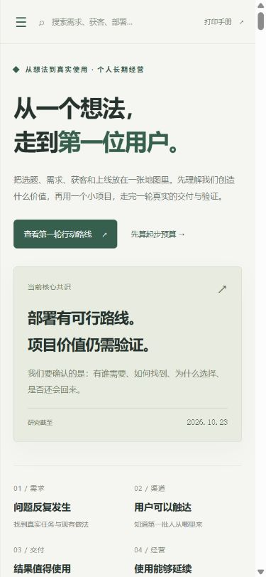

# 006 · 独立站实践手册：从需求到第一位用户

> 这个库带给我们的思考，是把独立站看成一条可以验证的经营流程：从需求信号、具体用户与渠道出发，比较竞品、做出交付样例，再开发最小产品、低预算部署，观察真实使用、复用与付费。它帮助个人选题、安排投入和定位问题；建站内容整理是贯穿其中的候选案例，商业价值仍待验证。

| 项目信息 | 内容 |
| --- | --- |
| 类型 | 对话整理与决策辅助网页；个人低预算海外工具站实践手册 |
| 资料截止 | 2026 年 10 月 23 日，价格与产品功能均是当时快照 |
| 当前状态 | 静态研究手册与完整引导图；候选商业工具尚未完成用户与付费验证 |
| 公开入口 | [研究手册](https://yydshly.github.io/1020_codex_project/projects/006-independent-site-playbook/) · [可缩放完整图](https://yydshly.github.io/1020_codex_project/projects/006-independent-site-playbook/guide.html) |
| 发布方式 | 本仓库 GitHub Pages，部署验证记录见 `notes/release.md` |
| 实现 | 无构建步骤的 HTML / CSS / JavaScript |
| 详细笔记 | [研究笔记与来源](notes/research.md) |

## 完整引导图与个人参考价值

2026-10-23 补充并记录的阅读要求：用一张完整引导图，整理这个研究库带给我们的思考，从需求确定一直串联到独立站搭建、真实使用与后续验证；说明每一步对个人选择、执行和投入的参考价值。

[打开可缩放的完整图网页](web/guide.html) · [下载完整 SVG](assets/independent-site-guide.svg) · [下载完整 JPG](assets/independent-site-guide.jpg) · [查看绘图源码](src/build_guide.py)

图为 **1800 × 8387** 的矢量长图。网页首页提供入口与预览，独立图页可缩放、适应宽度、跳转九个主题区域和下载。每阶段写清动作、产物、通过条件、失败回路和参考价值。

九阶段主线为：目标约束 → 用户任务与渠道 → 竞争与差异 → 交付样例 → 市场与形态 → 最小产品 → 采购部署 → 验收与首批使用 → 复用收费。图后半部分展开素材整理案例、三个方向、竞品、获客、部署结构、采购和预算、黑五以及六类个人参考价值。候选与未执行事项保持明确标记。

对个人的用途包括：选题时筛选机会、开发时决定先后、采购时控制投入、没有结果时定位问题，以及为下一个项目保留可复用的证据、模板与步骤。


## 这份手册回答什么

讨论从“通过新词寻找独立站机会”开始，逐步收敛到个人长期经营的小工具。用户当前最重要的目标是**先跑通从项目选择、建站部署、找到第一位用户，到交付和尝试收费的完整流程**，而不是提前采购长期服务器，或直接开发完整 SaaS。

网页把几个常被混淆的问题放在同一张地图里：

- **方向**：为哪类人，解决什么反复发生的任务。
- **核心价值**：相比用户目前的工具和人工流程，节省了什么，改善了什么。
- **市场**：国内或海外；决定语言、接触用户的渠道和实际付款方式。
- **产品形态**：浏览器网页工具、App、插件或人工辅助服务。第一轮倾向浏览器网页工具。
- **基础设施**：域名、托管、后端、文件与数据库；按功能需要选择。
- **经营验证**：真实使用、结果是否有用、是否愿意再次使用和付费。

最终共识是：**小型工具站的部署已有低成本成熟路线；当前主要不确定性在项目价值和获客，不在是否买得到服务器。** 部署仍需实际跑通，不能用“可部署”替代“产品有人用”。

## 从需求发现到最终效果，可以探索的流程

**需求信号 → 具体用户与首批渠道 → 竞品和替代方案 → 输入到输出的样例 → 最小网页工具 → 域名与托管部署 → 外部验收与真实交付 → 复用和付费验证。**

这里有两类不同的“效果”：技术效果是用户能打开网站、完成输入、处理和结果交付；业务效果是结果确实减少工作，用户愿意带来下一个任务或付款。本次发布完成研究内容的公开展示，为实际项目提供参考；业务效果需要后续真实试验，不能由网页上线或搜索收录代替。

完整引导图沿用此前生成的版本，汇总每阶段的动作、产物、继续条件、失败回路和个人参考价值。素材整理示例用来把抽象路线落到具体任务，不代表该方向已经成立。

## 网页内容与交互

网页面向复盘与执行，包含目录和搜索、决策结论、候选方向、素材收集案例、竞品覆盖、需求证据、获客与验证流程、采购路线、预算估算、执行清单和来源链接。

预算与清单用于本地试算和记录。它们**不会自动购买域名或服务器、创建云资源、代扣费用或对外发送联系信息**。页面不是已接入支付、文件处理或用户服务的商业工具；其中的例子用于解释如何验证业务。

## 快速运行

无需安装依赖、无需 API Key、无需构建。可直接用浏览器打开：

```text
projects/006-independent-site-playbook/web/index.html
```

也可以从任意目录运行子项目的 `preview.ps1` 启动只监听本机的预览；默认端口为 8066，可用 `-Port 8067` 调整。

为了让本地资源与浏览器行为更接近实际托管，建议从仓库根目录运行：

```powershell
python -m http.server 8066 --directory projects/006-independent-site-playbook/web
```

随后打开 [http://localhost:8066/](http://localhost:8066/)。这是本机预览地址，只有服务运行时可用，不是公开线上地址。

## 内容结构

```text
006-independent-site-playbook/
├── README.md              # 阅读与运行入口
├── project.json           # 仓库子项目元数据
├── notes/
│   └── research.md        # 完整共识、事实/建议/假设、验证计划与来源
├── web/                   # HTML / CSS / JS 静态网页
│   ├── guide.html         # 完整图浏览器，支持缩放和区域跳转
│   └── independent-site-guide.svg
├── assets/                # 完整引导图与预览图
└── src/build_guide.py      # 标准库绘图脚本，生成并同步两份 SVG
```

## 当前决策与边界

| 决策 | 当前结论 | 尚未成立的事情 |
| --- | --- | --- |
| 第一轮目标 | 跑通一次用户获取、交付、反馈和收费尝试 | 并未证明已找到长期可经营的产品 |
| 素材收集案例 | 保留为首个候选，优先测试“已有材料 → 页面内容包与缺项” | 竞品已有大量覆盖；新切口尚无付费验证 |
| 其他方向 | 商品图片批处理、供应商表格整理作为备选 | 不代表需求已验证，也不建议同时开发 |
| 市场与形态 | 沿已调研线索，优先海外英文网页工具 | 若国内已有可接触用户，也可先在国内验证 |
| 默认部署 | Porkbun 普通 `.com` + Cloudflare 静态/轻量后端 | 是否适合 Cloudflare，仍要看实际运行需求 |
| 完整服务器 | DigitalOcean 2GB VPS 作为备用 | 不预先购买长期 VPS 套餐 |
| 首批用户 | 定向接触设计师、小工作室，用真实项目测试 | 候选名单不等于已联系、已同意或有购买意向 |

## 采购快照

以下保留对话中截至 2026-10-23 的官方资料价格，供比较；购买前需再次确认结算价格、税费、地区、付款资格和额度。本方案以可使用 PayPal、国际卡不作为起步前提的条件设计。

| 项目 | 默认选择 | 对话价格快照 | 购买时机 |
| --- | --- | --- | --- |
| 域名 | Porkbun 非溢价 `.com`，1 年 | $11.08 / 年；当时普通续费同价 | 名字确定后买，未定先用平台临时域名 |
| 静态与轻量部署 | Cloudflare 免费起步 | 免费额度内 $0；Workers Paid $5 / 月起 | 现在试部署，触及限制或确有需要后升级 |
| 文件 / 数据 | Cloudflare R2 / D1 | 各有免费额度与用量计费 | 功能需要后再开，不等于无限资源 |
| 完整 VPS | DigitalOcean Basic Regular 2GB | $12 / 月；加周备份约 $14.40 / 月 | 需要完整系统环境或后台任务后再开 |
| 黑五 | 只比较确实需要的长期套餐 | 不计入尚未核实的 2026 折扣 | 2026-11-27 黑五前后复核；不停下项目等待促销 |

按三个月连续使用测算，域名加免费部署约 $11.08；加 Workers Paid 约 $26.08；改用 DigitalOcean 加周备份约 $54.28。未含 AI API、超额资源、适用税费及收款手续费。PayPal 能支付基础设施账单，不自动代表网站已具备向客户收款的资格和能力。

## 如何判断第一轮是否值得继续

1. 筛选约 30 位匹配对象，争取 8—10 次交流；这是实验目标，不是承诺转化率。
2. 获得 3 个真实项目，交付可核对的结果，记录用户与我们双方的总耗时。
3. 对下一个项目提出明确价格，区分口头赞同、实际使用、再次使用和真实付款。
4. 参考继续门槛：3 位试用者中至少 2 位愿意继续给第二个项目，其中有人实际付款，且人工介入可减少。这是小样本决策门槛，不是统计证明。

“Google / AI 已收录”“网页可访问”“有人点赞”分别代表可发现性、技术可用性和兴趣信号，均不能单独证明需求成立。

## 来源与使用说明

官方产品资料、公开求助与从业者经验的完整链接见 [notes/research.md](notes/research.md)。网页采用自己的归纳和解释，不复刻竞品产品界面，不把营销文案当作独立市场证据。未联系研究对象，未进行自动采购，未验证 PayPal 结算或海外收款流程。

外部链接的内容、价格和访问状态可能变化。当前文档与网页是知识整理产物；公开发布、真实用户验证、支付接入等结果应在实际完成后另行记录。

## 本次实现与验证

- 仓库索引校验通过：6 个子项目；静态站打包通过，产物位于仓库 `_site/`。
- 仓库现有 7 项测试通过；网页脚本语法检查通过。
- 浏览器验证了方向切换、案例前后对照、章节搜索、来源分类、预算计算、执行清单刷新保存及 Markdown 导出；未发现控制台错误。
- 验证了桌面与 390px 手机布局，手机页面无整体横向溢出；宽表格允许在自身区域滚动。
- 网页没有安装第三方前端依赖，不需要 API Key。本机预览与公开发布分别验证，公开发布结果见 `notes/release.md`。

图的内容与布局需要更新时，在仓库根目录运行 `python projects/006-independent-site-playbook/src/build_guide.py`；它只写本子项目的 SVG 与章节定位数据，不联网、不删除文件、不采购资源。

新增完整图已通过 SVG 解析、双份文件一致性与浏览器文字边界检查；375 行文字未超出画布。图页的缩放、原尺寸、主题区域跳转已实际验证。JPG 为浏览器渲染导出，完整尺寸 1800 × 8387；后续修改 SVG 时需同时重新导出 JPG。



---

[返回总索引](../../README.md)
