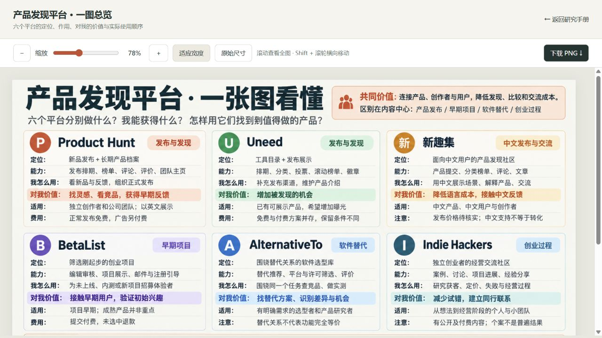

# 008 发布记录

日期：2026-10-23。

## 发布内容

- 六个平台：Product Hunt、Uneed、BetaList、AlternativeTo、Indie Hackers、新趣集。
- 摘要逐一说明平台能力与个人价值，包含发现灵感、竞品比较、早期招募、中文反馈、发布曝光与创业经营。
- 使用本次已生成的 `platform-overview-2026-10-23.png` 作为目录封面、网页总览和主要引导图，不重新生成；保留原始 SVG 作为详细流程补充。
- 交互包括平台筛选、十维对比、场景选择、来源搜索、原图缩放和下载。
- 区分官方平台事实、研究归纳与尚未验证的商业效果。

## 发布位置

- [研究网页](https://yydshly.github.io/1020_codex_project/projects/008-product-platform-atlas/)
- [总览引导图查看器](https://yydshly.github.io/1020_codex_project/projects/008-product-platform-atlas/overview.html)
- [PNG 原图](https://yydshly.github.io/1020_codex_project/projects/008-product-platform-atlas/platform-overview-2026-10-23.png)

## 校验结果

- 内容提交：`ec7f0bc88e99d448b4b56854f858bd247e8dae9e`，已推送至 `origin/main`。
- [GitHub Pages 发布工作流](https://github.com/yydshly/1020_codex_project/actions/runs/39920955520)成功，部署的内容提交与上述一致。
- 发布前：资料与链接校验、两个交互脚本的语法检查、目录同步、仓库检查、8 项既有测试、静态构建全部通过。
- 发布后：站点首页、008 研究页、总览图查看器和 PNG 原图均返回 HTTP 200；线上索引摘要包含六个平台及各自的能力与价值。
- 浏览器实测：软件选型筛选正确显示 AlternativeTo；原图加载为 1536 像素，原始尺寸显示 100%，适应宽度显示 78%；未发现脚本错误。
- 线上图片为 2,008,815 字节，与生成原图、本地 assets 和 web 副本的 SHA-256 一致：

```text
56e9d2306d9dd98691b4b3adc8026b46b3b56c99d8d90b64dd24277bd9c2ef2a
```



发布在独立工作树完成，仅提交 008 研究内容、目录条目与发布说明；未纳入主工作区其他未完成项目。保留现有站点的其他已发布内容。
