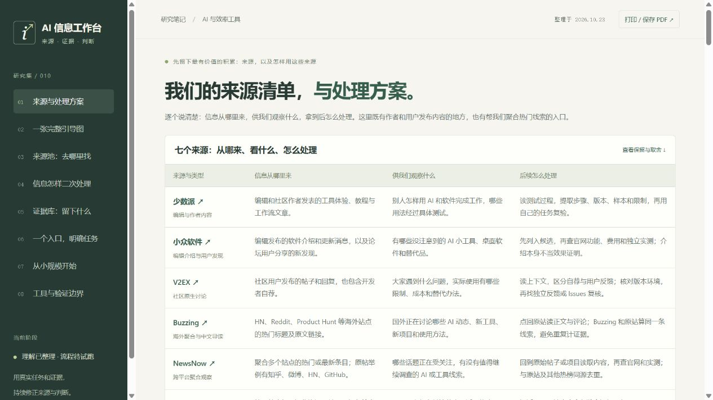

# 010 · AI 信息工作台：从来源到证据与判断

> 以少数派、小众软件、V2EX、Buzzing、NewsNow、今日热榜、SoPilot 为入口，按需补充产品官网/更新日志、Issues 和 Show HN；读原文、追溯出处、合并同源转载、保留独立实测与反例，互补核验并沉淀证据。支持工具选型、工作流优化、更新跟踪、简报问答、趋势与选题、需求/竞品研究；可继续探索团队采用、垂直站、研究订阅和自动助手。目标是减少重复调研与遗漏，让判断可追溯、可更新、可复用。沿用已生成全景图；自动化与业务方向尚待实跑验证。

| 项目资料 | 内容 |
| --- | --- |
| 研究日期 | 2026-10-23 |
| 研究状态 | 方法与网页已整理，实际信息工作流待试跑 |
| 本项目仓库 | https://github.com/yydshly/1020_codex_project |
| 讨论起点 | https://x.com/shenxiankk/status/2107493081146691700 |
| 在线研究页 | https://yydshly.github.io/1020_codex_project/projects/010-ai-evidence-workbench/ |
| 在线全景图 | https://yydshly.github.io/1020_codex_project/projects/010-ai-evidence-workbench/guide.html |
| 本次实现 | 原创静态网页、来源筛选、四阶段教学示例、提示词生成、完整 SVG 引导图、JSON 空白模板 |
| 当前边界 | 未接入自动采集、外部模型、持续证据库；虚构教学材料不代表工具实测 |
| 外部工具验证 | Inoreader、n8n、TrendRadar 为前述资料调研候选，本项目未部署或连续实跑 |

## 网页与完整引导图

- [打开网页](web/index.html)
- [完整图查看器](web/guide.html)：八个章节跳转、适应宽度、缩放、滚动和原图下载。
- [原始 SVG](assets/source-to-evidence-guide.svg)
- [PNG 完整长图](assets/source-to-evidence-guide.png)：1600 × 8570，可保存或分享。




完整图分为八部分：

1. 六项核心价值与四类积累：来源池、处理规则、证据库、判断记录。
2. 七个原始来源及官网、Issues、Show HN 三类补证入口，说明信息从哪里来、观察什么、怎样处理及搭配。
3. 六阶段闭环，每步给出动作、产物、通过条件和个人用途，并说明缺证据时的返回路径。
4. 三类记录结构、6 篇材料变为 3 组证据的虚构示例，以及更新和冲突处理规则。
5. 按需调研、持续观察、三种来源模式、日常提示词和来源池取舍。
6. 十二类应用：工具选型、工作流、更新跟踪、简报问答、趋势雷达、内容选题、需求研究、竞品分析、团队采用、垂直独立站、研究订阅、自动研究助手；各自写明证据、产物和验证办法，并补充从需求到交付、付费和部署的验证路径。
7. 从人工执行、辅助采集到持续运行的三阶段演进，说明升级条件、扩展轴与运行要求。
8. 两周起步、六个复盘问题，以及已完成整理和未运行能力的边界。

图中的应用与业务方向是本次方法的扩展建议，尚未实现或验证；外部网站的可用性局限保留在图中。

## 打开网页先看什么

首屏直接展示本次讨论最值得沉淀的两项资产：

- **我们聊过的七个原始来源**：少数派、小众软件、V2EX、Buzzing、NewsNow、今日热榜、SoPilot。每个入口都保留链接、补充的信息和使用取舍；再列出目标产品官方资料、项目 Issues、HN / Show HN 等补证入口。
- **基于来源的处理方案**：明确任务与缺口 → 读原文并追溯出处 → 合并同源转载、保留独立实测和反例 → 官方/实测/反馈互补核验 → 记录证据、形成有边界的判断。提供示例和提示词入口继续使用。

顶部清单现按“来源与类型、信息从哪里来、供我们观察什么、后续怎么处理”四列解释；手机布局按单个来源分块阅读。

少数派、小众软件、V2EX 主要承载编辑、作者或社区用户发布的内容；Buzzing、NewsNow、今日热榜和 SoPilot 偏聚合与观察入口。观察角度与后续处理是我们的使用方案，不能据此说网站已经完成内容核验。

NewsNow 的官方项目可确认聚合定位，但本轮网页未返回可读榜单，具体示例平台沿用原帖介绍；今日热榜本次返回 503，当前栏目未核实。上述边界同时保存在网页和来源模板中。

完整引导图和来源下载模板同步保留这些说明。修改 `src/source-guide.json` 后运行 `python src/build_assets.py`，会一并生成网页顶部七行说明、完整图和下载模板中的来源字段。全景图内容与版式在 `src/build_guide.py` 中维护；`assets/guide-layout.json` 记录尺寸与章节位置。

## 我们形成的共同理解

1. 网站是候选信息源。模型搜索能力增强后，独有价值主要来自新线索、原创测试、长期体验和失败反馈；聚合、翻译和清单不直接证明产品效果。
2. 入口是提出目标的地方，可以就是与模型的聊天。提示词说明任务、约束、证据标准和输出要求。
3. 来源池记录“去哪里找、各自补什么”，不是封闭白名单。优先参考，按证据缺口扩展，证据足够则停止。
4. 二次处理包括读取原文、追溯出处、同源去重、比较条件、找矛盾与缺口。多篇转载只算一组来源证据。
5. 证据库保存事实或反馈、类型、出处、日期/版本、条件、同源关系和核验状态。模型综合判断独立记录并引用证据。
6. 上层应用可以做选型、简报、趋势与工作流优化。先跑通真实任务，再决定是否自动化。

## 起步来源

| 来源 | 建议分工 | 边界 |
| --- | --- | --- |
| 具体产品的官方文档、价格与更新日志 | 功能、版本与限制核对 | 声明不等于实测 |
| 小众软件 | 补充小工具、桌面软件与替代品 | 介绍不能直接当作效果证明 |
| 少数派的实测与横评 | 测试过程、长期体验与工作流 | 逐篇筛选，核对条件与日期 |
| V2EX | 问题、反例与迁移体验 | 区分自荐、用户反馈和个例 |
| Show HN | 海外新项目和试用讨论 | 作者自述与独立反馈分开 |
| 项目 Issues / 支持论坛（按需） | 复现条件、影响版本与修复 | 未确认的故障保持不确定 |

Buzzing 作为备用发现入口；NewsNow、今日热榜、SoPilot 移出日常工具选择的默认查询，仅在研究热度或内容运营时按需启用。该取舍是本次目标下的方法建议，不代表对网站整体质量评级。

## 示例与模板

网页的工具 A、材料 A—F 和全部测试反馈均为虚构教学示意：一份官方材料、三份转载、一份独立实测、一条问题反馈，整理为三组证据。不得将其放入真实证据库。

- `web/templates/sources.json`：起步来源与分工。
- `web/templates/evidence.json`：空白证据记录、字段说明。
- `web/templates/decision.json`：空白判断记录，以证据编号引用底层材料。

JSON 仅是便携起步格式，可按同样字段放到表格或笔记软件；页面没有持久存储和数据编辑功能。

## 本地运行

静态 HTML/CSS/JS，无第三方运行依赖。可以双击 `web/index.html`，或在本项目目录运行：

```powershell
python -m http.server 8018 --bind 127.0.0.1 --directory web
```

访问 `http://127.0.0.1:8018/`。页面只使用相对资源地址，可直接纳入仓库现有 GitHub Pages 静态打包。地图与模板由以下命令生成：

```powershell
python src/build_assets.py
```

SVG 与模板可用 Python 标准库生成；当前环境安装 Pillow 并有微软雅黑字体时，同步生成 PNG 长图。网页运行不依赖 Pillow。

网页用于展示已整理的方法，不在浏览器里调用外部模型或自动抓取网站。发布流程与线上验证见 [发布记录](notes/release.md)。

## 实践与验证

见 [验证记录](notes/verification.md) 和 [发布记录](notes/release.md)。原工作区的 `projects/007-canal-blender-test/` 尚无 `project.json`，曾阻挡原工作区全库校验。本次保留其他项目现状，从远端 `main` 建立独立发布目录，仅加入 010；在完整发布目录中，8 个项目的目录校验、8 项单元测试与静态打包均通过。

## 来源与许可

正文是对本次讨论的整理；网页、样式和引导图为本次原创实现。仅链接和转述外部资料，没有复制上游实现、整篇文章或第三方图片。项目未新增统一开源许可证，遵循仓库已有许可状态。

- [原始帖子](https://x.com/shenxiankk/status/2107493081146691700)
- [小众软件](https://www.appinn.com/)
- [少数派实测示例](https://sspai.com/prime/story/ai-assisted-spreadsheeting-a-survey)
- [V2EX](https://www.v2ex.com/)
- [Show HN 规则](https://news.ycombinator.com/showhn.html)
- [Buzzing 的聚合说明](https://www.buzzing.cc/)
- [Inoreader Intelligence](https://www.inoreader.com/features/intelligence)
- [Inoreader Filters](https://www.inoreader.com/features/filters)
- [n8n Remove Duplicates](https://docs.n8n.io/integrations/builtin/core-nodes/n8n-nodes-base.removeduplicates/)
- [TrendRadar](https://github.com/sansan0/TrendRadar)

---

[返回研究总索引](../../README.md)
