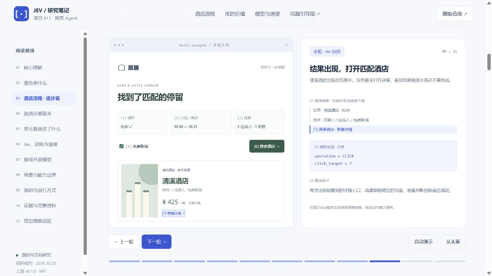

# 011 · Jev Ultrafast：从网页选项到自动执行

> 这个库把网页 DOM/ARIA 控件转成候选操作，由 Jev 结合目标、页面状态和历史选择，程序检查后驱动浏览器执行，再读取新页面继续循环。它提供可复用的网页 Agent 运行骨架，适合查询筛选、导航和普通表单原型；模型替换、复杂控件适配、任务恢复、业务组合与评测是可继续开发的方向。模型 DONE 后仍由业务独立验收。


[放大查看核心横图](web/architecture.html) · [保存 PNG](assets/browser-agent-architecture.png) · [下载 SVG](assets/browser-agent-architecture.svg) · [打开详细研究网页](web/index.html)

| 研究信息 | 内容 |
| --- | --- |
| 上游仓库 | [browser-use/jev-ultrafast](https://github.com/browser-use/jev-ultrafast) |
| 核对日期 | 2026-10-23（Asia/Shanghai） |
| 固定研究 commit | `1231850a0bf1a0c0341fe408ef1668dbbfdfac46` |
| 上游包与许可 | v0.1.0 / MIT / Python ≥ 3.12 |
| 本项目内容 | 核心架构与执行循环横图、详细研究网页、11 阶段酒店教学、DOM 规则实验、详细研究总图、底稿和来源索引 |
| 验证范围 | 已核对源码与官方文档；网页为本地教学，没有连接 Jev、文字模型或酒店平台 |

## 打开研究页

- [在线研究网页](https://yydshly.github.io/1020_codex_project/projects/011-jev-browser-agent-study/) / [在线横向架构图](https://yydshly.github.io/1020_codex_project/projects/011-jev-browser-agent-study/architecture.html)。发布状态见[发布记录](notes/release.md)。
- [核心横图查看器](web/architecture.html)：先看四方分工、执行循环、文字助手与独立验收；支持缩放和图片下载。
- [详细研究网页](web/index.html)：展开核心价值、架构分工、酒店教学、模型训练、速度、替换方案与边界。
- [详细研究总图查看器](web/guide.html)：进一步查阅整个探究过程，支持适应宽度、100%、缩放和方向键滚动。
- [详细研究底稿](notes/research.md) / [结构化来源索引](notes/sources.json)。
- [本地验证记录](notes/verification.md)。

## 进一步查看完整研究

横图专注核心架构和执行循环。网页正文保留选项来源、模型与训练差异、为什么快、开源替换路线、酒店逐轮教学、性能证据与复用价值。

<details>
<summary>详细研究总图与完整资料</summary>

- [打开详细研究总图](web/guide.html)
- [高清 PNG 长图](assets/browser-choice-guide.png) / [可缩放 SVG 长图](assets/browser-choice-guide.svg)
- [详细研究底稿](notes/research.md) / [来源索引](notes/sources.json)

</details>

## 顶部首先要看懂什么

**这个库提供应用层的浏览器 Agent 运行程序。** 业务给网址和目标；程序读取当前网页，发现控件与合法操作，组织状态和问题；Jev 选择操作及对应目标；程序检查、执行、记录并重新观察。

Jev 负责抉择，独立文字助手只在需要填字时生成内容，Browser Harness / Chrome 执行浏览器输入。业务程序仍负责完整目标、特殊流程和结果验收。

它选择的粒度是“点击哪个按钮、填写哪个输入框”，酒店查询等业务由多次细粒度操作组成。程序依据 DOM / ARIA 规则生成候选，不需要先让另一个模型出题。

## 对我们的价值与后续扩展

直接调用 Jev 只得到一次判断；这个库已经连接控件提取、候选与状态组织、执行前检查、真实浏览器操作、近期历史、失效重选和本地调试。自己实现同样的运行循环可以达到同类能力，复用它的价值是减少重复工程，并提供研究模型表现与执行延迟的起点。

优先用受控网页和独立验收器建立基线，再做同条件模型对比；有数据后改造决策适配层，按具体网站补复杂控件、恢复机制及业务流程。以上扩展方向需要开发和验证，原库不包含完整酒店业务、通用长任务恢复或跨模型评测平台。详细边界与路线见[研究底稿第 15–17 节](notes/research.md)。

## 本页模块

1. **核心理解**：一句话定位与循环总览。
2. **谁负责什么**：业务、库、Jev、文字助手和浏览器的边界。
3. **酒店逐轮教学**：填城市、选联想、打开日历、选入住与离店、设置筛选、搜索、等待、详情、DONE、独立核验。
4. **选项从哪里来**：HTML 类型、名称、状态及可实际操作的禁用 / 只读 / 隐藏实验。
5. **库比直调 Jev 多什么**：通用读取、执行、历史、失效处理和 inspector 的复用价值；另有研究结论与五条扩展方向，说明开发与验收要求。
6. **模型与速度**：普通生成模型、Jev 的官方架构与 RLCD 声明，作者测量的条件与局限。
7. **模型替换**：约束输出、直接读取单 token 候选分数、验证校准与按需微调。
8. **场景与边界**：网页查询、语义导航、普通表单与研究基线，以及 MVP 未覆盖范围。
9. **源码和运行方式**：固定 commit 文件导航、上游 PowerShell 安装摘要与 Python 用法示意。
10. **证据资料**：完整图、底稿下载、来源类型和未验证内容。
11. **常见误区**：对上下文、并行、历史、训练、业务能力和 DONE 的澄清。

## 酒店演示的性质



本页“旅居”“清溪酒店”、价格、条件与步骤是原创前端教学数据。没有实时搜索、模型推理、登录、订单或支付；演示只切换固定状态。

日期固定为 2026-10-30 至 2026-10-31；2 位成人在初始状态已满足，无需再操作。每轮左侧显示当前页面，右侧显示状态与候选节选、示意模型返回和程序动作。最后一轮明确为业务独立校验，不再调用 Jev。

上游原版使用 `operation` 加按操作类型区分的 target 多问题，而不是把所有操作固定平铺为 A/B/C。本页编号与候选节选用于理解，不是原库真实 trace。

上游酒店验证是在本地 fixture 上搜索、筛选与打开结果，不能据此视为任意真实酒店网站的完整订房支持。

## 性能和模型结论

- 作者的航班录制为 7.073 秒，17 次 Jev 请求的延迟中位数 178 ms；本项目未复测。
- 优化比较前后同 Jev 1.13 与 Mercury 设置，各 3 次；任务中位耗时 9.450 → 7.092 秒、浏览器协议调用中位数 1,092 → 101。这是执行层优化，不能解释成 Jev 与其他决策模型的速度比较。
- 录制计时从初始页面观察后开始，包含模型、字段文字、浏览器、失效决策和加载；不含启动、首次导航和独立终检。
- 文字助手约 $0.00006272 不代表总任务成本。
- 官方描述 Jev 使用专门架构、并行采样与 RLCD；网络细节、基座和完整训练公式未充分公开，库中也没有模型权重。
- confidence 反映分布集中程度，不是业务成功率；原库没有基于 confidence 阈值的通用拒绝逻辑，DONE 必须独立验收。

细节与稳定链接见[研究底稿](notes/research.md)。

## 本地运行与维护

纯 HTML / CSS / JavaScript，无第三方运行依赖，可以直接打开 `web/index.html`。也可在仓库根目录运行：

```powershell
python -m http.server 8021 --bind 127.0.0.1 --directory projects/011-jev-browser-agent-study/web
```

访问 `http://127.0.0.1:8021/`。全部本地资源使用相对路径，按现有 GitHub Pages 规则打包到项目子路径。发布采用远端 `main` 与既有 Deploy Pages 工作流，具体提交、部署结果和线上校验见[发布记录](notes/release.md)。

```powershell
python projects/011-jev-browser-agent-study/src/build_architecture.py
python projects/011-jev-browser-agent-study/src/render_guide.py browser-agent-architecture
python projects/011-jev-browser-agent-study/src/build_guide.py
python projects/011-jev-browser-agent-study/src/render_guide.py
python projects/011-jev-browser-agent-study/src/check_site.py
node --check projects/011-jev-browser-agent-study/web/app.js
python scripts/projects.py sync
python scripts/projects.py check
```

`notes/research.md` 和 `notes/sources.json` 为研究底稿；网页下载副本位于 `web/docs/`，改动后同步这两个副本。核心横图由 `src/build_architecture.py` 生成，详细研究总图由 `src/build_guide.py` 生成，均同时写入 `assets/` 与 `web/assets/`。PNG 渲染器 `src/render_guide.py browser-agent-architecture` 导出核心横图；不传参数则导出详细长图。该制作工具需要 `resvg-py==0.5.0`，网页运行没有此依赖；渲染器保留箭头、虚线与系统字体。

## 来源与许可

研究页、交互、图与底稿是本次原创整理。仅转述并链接上游代码与官方资料，没有复制整套上游实现或发布模型权重。上游为 MIT；本研究所在仓库尚未指定统一开源许可证。

- [固定上游版本](https://github.com/browser-use/jev-ultrafast/tree/1231850a0bf1a0c0341fe408ef1668dbbfdfac46)
- [作者性能报告](https://github.com/browser-use/jev-ultrafast/blob/1231850a0bf1a0c0341fe408ef1668dbbfdfac46/docs/performance.md)
- [TypeSafe 共享状态](https://docs.typesafe.ai/concepts/state) / [并行问题](https://docs.typesafe.ai/patterns/fan-out)
- [TypeSafe RLCD](https://docs.typesafe.ai/introduction/machine-learning-primer) / [发布说明](https://typesafe.ai/blog/introducing-system-one-models-and-jev)
- [Hugging Face logits](https://huggingface.co/docs/transformers/en/main_classes/output#transformers.modeling_outputs.CausalLMOutput)
- [概率校准研究](https://proceedings.mlr.press/v70/guo17a.html)

---

[返回研究总索引](../../README.md)
