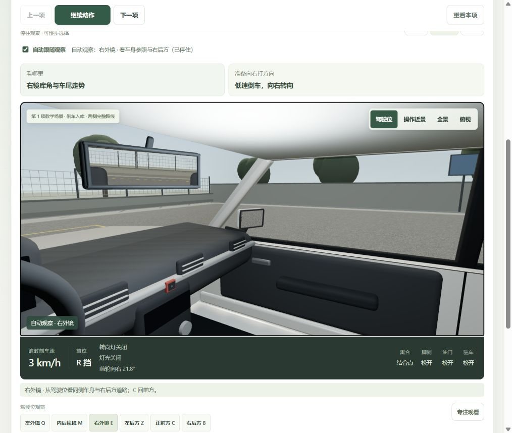
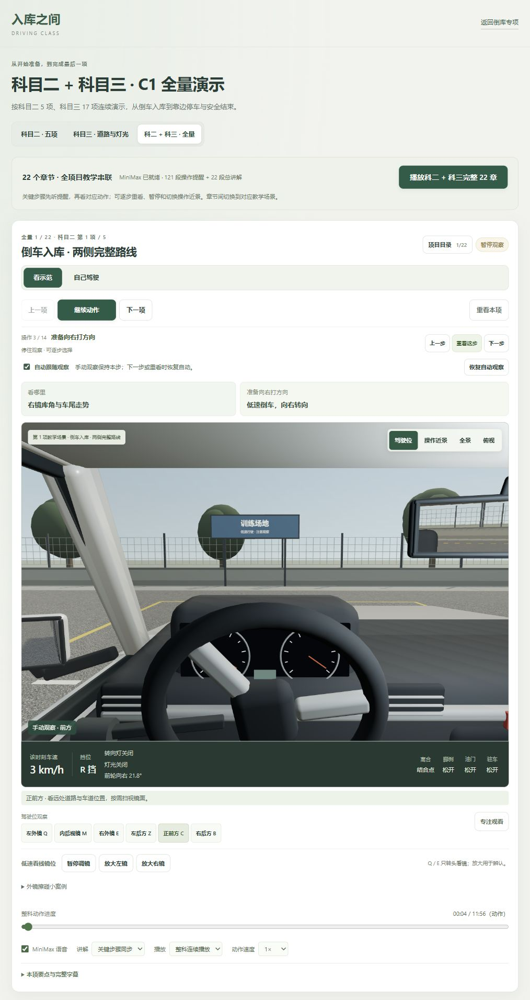
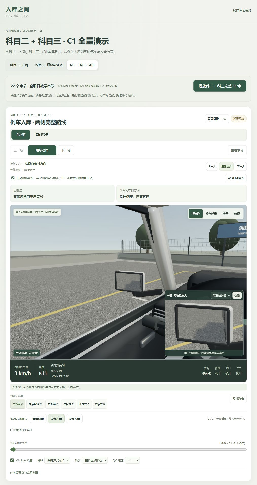

# 自动演示观察跟随 · 2026-10-25

用户反馈属实：此前课程虽然显示“看右镜”，画面主要由手动按钮改变，提示没有带动实际观察方向。本轮为现有完整演示增加默认开启的“自动跟随观察”，不替换原驾驶、镜面、语音、复盘和倒库专项。

## 体验

进入 `http://127.0.0.1:4312/courses.html?course=all&chapter=reverse-parking`，可播放完整 22 章，也可在“准备向右打方向”处点“重看这步”。提醒先展示右外镜，尾段核对前方外摆；倒车动作以右镜为主，短暂核对前方，再返回右镜。左倒对应左镜，回轮阶段交替核对两镜，驶出回看前方。

镜头转动保留原驾驶眼位、实体镜片及镜内视野，没有改变镜面物理或自动放大。原“放大左镜 / 放大右镜”继续作为可选辨认辅助。

- 暂停会同时停住观察方向；选择新步骤、拖动进度或重播时，会定位该步骤的观察。
- 手动选 Q/E/C/M/Z/B、全景、俯视或操作近景，本步骤保持手动；下一步或明确重看时恢复跟随，也可点“恢复自动观察”。
- 取消“自动跟随观察”后，跨章节仍保留手动视角。
- 自己驾驶期间不自动转头、不代记观察完成；接手保留当前看镜方向。原操作近景接手转驾驶位的行为保留。
- 调镜先暂停，自动跟随让出控制；完成调镜保留所选镜面与暂停状态。

## 观察计划和同步边界

22 章共 121 个稳定操作 ID 各有明确的提醒 / 动作观察计划，不通过口令中“左、右”等文字猜镜头。提醒使用当前同一段 MiniMax 音频的播放时间与时长，动作使用模型时间；暂停、语音错误或调镜不由独立计时器继续切镜。

科三起步、变道等操作前按同侧外镜、同侧后方、前方展示；行驶动作回看前方。车内后视镜使用既有实际后窗反射，左右后方使用既有同眼位转头。绕车检查用辅助全景，静止灯光用辅助近景，界面明确区分教学视角。前方路口、斑马线等风险不会被错误替换为后视镜；换挡动作也不会让驾驶视线持续低头。

镜头顺序属于按步骤编排，不是语音逐字强制对齐，也不是实车扫描时长标准。默认“关键步骤同步”才能看到完整操作前观察段；静音或选择本项总讲解时，仍按动作计划观察，不在车辆行驶中额外补播长时间盲区视角。短步骤和 4 倍速会合并过短镜头，避免快速闪切。

右倒、左倒、侧方转入提醒分别复用原 5.796 / 5.976 / 5.796 秒音频；主镜保留约 4.4–4.6 秒，尾段前方约 1.4 秒，不用对侧后视镜代替车头外摆观察。动作阶段保持主镜为主。以上为本演示编排，并非要求实车按秒看镜。

## 实际页面核对

1. 全量倒库动作进度 4 秒：第 3/14 步“准备向右打方向”，E 右外镜自动选中，驾驶位实际转向右镜；40 秒左倒第 10/14 步自动 Q 左镜。
2. 手动 C 看前方：本步保持手动，出现恢复按钮；恢复后自动回到当前步骤右镜。点“重看这步”正常启动原 MiniMax 提醒。
3. 暂停观察后，时间与当前观察方向不继续巡回。
4. 左倒接手自己驾驶保持左镜；驾驶暂停后手动切内镜不被自动改回。
5. 科三起步“打灯并观察”重看时，语音字幕出现并自动选左镜；绕车准备自动全景，模拟灯光自动操作近景并标为教学辅助。
6. 关闭跟随、选择俯视后，从起步跨回灯光、绕车准备，俯视保持。重新开启后，准备章恢复辅助全景，灯光章恢复操作近景。
7. 暂停调镜中切左镜，完成调镜后仍暂停并保留左镜；恢复自动清除过期的手动放大并回到本步右镜。

本轮浏览器核对是代表性步骤和控制边界，没有人工连续听完全部 121 段。所有步骤的计划覆盖、实际语音时长、动作区间、1 倍 / 4 倍速取样，以及暂停、手动覆盖和控制权边界由自动回归补充。

## 检查

- `npm test`：**391 / 391 通过**，全量结果见 `test.log`；本轮新增观察计划 14 项、跟随控制 10 项回归。
- `npm run build`：通过，课程 `courses-CN_a7nDo.js` / `courses-DelnhoCY.css`；结果见 `build.log`。倒库脚本与共享场景包未变，原共享包 697.42kB 超过 650kB 的体积提示保留。
- `npm run speech:verify`：191 段通过，27,569,676 字节，1,702.62 秒；本轮未生成或替换音频，未读取密钥。
- 原倒库入口、科二科三、全量 22 章、手动驾驶、真实镜面与外镜擦碰、练习目标及复盘重练继续保留。
- 最终构建页面的浏览器 error / warn 日志为空。

截图均为本轮真实页面，不生成或编辑页面截图。最终体验页停在倒库右转步骤，自动跟随与 MiniMax 开启、1 倍速、连续模式；点“重看这步”可听讲并看观察变化，顶部完整播放入口仍从头串联全部 22 章。

