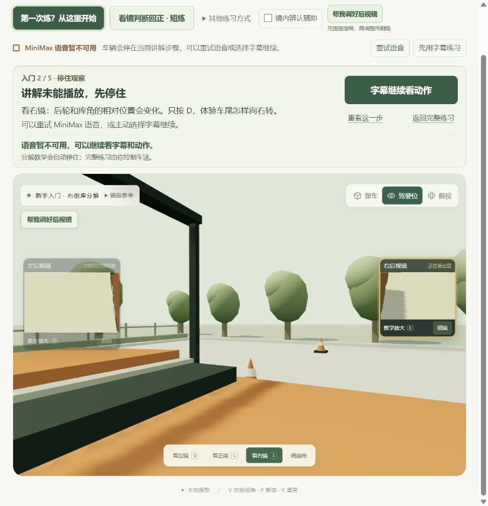
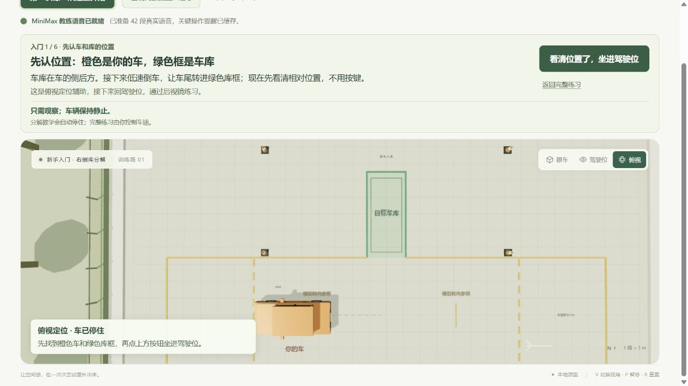
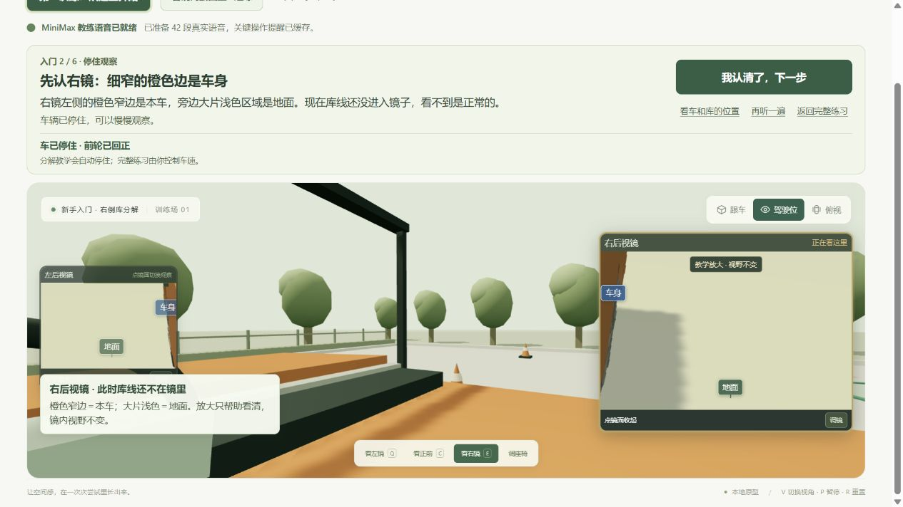
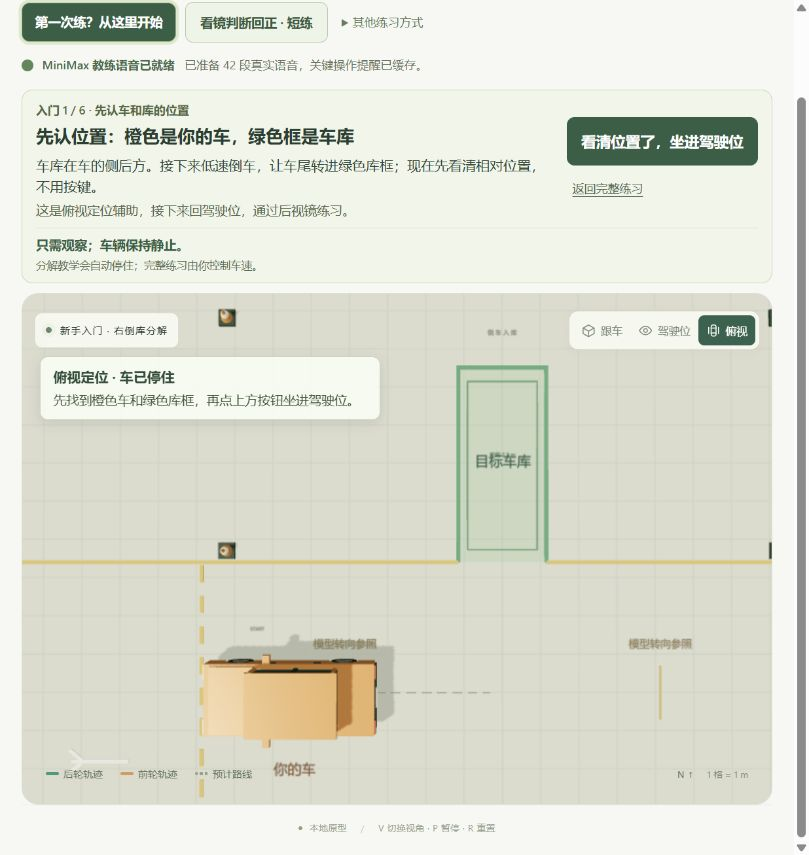
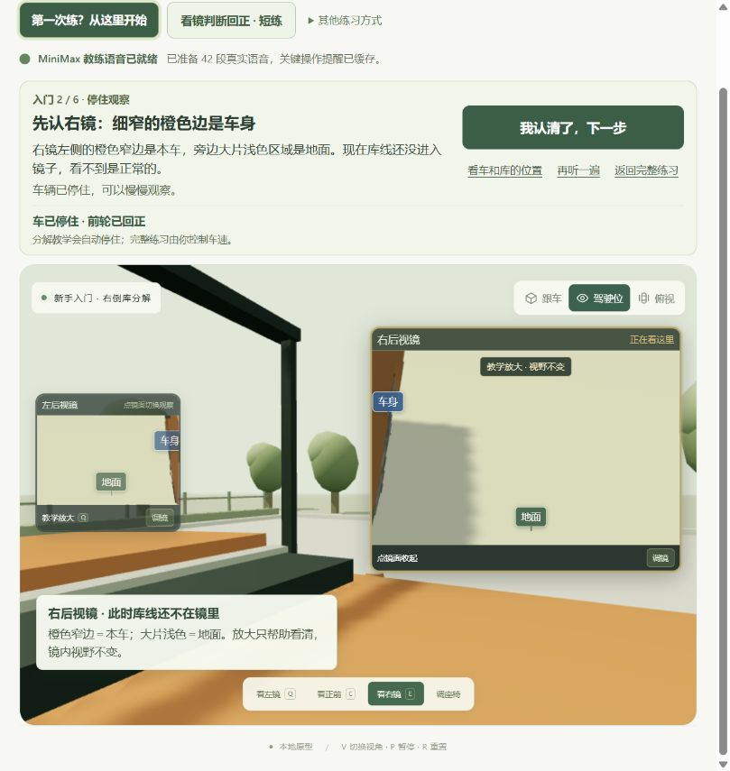

# 新手画面可理解性审查

日期：2026-10-24。依据本轮现场截图与实际操作记录；各构建的验证范围单独说明，不将截图等同于完整验收。

## 原画面为什么看不懂

1. **要求寻找尚不可见的参照。** 从起点到右打结束，库线确实尚未进入后视镜视域；提示却让用户比较后轮、库角。用户无法知道是自己没找到，还是画面本来就没有。
2. **缺少车、库与镜面之间的关系。** 初次进入就向侧窗转头，场景中树木、棚架占据大部分画面；镜子较小，细窄车身与大片地面又没有辨认标记。用户尚未理解车库位置，就被要求依镜转向。
3. **系统状态盖过学习任务。** 语音失败在顶部、任务标题和状态中重复出现；字幕、调镜、辅助、模式切换等入口同时出现，难以判断现在由系统示范，还是轮到自己操作。

## 本轮调整

新手流程由原五步增加为六步：**先俯视定位 → 认右镜 → 右打 → 保持倒车、等待库线出现 → 左右确认 → 主动回正**。先建立空间关系，再看镜子；原模式和练习入口保留。

俯视步骤用实际场景中的橙色车辆、绿色目标库框与文字标注交代位置，并明确“车辆停住、只需观察”。上方保留一个当前主动作；进入后续教学时区分停住观察、系统示范与亲手操作，次要操作退到次级入口。

认镜阶段明确指出细窄橙边是本车、大片浅色区域是地面，并说明“库线还没进入镜子，看不到是正常的”。新手教学显式放大当前观察镜，低优先级镜仍可辨认；这是显示尺寸放大，**没有扩大镜面 FOV**。

车身、地面标签使用真实投影定位，并接受 renderer 的实际遮挡判断；库线提示结合几何可见性与真实遮挡判断，不在镜域外虚构参照。新手隐藏顶部重复镜面设置，场景内调镜和其他模式仍可到达。

库线出现后才要求比较车身与库边线；当前构建补充“绿色库边线”的解释，右打结束而库线未出现时先等待。教学阶段切换会调整滚动，使当前主操作更容易保持可见。

## 已记录的验证

最终构建为 `index-ebvl9zvQ.js` / `index-B5LQwI7I.css`，最后重跑全量 156 项测试全部通过。语音包校验仍为 42 段、5,995,656 字节、370.22 秒，本轮没有重新生成音频。

`index-DM_P-evF.js` 浏览器实际完成六步：俯视定位 → 认右镜 → 右打讲解与自动示范 → 亲手 D 到 34°自动停 → 保持示范 → 亲手 S 到观察点自动停 → 右镜、左镜确认 → 回正示范 → 亲手 X 完成。随后从“下一步：自己判断回正”进入原短练 ready，旧教学标签和说明不残留。全程语音保持 ready，没有报错。

后续 `index-CQj6LSoq.js` 细化重复入口、库线说明和阶段滚动，在 824×871 视口重新加载并走过定位、认镜，按钮、标签与说明互不遮挡。最终 `index-ebvl9zvQ.js` 只把俯视说明卡移到左上，同尺寸重新加载确认车、目标库、说明与按钮完整可见。

最终恢复默认 1280×720 视口，DOM 确认加载 `index-ebvl9zvQ.js`，无横向溢出；页面停在 1 / 6 俯视定位，MiniMax ready，控制台 error / warn 为空。最终封面已实际打开检查，`07-final-orientation.png` 保留同图。

## 当前证据的边界

- `02-orientation.png` 可见车、库、相对位置说明与单一主按钮；`03-recognize-mirror.png` 已覆盖为 `index-DM_P-evF.js` 的完整画面，底部视线控制可见。`04-line-visible.png` 来自该构建后续步骤，只证明库线进入镜面，底部不完整。
- `05-small-orientation.png` 为最终 `index-ebvl9zvQ.js`，`06-small-mirror.png` 为 `index-CQj6LSoq.js`，两张都实际使用 824×871 视口；最终封面为恢复默认视口后的 `assets/preview-understand-scene.png`。这些证据不能扩展为所有窗口尺寸均无裁切或遮挡。
- 六步完成与转入短练由上述实际操作验证，保留原构建归属；正常语音截图不能单独证明语音故障分支的理解体验，也不代表最终构建重新手工走完全部步骤。
- 静态截图不能证明键盘导航、焦点顺序、读屏体验或完整无障碍达标。本轮解决的是首次理解障碍；物理镜面仍是模型工程参考，未由实车测量验证。
