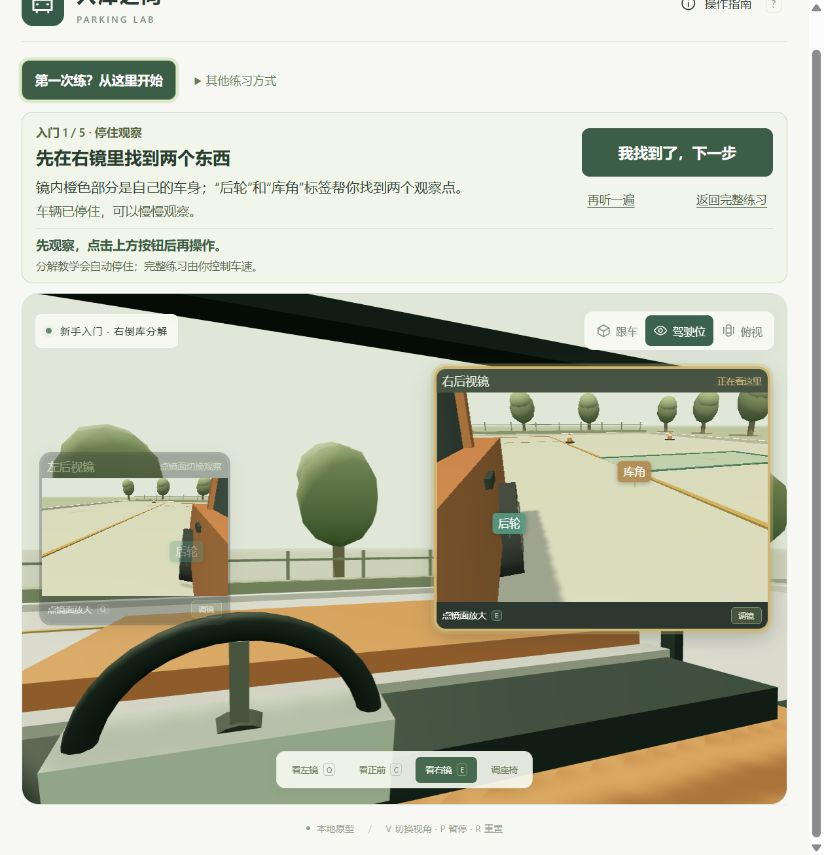
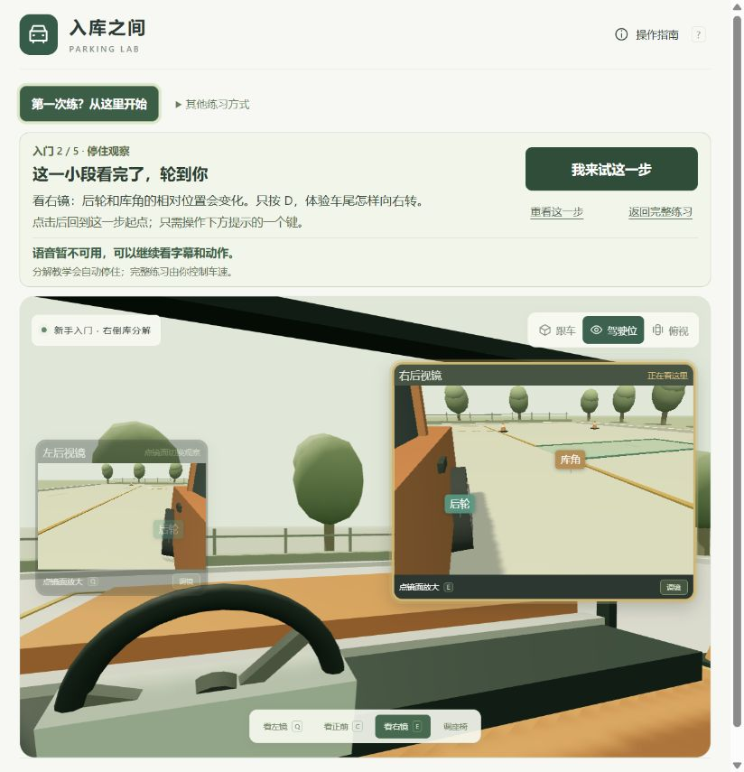
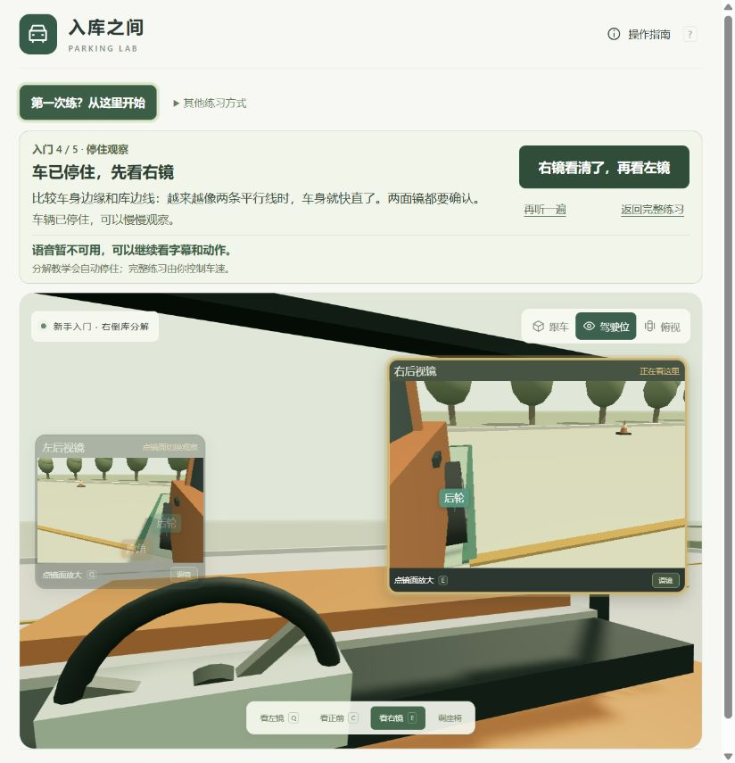
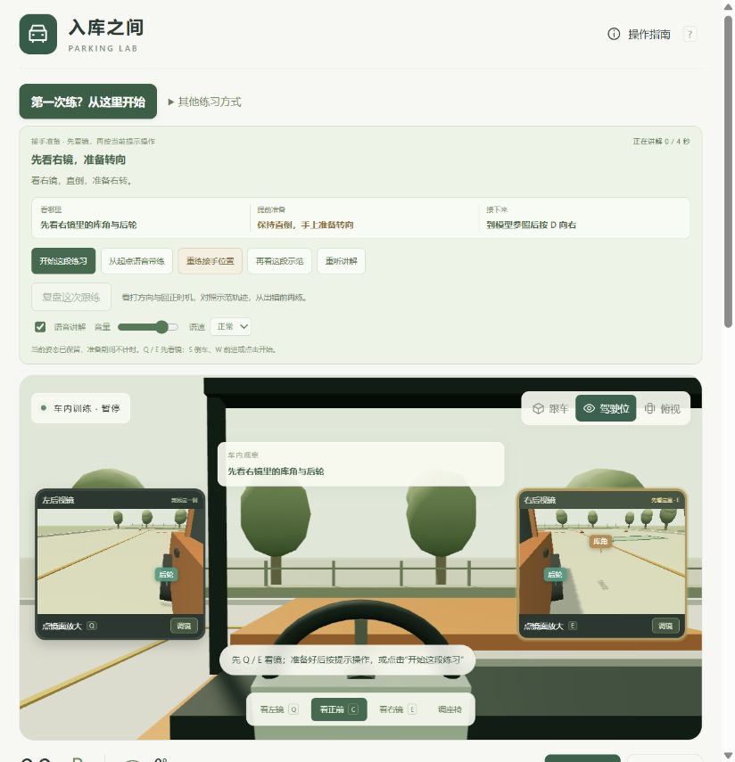
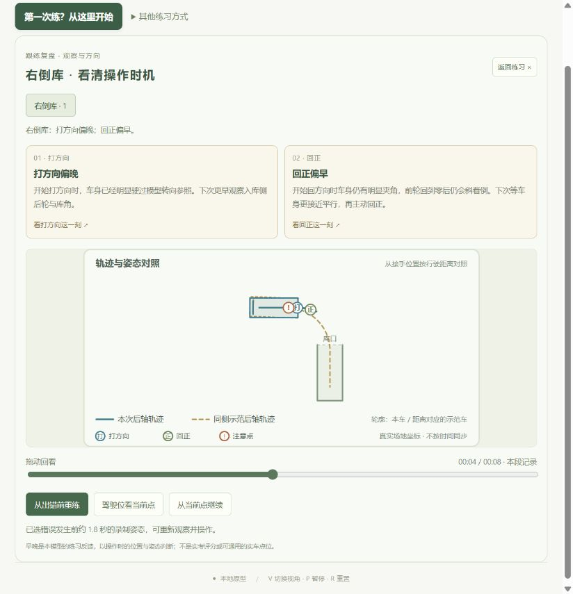

# 倒车入库原型：教练视角与页面审查

日期：2026-10-24。对象：http://127.0.0.1:4312/ 。本轮只审查，不修改教学代码。

> 这是本次优化前的审查快照。其后的回正/纠偏统一判断、镜面短练闭环及页面简化已实施；当前验证结果见 [verification.md](../verification.md)。以下保留问题发现时的证据。

## 结论

需要优化，优先顺序应是指导正确性、观察判断训练、辅助退出、复盘解释，最后才是装饰和场景细节。当前版本能帮助认识倒车转向和主动回正，但完成按键任务还不能证明学员能独立判断入库时机。这个结论是基于当前浏览器操作与代码检查的教学推断，尚无实车训练效果数据。

保留项：驾驶位与双镜、镜内后轮/库角标签、分解慢放与暂停、实际操作记录、错误前重练。浏览器中故意晚打方向并提前回正，复盘正确给出两项对应结果。

## 本轮流程与截图

截图是本轮新采集的 824 × 855 像素左右的当前浏览器画面，保存后重新打开检查。未用旧封面代替本轮证据。

1. **进入镜面教学：入口明确，观察检验不足。** 右镜放大、金边、标签能引导注意力；“我找到了”只依靠自我确认，没有要求指出观察对象。辅助文字与非当前镜较淡，存在可读性风险。

2. **看短示范并亲手右打：动作交接清楚，过关主要依赖按键。** 按 D 到右 34°会自动停住；本轮无需判断库角就能完成。截图中语音错误是在本地预览服务停止时出现，不能据此判定音色、音频格式或播放实现有缺陷。

3. **保持转角、双镜对照与回正：有顺序，缺少视觉判断的解释。** 保持阶段自动到观察点停下；之后两次确认按钮与 X 就能完成。镜中没有高亮“比较的是车身哪条边、库位哪条线”，也没有早/合适/晚的同视角对照。三维透视下的画面不能只靠“像两条平行线”一句话讲清。

4. **进入完整带练：功能可用，信息与难度同时增加。** 新手时 D/X 由系统代管低速倒车并自动停，完整练习需要另控 S 与制动。当前窄窗口中，顶部语音卡、三栏说明、五个操作入口、语音参数和场景内两层提示争夺注意力，速度、转角与驾驶按钮在首屏下方。应先给一段无自动停车的短练，再进入全路线；驾驶状态的主要信息应集中在镜面附近。

5. **故意犯错后复盘：诊断与重练可用，镜面因果解释不足。** 操作序列为 S 约5.2秒、D约0.8秒、S约1.8秒、X、S约0.8秒、P（仅本模型审查输入，不是实车操作方法）。复盘识别“打方向偏晚；回正偏早”。默认显示俯视轨迹，需要另点驾驶位看镜面；未并排显示错误瞬间与正确参照的镜中画面。建议先解释第一个错误，再给一个明确重练目标。

## 按影响排序的问题

### P0：统一指导逻辑，识别回正后的残余偏角

**事实：** `src/lesson.js:115` 的普通练习在夹角不大于5°时提示回正；`src/voice-guide.js:54` 起的语音带练按速度与回正耗时计算。两种模式判断不一致。对现有运动模型的只读复现中，普通练习首次提示回正约在 -4.976°，立即回正后车身仍约 -3.840°，依后续提示直倒会出线。这是模型反馈问题，不是实车容差结论。

**事实：** `src/voice-guide.js:155` 在剩余夹角不大于7°、前轮转角不大于2°时可进入继续直倒，未预判侧向余量是否允许继续。模型复现：约 -5.997°开始提前回正，归零后车身约 -4.861°且尚未出线，系统给出 park；继续直倒约1.861米后出线。

**建议：** 各模式共用同一套状态判断，分别检查前轮转角、车身偏角、两侧净空、继续行驶的预测风险。提前回正后应先诊断“前轮正了，车身仍斜”，再给适合当前姿态的纠偏教学。不要把正向示范脚本直接当作所有偏离姿态的处方。

### P1：让学员作判断，再作动作

**事实：** `src/beginner.js:35` 自动在2.7°附近停住；`src/main.js:388` 起通过确认按钮推进镜面观察。实际走完流程时，学员可以不作任何视觉判断。

**建议：** 先在镜中点选后轮和库角；在三个相近姿态中判断“还早 / 可开始回正 / 已晚”；再在同一短片段关闭自动停，自己选择回正时机。过关依据应包含独立操作表现，而不只是方向是否转到了固定角度。

### P1：把“看哪里”变成镜中可见证据

**事实：** 截图03只有后轮/库角标签，缺少正在比较的车身边缘、库边线和间隙变化说明。

**建议：** 暂停时短暂描出两条目标边，展示同视角的早/合适/晚对照。恢复行驶后逐步淡去辅助，要求学员自己识别。左镜应有独立观察目的，不能只完成一次切换确认。

### P1：增加从辅助入门到独立跟练的过渡

**事实：** `src/beginner.js:20` 中 D/X 同时触发代管倒车；完整练习则需要 S 配合。`src/vehicle.js:53` 的固定回正速率使满角至零约0.237秒。这些辅助已在界面说明，但尚未有逐步退出的中间练习。

**建议：** 分为系统控速与停车、自己选时机、自己控速和制动、全路线四层。先训练右倒库短片段，再左侧迁移，最后完整项目。键盘一键回正只用于理解概念，不能据此证明实际回轮与C1手脚配合能力。

### P1：让驾驶位、镜面与当前动作成为页面中心

**事实：** 截图04在当前窗口中，上方卡片占较多高度，场景里还有重复提示，关键驾驶状态与控制在下方；部分字幕、镜面文字较小、较淡。

**建议：** 行驶时只突出当前看镜目标与当前动作；把重听、重练起点、再看示范、语音参数收进次级面板。停住后再展示解释。提高小字和淡色提示可读性，保留明确焦点。截图审查不等于已完成对比度、屏幕阅读器和缩放合规测试。

### P2：复盘回到镜中解释，并明确观察模型边界

**事实：** 截图05有同坐标轨迹、操作早晚和错误前重练，但镜面观察需要切换。`src/cockpit.js:36` 的镜头计算不使用 `seatFore`，驾驶位主镜头使用座椅前后值，当前两者联动不完整。

**建议：** 复盘按“当时镜中画面 → 错误动作 → 轨迹后果 → 下次观察目标”解释，并排显示实际与正确镜面，突出第一个关键偏差。镜面适用于观察概念训练；若以后用于点位校准，应先完善眼位与反射成像关系，再由实车验证。

## 建议的下一轮范围与验收

1. 先修回正及纠偏指导的一致性，覆盖不同速度、侧向偏移、提前/延后回正，避免在可预见出线的姿态持续提示直倒。
2. 做一个短的“自己判断回正”练习：先示范，再无自动停操作，失败后立即对照错误镜面和正确镜面，回到错误前重练。
3. 整理驾驶页，把当前镜面、唯一动作提示、车速/前轮状态和暂停放在同一视区；解释与参数在停住或展开后看。
4. 用首次使用者检验：能否说出看哪两个对象、能否在没有动作口令时选时机、变更起点后能否迁移。当前没有这些学习效果数据，不给教学效果打分。

## 语音与考试依据核查

- 首轮音频失败时，本地4312端口请求连接拒绝。恢复现有 `npm run preview` 后，`audio/beginner_center.wav` 返回200、`audio/wav`，浏览器重新显示“正在讲解”，完整带练显示0/4秒进度。没有修改音频或教学代码。未对真实听感、语速适宜性及设备兼容性作结论。
- [公安部标准化平台 GA 1026—2022](https://ywtb.mps.gov.cn/gabzh/portal/stdDetail/309760) 在本次查询仍标为现行。标准状态核查不等于认证本原型的评分、模型阈值或教学点位。
- [河北交通安全网观察示例](https://www.hbgajg.com/html/2016/0223/28756_2.html) 强调通过后视镜观察车身与库线；该2016年资料只用于支持观察思路，不作为2026年考试规则或统一点位依据。

## 检查范围限制

审查覆盖当前桌面窄窗口的五步新手教学、进入完整跟练、一次故意错误的复盘，以及相关运动、指导和镜面代码。没有验证真实车辆镜面、方向盘/踏板硬件、不同考试车型、手机真机、全套实考判罚、屏幕阅读器或真实学员学习成效；没有将模型里的角度、秒数、距离当作实车建议。
