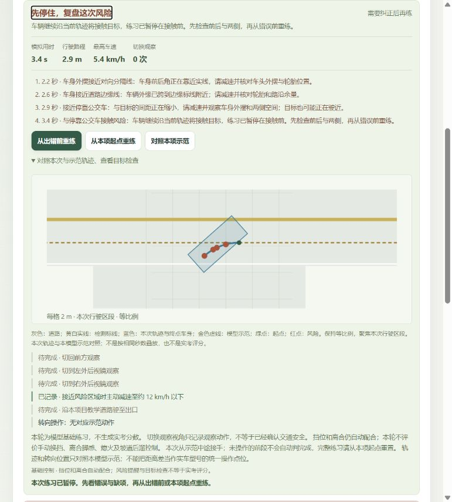
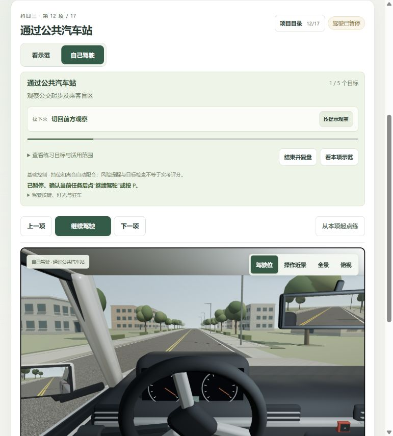
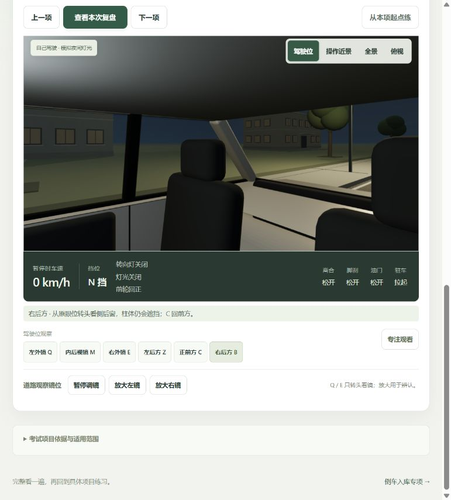
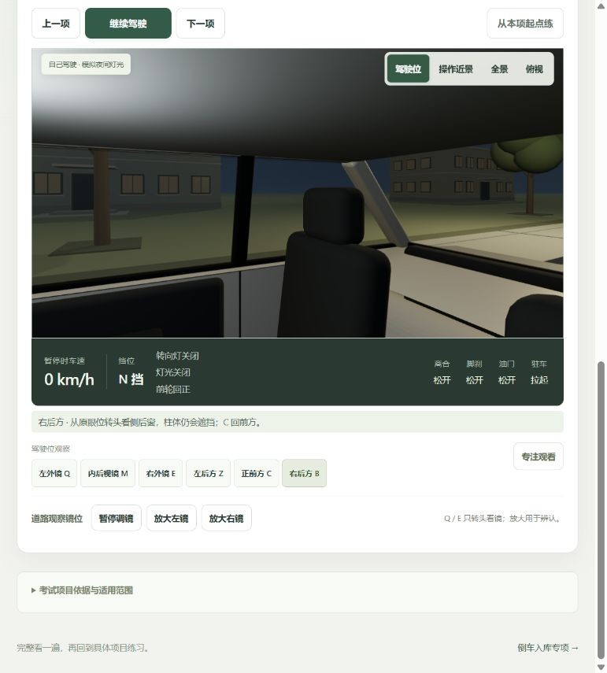
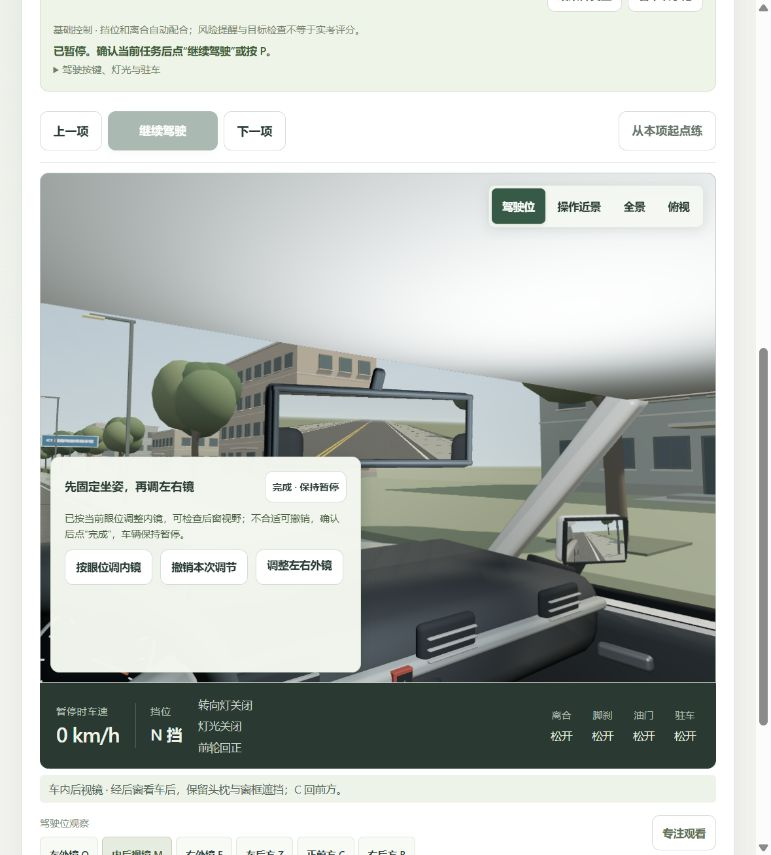
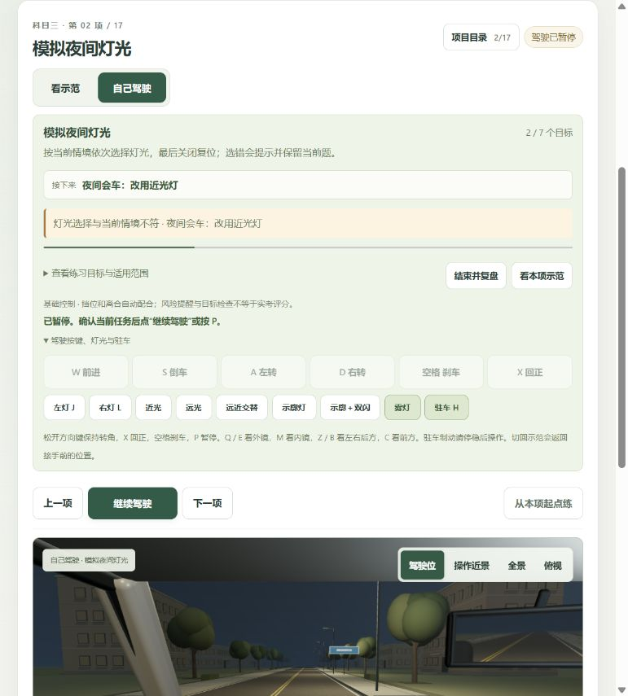
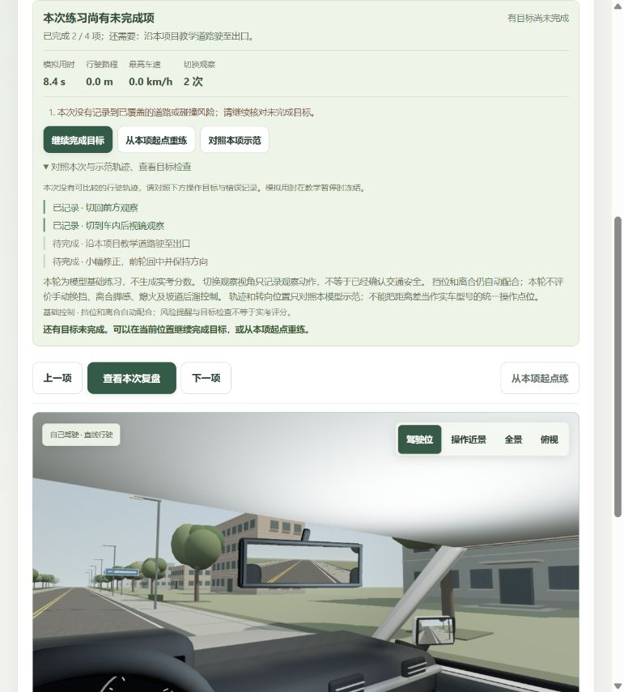
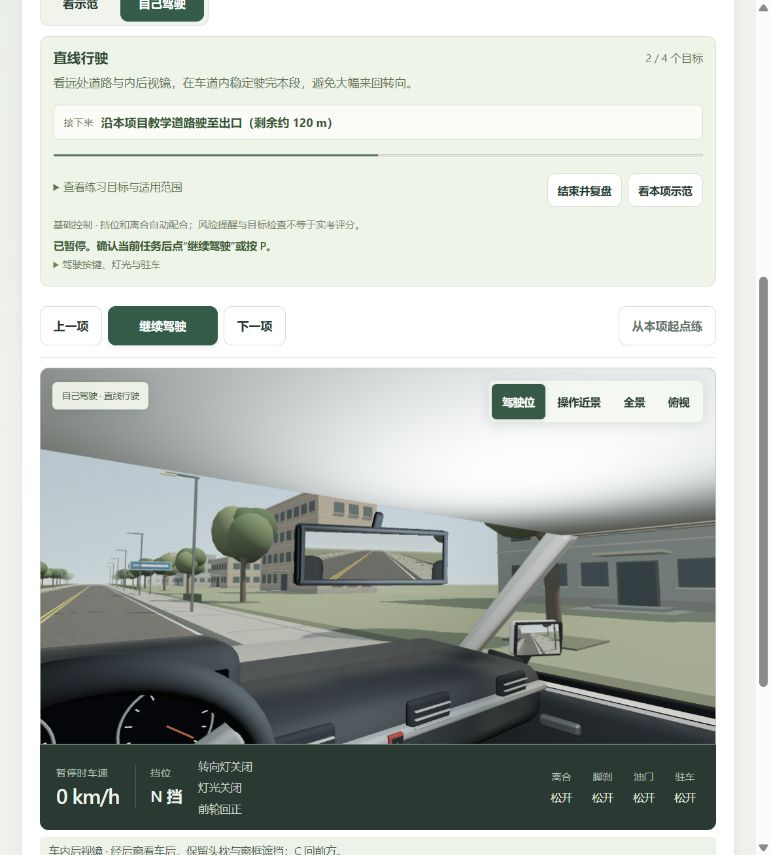

# 整体复查与修复 · 2026-10-24 至 25

本轮结合实际页面、车辆几何和状态机反例，检查风险、观察、每章目标与复盘重练。原科二五项、科三十七章示范、191 段 MiniMax 和倒库专项保留。

## 1. 越线与碰撞：代表路径验收通过

修复驶离目标仍提示“接近”、页面旧提示残留、跨帧脚本行人穿过静止车辆漏检、长车原地旋转扫入车身漏检，以及 `time` 时钟别名被插值误写。扫掠同时考虑物体平移、转角与高度变化，实际场景数据仍优先于脚本后备数据。

道路车辆包络从车壳 1.76 m 修正到包含轮胎外缘的 1.86 m。道路和库线仍按本车车身与轮胎接地区检查，不把外镜外伸等同压线。初始位置已不安全时明确返回没有接触前快照，控制器保留原位置暂停，不再把重叠起点称为安全位置。

实际倒向公交车时出现接近提醒，暂停后脚刹停稳、向前驶离，提醒消失；另一次继续倒向公交车，在接触前自动停住并进入复盘。风险前重练保留右后方观察方向。复盘图补上实际道路、检测标线和终点车身，修正轮廓连线顺序，移除 X/Z 轴术语。

安全测试 14 项通过。全部 22 示范采样包含关键帧与精确终点，无拦停误报。直角近桩、右转外摆及靠边近漆线仍可能出现合理余量提示，不代表实考扣分。

## 2. 后视镜与肩后观察：修复视线和撤销，保留遮挡

未发现内镜反射左右颠倒或肩后视角移到车外的问题。六方向仍使用同一驾驶眼位；内镜通过后窗取景，保留头枕和窗框遮挡。

原右后方视线中心首先撞上副驾头枕，现改为穿过实际侧后窗的参考方向；左侧保留。没有隐藏车柱、头枕或伪造无盲区全景。参考角属于本模型观察方向，不是实际人体颈部转角标定。

调内镜时车顶支臂固定端原会漂移约 5.5–7.3 mm，现固定车顶端并重连镜壳。撤销快照补齐内镜角度，恢复顺序为座椅、外镜，再内镜。实际将眼位从 1.28 m 调至 1.38 m、推荐内镜、撤销后回到 1.28 m / 前后 1.10 m；自动看镜不增加目标计数。

修正驾驶模式样式覆盖调镜场景高度的问题。内镜调整使用下方紧凑面板，镜面完整可见，保留撤销、完成与“调整左右外镜”返回入口；均已实际操作。

观察、内镜、外镜相关 17 项检查通过。边界参考厂商对[内镜经后窗居中、驾驶前调整](https://ownersmanual.hyundai.com/full_webhelp/LX2/2025/en_US/id00f63cd6ead.html)及[凸面外镜距离感、结合直接回看](https://ownersmanual.hyundai.com/full_webhelp/LX2/2025/en_US/id167fe7c2cb0.html)的说明；这些原则不能证明本模型已完成某款教练车实车标定。

## 3. 目标、操作、复盘与重练：修复缺项续练和错题恢复

灯光选错原先只改变车辆灯光，没有即时解释。现立即显示错因，答对提示下一题，历史错误仍保留供复盘。

暂停时多道题共享模拟秒数，旧重练可能回到第一题。现在按答题动作保存语义快照。实际走通“2/7 → 第三题雾灯错误 → 复盘 → 重练仍为 2/7、远光 → 后续完成 7/7”，纠正后的新一轮没有被旧错误卡住。

无风险且仅缺项的复盘新增“继续完成目标”，保留位置、历史、进度和观察方向；错误及风险复盘仍要求重练。终点缺项后续练不会每帧重新弹复盘，补齐目标及新风险仍正常复盘，新一次重练重新允许终点检查。

实际直线先观察至 2/4、主动复盘、继续完成目标、继续驾驶，最终 4/4、115.3 m，无道路或碰撞误报。状态区和清单避免重复替换相同内容，减少焦点附近变化及重复播报。

模型层另修复温和超车小转角漏查观察/转向灯、会车减速阈值与示范不一致、减速等号边界、静止预打方向误记观察错误、同一秒停车前后观察顺序、中途接手误记前段动作及重练继承旧转向统计。

练习测试 27 项通过，覆盖 22 章基础目标可达性。倒库示范保持原时序，库内停点很短，参考测试额外插入右库 17.5833333333 s、左库 52.75 s 精确停点；不能由粗采样漏帧推断手动停车不可能完成。

## 验证与保留功能

- 全量 `npm test`：345/345，通过日志 `tests.txt`。随后提示事件元数据变更又检查风险与练习专项 41/41，通过日志 `targeted-tests.txt`。
- 最终构建通过：`courses-D4OAKCGA.js` / `courses-BOKHu6Zn.css`；原倒库 `main-CeXroBPg.js`、共享 `driver-view-DAj2XKP5.js` 保持。共享 697.42 kB 旧体积提示保留，没有提高阈值。
- `npm run speech:verify`：191 段 SHA-256 校验通过，27,569,676 字节、1,702.62 秒；本轮没有新增语音生成或改动凭据。
- 最后浏览器 warning/error 日志为空。最终为直线、自己驾驶、内镜观察、0 km/h / N 挡暂停、目标 2/4、剩余约 120 m，体验页已保留。

## 仍需区分的能力边界

碰撞为车身包络和已登记目标的教学提醒，未覆盖外镜壳、支架及复杂底盘精细擦碰，不是碰撞形变仿真。车型、眼位仍为工程参考，未实车标定；离合与挡位继续自动配合，不评真实离合脚感、手动换挡、熄火和完整考试分数。

切换视角只记录去过该处，不能证明已看清交通并确认安全。其余章有自动反例检查，本轮没有人工开完每章所有操作组合；也未完成手机真机、屏幕阅读器和完整无障碍合规验收。

所有采用的截图均为本轮实际浏览器并已查看。`10-inner-before-adjustment.png` 捕获到较早左镜画面，已拒绝用作内镜前后对比证据；`11`、`12` 是中间调整记录，最终以 `13` 展示调整界面。没有生成或编辑假截图。
