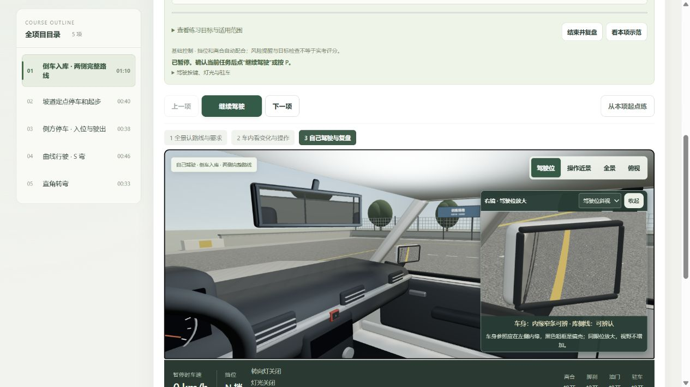
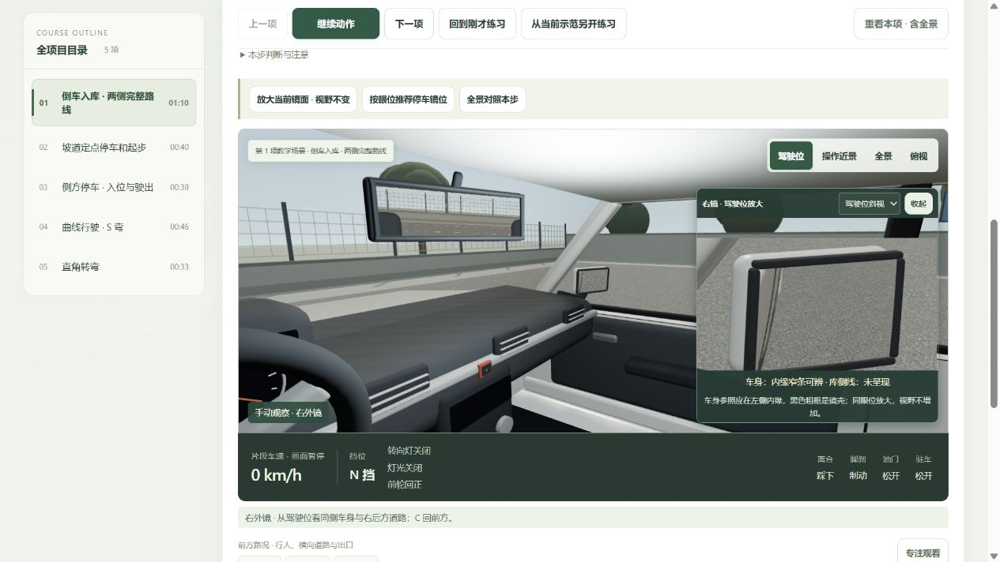
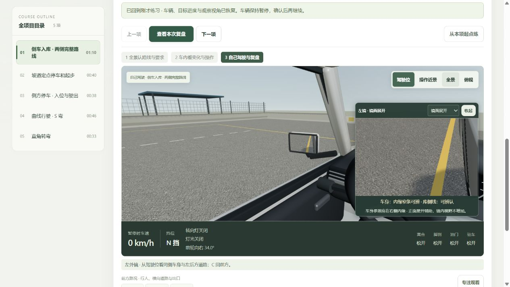

# 整体复查与修正 · 2026-10-25

本轮检查实际页面，并用车辆控制模型和安全引擎复现边界操作。结论：发现并修复了路口、变道、低速区、镜面辨认及示范返回练习的问题；保留科二五项、科三十七章、完整连播、191 段 MiniMax 与原倒库专项。仍是教学原型，不是实车校准或考试评分验收。

体验入口：<http://127.0.0.1:4312/courses.html?course=all>。现有用户页面更新至完整 22 章起点，语音开启、1×、尚未开始播放。

## 1. 看示范、理解目标 — 可用，观察时机已前置说明

学校和公交章节在开始练习时直接说明：接近区域时观察前左方、前右方与正前方，持续留意变化并完整低速通过；驶出后补看不补记。路口说明进入前与停车等待后重新起步前观察；变道说明先打灯、查同侧外镜及肩后，再全车入道并顺直。目标与下一步提示使用同一文案来源。

全景导览、动作分步、教学暂停、自动观察跟随、单科及全量入口仍在。原页面已确认 48 段倒库语音就绪；整科页确认 121 段操作提醒与 22 段总讲解就绪。

## 2. 自己判断并操作 — 已修复确证反例

这一步的误判来自状态和几何计算，截图不能证明；以下由自动测试和独立探针验证：

| 原问题 | 修正与验证 |
| --- | --- |
| 距路口较远的小幅纠方向立即算作转弯，过早锁定观察与灯光错误 | 结合真实路口区域、道路朝向和实际偏航识别转弯；一般小修正不触发，明显提前转向仍可识别 |
| 斜着接手后回到道路方向，被当作开始变道 | 使用登记车道方向，避免把初始车头偏角当道路方向 |
| 入道时缺灯或观察已过期，入道后补做又被判完成 | 在首次全车入道时锁定条件；事后补看、补打灯不能洗掉本次结果 |
| 已沿横向道路驶离路口，仍受无限宽的低速区检查 | 使用二维区域与全车相交判断；真实驶出后停止计时，但侧向绕离不冒充直行完整通过 |
| 区内接手，整车退回入口前重走，仍不能完成 | 允许真实完整重走；不清除已有超速、累计超速时长或重新给予入区减速宽限 |
| 学校或公交驶出后才补看，仍可补成完成 | 有效观察只在近期接近入口或区域内记录；驶出锁定，缺项给出可从有效窗口重练的反馈 |

独立 `zone-probes.mjs` 使用实际 `stepCourseDriving` 控制模型、`evaluateCourseSafety` 和练习判定联合运行，**不是浏览器手动驾驶录像**。三例通过：横向离开不误报；区内接手退回后完整通过；学校漏看晚补仍失败，重练正确补看后通过。22 章正常模型练习回归无新增误报。

## 3. 看镜并辨认参照 — 已修复误认，放大控制可用

库线识别不再只投影理论库位点：须找到真实侧线 mesh、正确材质与反射源首命中。无漆线、隐藏、移位、只有库底横线、线段过短或显示过细，都不能冒充“可辨认库侧线”。左右侧线身份分别保留。

车身参照遇到局部外部遮挡时，重新计算剩余可见宽度和面积，并提示遮挡不确定；不能用原来完整车身的缓存面积声称可辨。未改变眼位、镜壳、镜域或 FOV，仍可选择驾驶位斜视和同一镜域展开。

实际页面抽查：右侧 12.4 秒、左侧 47.6 秒均能辨认真实侧线；起点右镜准确显示“库侧线：未呈现”。放大浮窗增加独立辨认状态，黑色粗框是镜壳，本车参照是内缘窄条；开启放大时为画面保留 390px 最小高度，避免遮住视角按钮。

局限：几何、遮挡与显示像素估计不等于人眼辨认或真实车型标定；截图不能证明视力适配、光照下的实际可读性或完整无障碍合规。本轮检查了当前桌面窗格，未做手机真机验收。

## 4. 复盘、看示范、返回练习 — 已走通

原顶部“看示范”会丢掉练习快照，切章又会清掉返回入口；现所有示范入口统一保存。即使去看另一科，再点“继续刚才练习”，也恢复原课程、车辆、目标、复盘、观察方向、镜位及放大方式，保持暂停，恢复本身不增加观察次数。

实际页面流程：倒库 12.4 秒接手 → 左右镜观察 → 左镜展开 → 结束复盘（2/7，2 次观察）→ 顶部看示范 → 换科三 → 顶部继续刚才练习 → 返回原倒库、原复盘和左镜展开。另验证“从当前示范另开练习”建立新章节练习，避免返回与重新接手含义混淆。

倒库同一位置会在左右路线中重复出现，看示范的时间点改用已记录路线进度，避免左倒库复盘跳回右倒库。55 / 65 / 69 秒重访同一位置的反例已覆盖。

## 验证与版本

- `npm test`：**472/472**；见 `test.log`。覆盖原倒库回正、复盘、镜面、运动、安全、22 章与语音流程。
- 最后只补目标说明文案后，练习、快照及整科集成相关 **57/57** 再次通过；见 `targeted-final.log`。未无理由重复全部测试。
- 独立区域探针 `node notes/course-reaudit-20261025/zone-probes.mjs --assert-fixed`：3/3；`zone-probes.log` 记录运行前后源码 SHA 与稳定性。
- `npm run speech:verify`：191 段 SHA-256 通过，27,569,676 字节、1,702.62 秒。本轮没有生成、替换音频或读取凭据。
- `npm run build` 通过：最终 `courses-CbRtQHx7.js`、`courses-DUHxC8Ue.css`；原倒库 `main-CwMGl_z7.js`。既有共享包 710.35kB 的提示保留，未调高阈值。
- 最终整科页、原倒库首页运行日志未发现 warning / error。MiniMax 开场先保持车辆停住，实际播放后自动进入车内逐步示范；抽查至 19.2 秒出库步骤后主动暂停（截图 15），未完整人工听完所有音频。
- 本轮截图 01–04 为修复前；05–07 为中间版；08–11 为最终逻辑版 `courses-C0cu_Cn0.js`；12–15 为仅更新目标文案后的最终 `courses-CbRtQHx7.js`。截图均由当前轮真实页面保存并回读检查，没有借用历史截图。

未声称人工完整驾驶全部 22 章。自动挡位/离合配合、模型教学低速上限、有限镜面虚拟视点近似和未做实车标定等既有边界仍在；本轮未扩展考试规则或生成实考分数。
