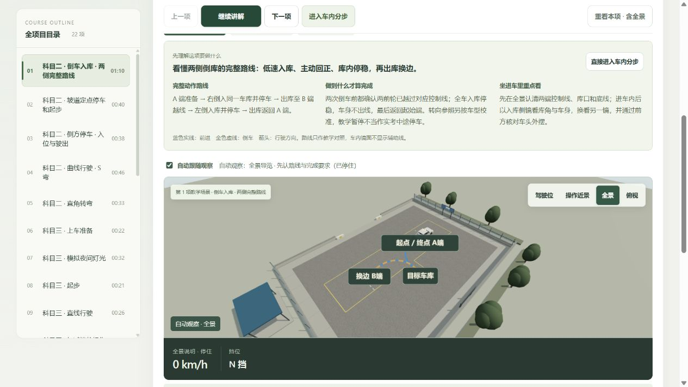
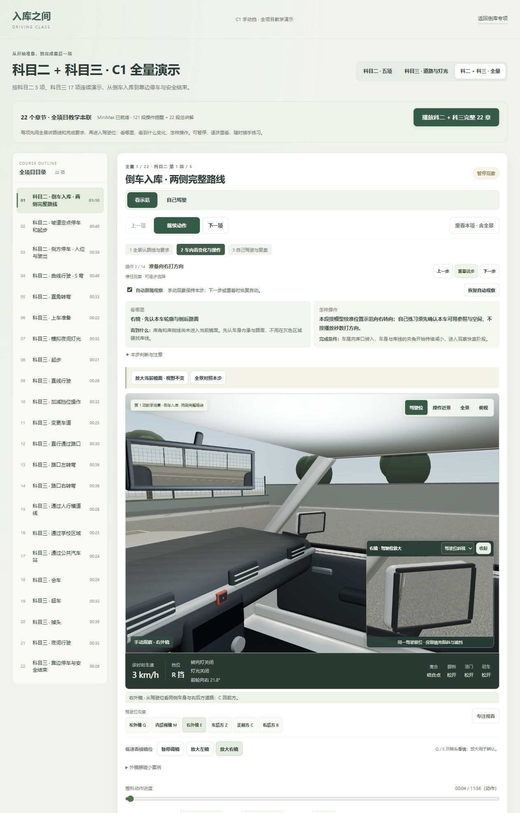
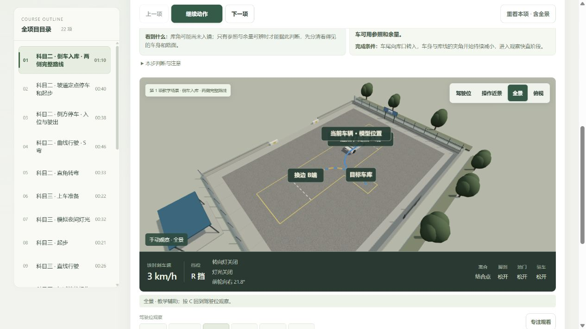
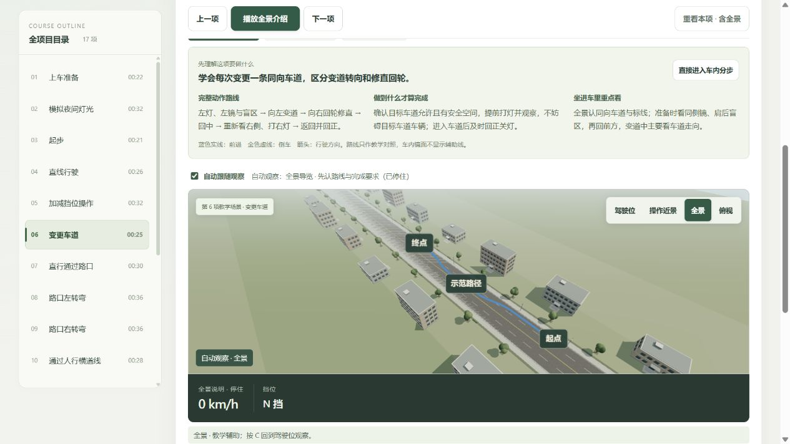

# 全景导览与可判断的操作说明 · 2026-10-25

用户要求开头先用全景讲动作，说明完成标准、应该看到什么、何时做什么，并继续优化先前的问题。本轮保留原功能，修改课程的教学顺序与提示。

## 体验顺序

1. **先看全景**：每章进入起点后展示目标、完整路线、完成要求和车内观察重点。整章路线使用原模型采样，蓝实线为前进、金虚线为倒车，箭头表示行驶方向。倒库标明 A 端、换边 B 端和同一目标车库。全景相机适配完整路线，不再仅偏移跟随当前车辆。
2. **听总讲解，再进车内**：默认播放既有 22 段 MiniMax 章节总讲解之一，车辆在起点停住，HUD 为 0 km/h；结束后从首条操作提醒开始，再演动作。可以暂停，也可主动进入车内分步。讲解暂停、错误或调镜时不移动；单步重看和时间轴跳转不会被强塞回开场。静音保留原连续播放行为，ready 状态仍可读全景说明。
3. **按变化理解操作**：22 章共 121 步均有“看哪里 / 看到什么 / 怎样操作 / 完成条件 / 注意”。例如向左回轮是收回原右转角，到前轮回中就停止，不是再打出一段左转；车身快直时准备回轮，回中后继续核对姿态与余量。
4. **看不清时有入口**：当前倒库镜域明确不包含库角或侧线时，改为辨认车身窄边与路面，不再要求寻找尚未入镜的点。可同眼位放大、暂停调镜，或在当前时刻切全景核对本模型位置；后者保持车辆位置与进度。返回自动后恢复本步骤观察。全景线、标签和箭头只在独立教学层，驾驶位与真实镜面中不显示，也不成为碰撞障碍。
5. **接手、复盘继续保留**：自己驾驶时不会由演示自动转头，接手保留当前看镜方向；原本章目标、缺项继续、错误前重练、轨迹复盘及倒库专项继续可用。自动看镜不会代替学员记录观察完成。

## 实际页面核对

- 完整 22 章从倒库全景开始：原总讲解字幕出现，暂停后时间仍为 0、车辆仍为 0 km/h；直接进入分步后是首条提醒，车辆没有提前行驶。
- 倒库动作 4 秒：自动右镜，提示“库角和库侧线尚未进入当前镜面”，动作说明明确是本模型校准位置，不能按播放秒数当实车点位。
- 点击同眼位放大后，保持实体镜壳倾斜及原反射视野；点击全景对照后，仍停在原 4 秒、原转角与位置。当前车标记随车辆，A/B/库位路线不重置。接近起终点时隐藏重复的当前车文字；中途文字与固定标签分别向上/向下锚定。
- 新“车身太细？暂停调镜”正常打开既有面板，车辆保持暂停；未自动改动镜角，既有推荐与撤销继续保留。完成后可重看本项回全景。
- 从右镜接手后仍为右镜，练习目标 0/7，不把演示自动观察记成学员完成。直接结束显示尚未完成、0m 轨迹与缺项继续按钮，没有误判为完成。
- 科三变道同样先展示完整路线与通用完成要求，起点/终点/示范路径清楚，车辆停住。长道路的全景取景由实际边界计算。
- 原首页和倒库专项正常加载，48 段原 MiniMax 显示已就绪；最终课程 error/warn 日志为空。没有操作用户原首页标签页或更改其练习进度。

## 标准与校准

本轮复核[公安标准化平台 GA 1026—2022 登记](https://ywtb.mps.gov.cn/gabzh/portal/stdDetail/309760)及[全国标准信息平台登记](https://std.samr.gov.cn/hb/search/stdHBDetailedCNF?id=E424B54CA6246DD7E05397BE0A0A5C54)，均标为现行。原[考试依据](../exam-basis.md)与课程依据继续保留。

页面将项目通用应达到的结果、观察和动作完成表现，与车型/座椅/镜位相关参照分别说明。没有新增实考评分器、统一镜沿点位、统一圈数或以播放秒数充当转向标准。既有语音讲概述和短提醒；本轮更细的判断条件显示在步骤卡，没有重新生成音频或宣称逐字语音对齐。

镜域查询的明确否定结果只用于排除不可能看到的参照；肯定结果不等于已解决遮挡、反差和人眼辨认。此次没有扩大物理镜域，也没有把隐藏线画进镜中。默认停车右镜的本车参照仍很窄，近体凸镜仍是现有工程近似，未作实车标定；真实遮挡和可辨认覆盖的进一步标定仍值得继续优化。本轮主要解决教学说明、辨认入口和路线理解，不能视为所有镜面限制已经消失。

## 检查与交付

- `npm test`：**426 / 426 通过**，`test.log`。新增教学指南 15、可见参照 3、路线 11 项，以及开场播放和全量顺序回归。1×/4×均验证 22 个 intro 与 121 个 cue 的全部 143 条准确交错，无重复漏播；全部 22 章开场结束或跳过后从静止起点进入首条提醒。
- 最后的标签锚点微调后，路线和参照 **14 / 14** 复查通过，`final-visual-checks.log`。未重复扩大无关测试。
- 最终构建通过：`courses-D7g2NNFz.js` / `courses-DyN36kw3.css`，共享 `driver-view-CPZzNp5X.js`。共享包 713.14kB 的既有体积类型提示保留，未提高阈值。构建日志 `build.log`。
- `npm run speech:verify`：191 段哈希通过，27,569,676 字节、1,702.62 秒。既有 22 段概述与 121 段短提醒重新编排使用，倒库 48 段保留；未调用生成服务、未读取密钥。
- 最终体验页：`http://127.0.0.1:4312/courses.html?course=all&chapter=reverse-parking`。停在全景讲解暂停状态，原位 0 km/h、N 挡、MiniMax 开启、1×、连续；点击“继续讲解”体验完整开场，或“进入车内分步”。

浏览器按代表性章节和控制边界核对，没有人工连续听完全部 143 段，也未在全部实际屏幕尺寸逐项手测。路线测试覆盖 22 章及宽窄画幅适配、采样上限、前进/倒车和停段、起终点重合、教学层隔离与资源释放。截图均来自本轮真实页面并已查看，没有生成或编辑截图。
