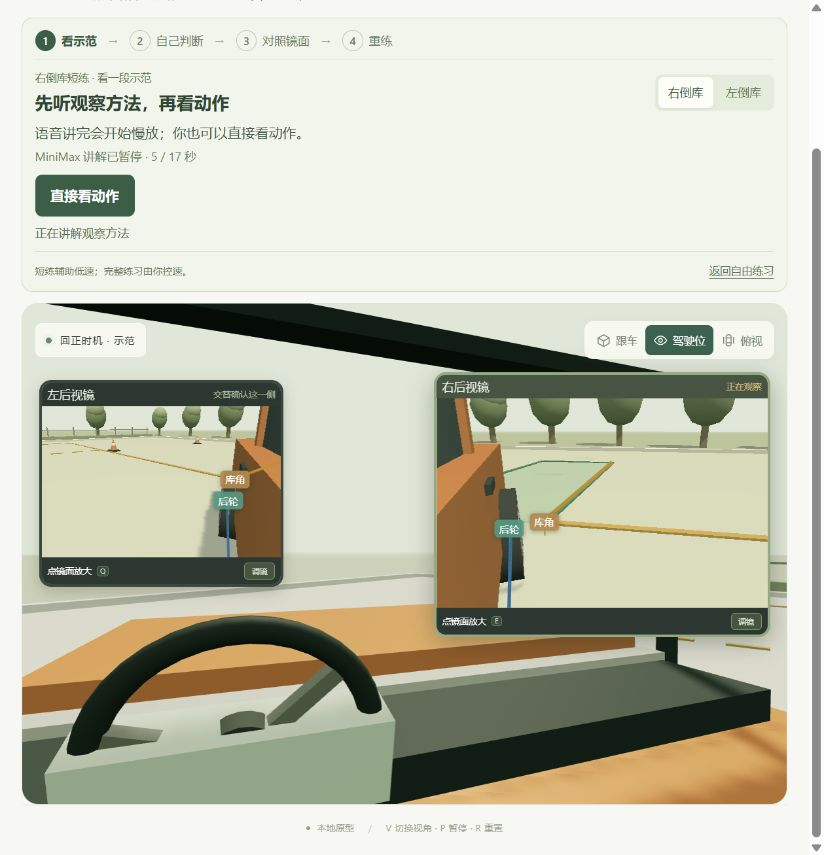
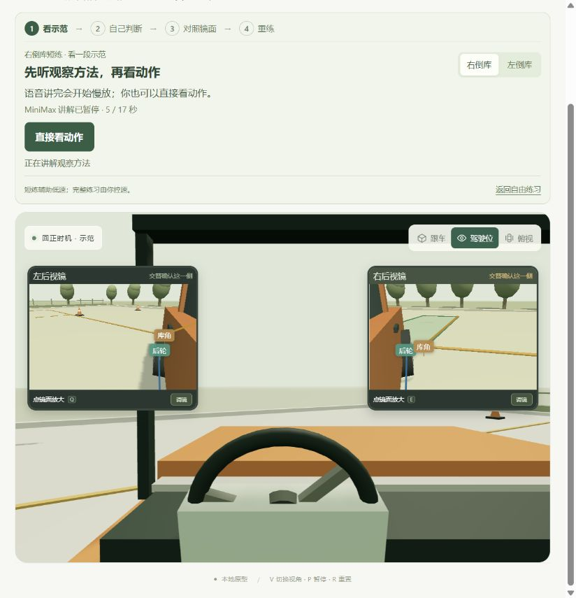

# 后视镜专项核查 · 2026-10-24

后续修复说明：下文保留核查时的原始画面和结论。本轮已加入有限球面、眼位关系、遮挡检查与常态 / 教学放大区分；现行实现、工程近似和验证范围见 [镜面建模与校准范围](../mirror-calibration.md)。该修复仍不代表原厂或实车标定。

范围：当前网页中暂停的右倒库短练，核对驾驶位后视镜显示大小、聚焦行为和可见范围。仅检查本轮现场画面和实现，未变更镜面参数或训练流程。

1. **进入检查时的右镜聚焦画面：教学可读，真实性不足。** 右镜内容区域约 337×213 CSS 像素，左镜约 244×154；浮动镜面覆盖了较大驾驶画面。大画面有助于辨认标签，但不代表实际坐在驾驶位时镜面的视角大小。

2. **取消右镜聚焦：放大行为本身一致，基础镜域未标定。** 两侧回到较小卡片，画面宽高比仍约 1.58；对照相同停车姿态，后轮、库角、远处树木的相对构图保持一致。放大没有额外增加视域。当前短练基础镜框宽度为场景的 32%，聚焦为 44%，均属于屏幕教学排版，不能用作实车镜面尺寸。

## 实现核对

- `src/cockpit.js` 中镜相机位置为车辆局部 x=±1.025 m、y=1.10 m、z=1.78 m。车宽 1.8 m，相机位于车身侧面外约 12.5 cm，这一位置尺度本身不能判为明显不合理。
- 纵向视场角固定 46°，在宽高比 1.58 时横向约 67.70°。这个数值并不单独证明所有实车都无法看到类似范围；实际范围还取决于镜片、曲率、眼位和调节方向。
- `src/mirrors.js` 使用镜旁的后向透视相机，并对贴图作水平翻转。尚无真实镜片有限孔径裁切、按眼位求反射视点或凸面镜曲率；因此当前画面应理解为教学后向视图，不能声称已模拟真实考试车后视镜。
- 调节座椅前后位置 `seatFore` 不改变镜相机；座椅高度仅用经验系数改俯仰。尚未建立完整的驾驶员眼位与镜域关系。
- 画面中的后轮与库角标签、蓝/金辅助线属于教学辅助；相邻小目标和细线的可读性不能当作实车可辨识程度。它们对小屏和视力较弱用户有帮助，宜在教学辅助中保留。
- 标签仅核对目标是否落在镜相机投影视域内，尚未作场景遮挡深度检查；因此标签出现不等于真实目标在该位置确实可见。训练时应避免让标签代替对实际轮廓和边线的辨认。

## 判断与建议

屏幕镜面偏大是确定的教学放大；可见范围是否超过具体车型，现有证据无法精确量化，必须标定。凸面镜确可扩展后方视野，同时会让物体显得更小、更远，不能把宽视野和较大的目标显示都视为实车默认效果。来源：[Ford 外后视镜说明](https://www.fordservicecontent.com/Ford_Content/vdirsnet/OwnerManual/Home/Content?ProcUid=G558245&Uid=G1054628&buildtype=web&countryCode=USA&div=f&languageCode=en&moidRef=G539487&userMarket=GBR&vFilteringEnabled=False&variantid=1494)。

建议先按代表性 C1 考试车型标定眼位、镜片尺寸/位置、镜域和成像比例，将训练默认显示与讲解放大区分清楚。现有放大和标注保留作观察辅助。不要只把 FOV 任意调小后称为“真实”。

限制：未获取具体考试车型的镜片参数或驾驶员眼位实拍，未作实车对照，未进行全面可访问性评估。
