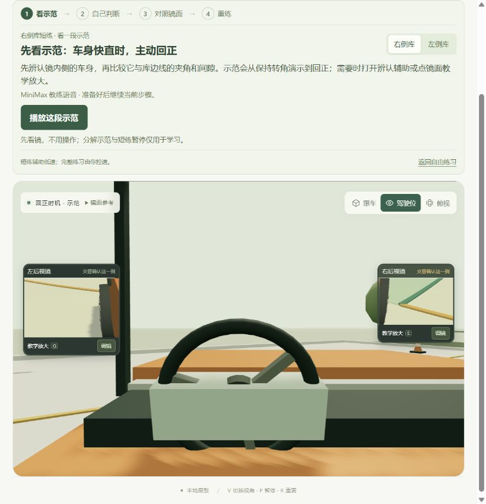
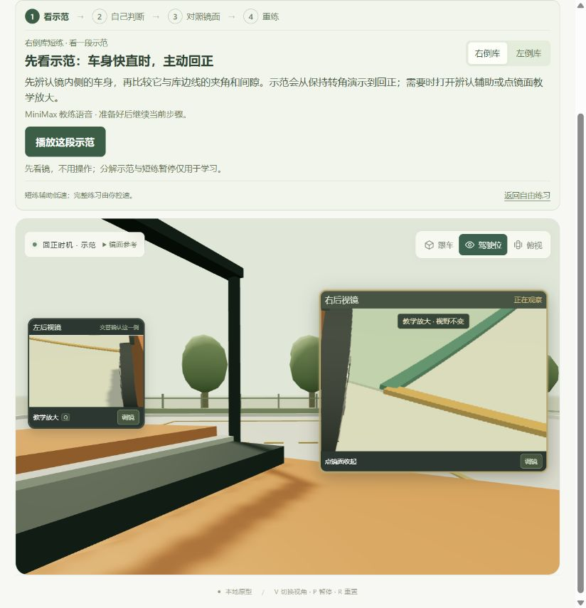
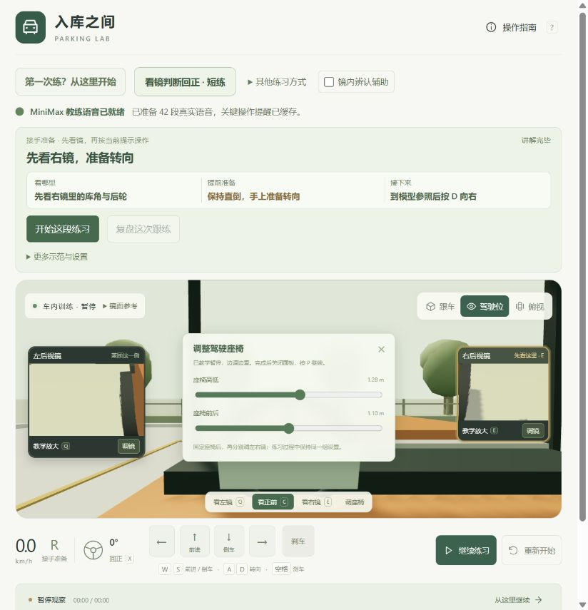
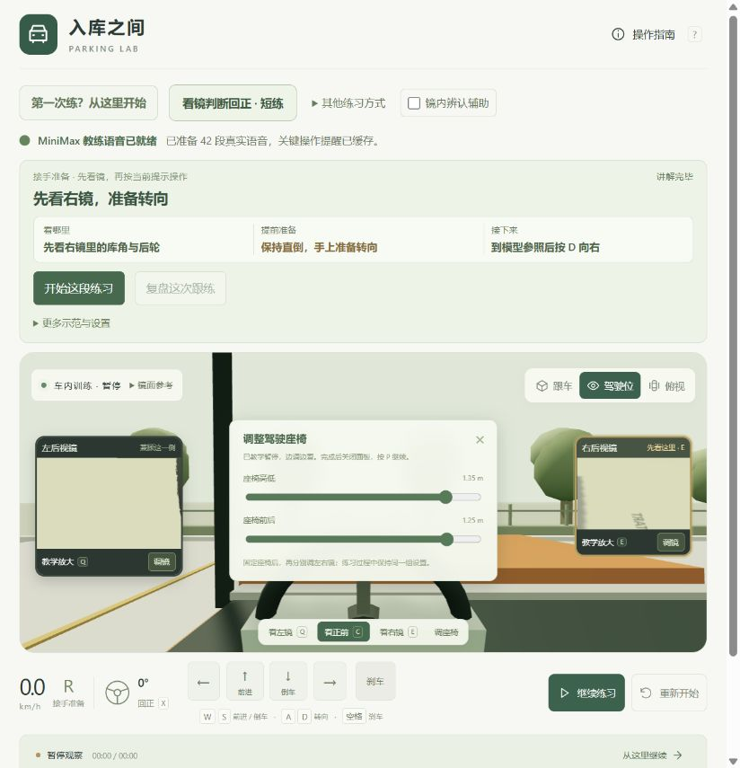

# 镜面建模与校准范围 · 2026-10-24

镜面采用有限大小的球面模型，建立驾驶员眼位、镜片朝向和镜中视域的关系。本轮进一步把镜片装入车辆实体镜壳，并让车内外使用同一窗口与车舱结构；教学放大和各训练模式保留。以下参数是本项目的工程参考，未经过具体考试车测量或实车验证，不是桑塔纳原厂眼位或后视镜标定。

## 来源与车型范围

大众官方 2020 年车型介绍给出的中国市场 Santana 长、宽、高分别为 4.48、1.71、1.47 m，轴距 2.60 m；这些数据只作为三厢轿车布局尺度的参照。该资料未提供本项目使用的驾驶员眼位、镜心、镜片大小或曲率参数。[Volkswagen Newsroom：Compact notchback models in China](https://www.volkswagen-newsroom.com/en/press-releases/market-overview-compact-notchback-models-are-one-of-volkswagens-key-segments-in-china-5954)。

当前 `CAR` 仍保留已有同级示意车型的车长 4.4 m、车宽 1.8 m、轴距 2.65 m，以维持车辆运动、场地路线和既有练习记录的一致性。没有把该模型改名为某款真实考试车，也不能由官方车身尺寸推出镜面已经匹配所有 C1 车型。

## 当前参数

车辆局部坐标以地面上的后轴中点为基准，+X 指向驾驶员左侧，+Y 向上，+Z 向前。以下为初始 / 重置参数，执行一键推荐后镜角由当前眼位重新求解。长度均为米；眼位高度是眼睛离地高度，并非座椅坐垫高度。

| 项目 | 当前工程值 | 可调范围 / 说明 |
| --- | --- | --- |
| 固定参考眼点 | x=0.39，y=1.28，z=1.10 | 用于计算镜片安装法线 |
| 眼位高度 | 1.28 | 1.15–1.38，对应“座椅高低” |
| 眼位前后 | 1.10 | 0.90–1.30，对应“座椅前后” |
| 左 / 右镜心 | x=+1.02 / −1.02，y=1.05，z=1.86 | 车身两侧外延 0.12 |
| 有效镜片大小 | 0.19×0.12 | 有限矩形孔径；UI 宽高比保持 1.58 |
| 球面半径 | 1.40 | 两侧均使用同一工程曲率 |
| 左镜调节参数 | yaw=9°，pitch=−18° | yaw −5° 至 25°；pitch −38° 至 −5° |
| 右镜调节参数 | yaw=10°，pitch=−18° | 同左镜范围 |

yaw / pitch 是代码中参考中心视线的调节参数，由其与固定参考眼点共同求出镜片法线；不是实车调镜刻度或镜片法线本身的角度。座椅改变只移动当前眼点，不偷偷重算镜片朝向以保持旧画面。左右眼镜距离不同，即使镜片尺寸和曲率相同，实际视域也自然不同。

初稿左 5° / −23°、右 6° / −24° 过于朝向轮胎，现场观察后调整为表中的最终默认值。正常训练不要求完整轮胎出现在镜中；先固定眼位，再根据车型校准少量车身、侧后方和地面参照。

## 一键推荐与轮距修正

此前确认并修正轮胎突出车身的模型错误：旧轮心在 ±0.88 m，胎宽 0.23 m，轮毂 / 辐条最大半宽 0.1275 m，最外缘达到 ±1.0075 m，超过车箱几何半宽 0.89 m。现轮距统一为 1.52 m、轮心 ±0.76 m，后轮及回正前轮最大外缘 ±0.8875 m；前轮转向仍保留正常扫掠。`src/car-body.js` 增加轮拱开口，保留正常轮胎几何。模型轮胎、轮迹、标签位置和前轮控制线接地点使用同组参数；车长、车宽、轴距及转向运动不变。

`recommendMirrorSettings` 在当前眼位下，以固定车身边与近远地面点为参照，独立求两镜 yaw / pitch，精度为 0.1°。求解不读取车库、车辆姿态和原镜角，不修改 FOV、球面曲率、座椅或车辆姿态。默认眼位推荐左 10° / −19.8°、右 8.3° / −19.1°；眼位改为 1.35 / 1.25 m 后为左 3.8° / −14.1°、右 2.9° / −16.7°。81 个座椅格点、162 面镜的模型求解均可用，重复求解幂等；超范围结果以 limited 如实报告。报告的“可见”仅是镜域判断，遮挡仍由渲染器检查，推荐不是原厂最佳标定或避免压线的保证。

场景和工具栏的一键入口推荐双镜，单侧面板只推荐当前镜；座椅面板与完整设置也可推荐双侧。应用前教学暂停，调好后不自动继续，仍可手动微调或撤销；撤销恢复镜角、不移动座椅。移动座椅只提示重新推荐，不偷偷改镜。浏览器已验证推荐、撤销、右镜极值后的单侧恢复、新眼位推荐、驾驶中调镜暂停及原有短练闭环；最终 148 项测试及 `index-CFB2mX4J.js` 构建通过，版本与实际流程见 [验证记录](verification.md)。

## 光学计算与近似

`src/cockpit.js` 根据有限球面上每个采样点的位置和法线，计算眼睛射向镜面的光线及其反射方向，并通过同一射线关系反求场景目标在镜面的位置。反射已包含在这套映射中，画面不再额外水平翻转一次。

球面镜的反射射线具有不同起点，不能由一个透视相机完全表示。`src/mirror-optics.js` 用 24×16 网格采样得到射线 UV，并以最小二乘拟合一个虚拟眼点；`src/mirrors.js` 从该眼点渲染场景颜色，再按球面 UV 合成。射线方向来自球面几何，场景颜色的共同视点仍是近似，近处车身可能存在视差误差；这不是逐场景像素的完整路径追踪。

| 默认状态度量 | 左镜 | 右镜 |
| --- | --- | --- |
| 物理反射镜域，水平×垂直 | 26.25°×17.34° | 22.66°×14.35° |
| 源纹理相机纵向包围 FOV | 18.92° | 15.68° |
| 最大采样射线原点误差 | 13.48 mm | 20.36 mm |

源相机 FOV 是为了包围所需反射方向并提供纹理，不是可见镜域。原点误差是拟合虚拟眼点到各采样反射直线的最大垂直距离，说明非中心成像被单一视点近似的程度；不是像素误差、全画面精度或实车校准误差。上述数值仅对应当前默认参数，调座椅或镜片后会变化。

后轮 / 库角标签先经过同一球面逆投影，再检查从镜面到目标之间的不透明场景物体遮挡。镜域外或被遮挡的目标不显示标签。实时镜面与复盘 `capture` 共用镜片几何、虚拟视点和 UV；复盘的蓝 / 金线继续明确作为教学标线，用于比较车身朝向和库边线。

## 实体镜片与共享车舱

白色 C1 工程参考车的车内外共用窗口结构，加入倾斜 A 柱、门板、仪表台和独立方向盘；实体镜片附着在车辆镜壳，依然使用上述镜心、眼点和有限球面反射。`src/mirror-surface.js` 将反射 UV 应用到实体镜片，教学浮层使用同一源纹理；不另造广角画面。渲染顺序为镜面纹理准备 → 主场景实体镜 → 可选教学浮层，避免主画面使用过期或不同来源的反射。

Q / E 正常看镜时根据镜心与眼点计算水平和垂直角，眼点、镜角不因转头而变化；教学放大按钮或点击实体镜片才打开浮层。驾驶相机横向 FOV 上限 100°，防止短宽画布产生过度广角；该显示上限与后视镜自身的物理反射视域是两个不同参数。

场景采用统一世界高度：路面 0.025 m、贴地漆线 0.027 m、地面参照 0.028 m、教学层 0.030 m。观察投影与场景漆线使用一致基准，不再以抬高数厘米的盒体模拟漆线。车辆运动参数不变；外观照片、生成路面材质和共享几何均不构成实车标定。当前实现和浏览器证据范围见 [场地首版验证](realism-build/verification.md)。

本轮实际浏览器已验证实体右镜点击放大，以及修复透明背景后的可见画面；完整带练的驾驶、场景暂停与轨迹复盘在 `index-oe2YU751.js` 走通。`index-BkWCR5Tt.js` 走通真实语音短练、提前回正、四张新镜面对比及出错前重练；座椅调高后提示重调、按当前眼位重新推荐、恢复参考眼位再适配也已实际操作。最终 178 项测试与 `index-L0xOqOMh.js` / `index-oV8a99Z0.css` 构建通过，最后只移动场景暂停按钮，完整闭环保留原构建归属。这些结果验证模型和界面工作，不提升为实车或厂家校准结论。

最终构建在 824×871 实查实体镜、教学放大卡、控制条和右下角继续按钮可见，按钮不遮挡镜卡标题；恢复原窗口、关放大回正前后，继续与暂停实际切换正常，控制台 error / warn 为空。最终驾驶舱、镜面和场地预览已实际查看；驾驶舱封面仅展示带练提示与车内画面，不作为全部页面或所有控件的证据。

## 界面与设置

- 常态只显示车辆上的实体镜片，Q / E 或看镜按钮正常转头，C 回正前。教学放大按钮或点击实体镜片打开辅助浮层，徽标明确“教学放大 · 视野不变”；不扩大镜片孔径或额外增加可见范围。
- 普通后轮 / 库角“镜内辨认辅助”默认关闭，共享开关与原车内设置同步。新手可使用独立的车身 / 地面教学标记，仍遵守实际投影和遮挡；原有示范、带练和复盘保留。
- 新手先俯视认车和库，再坐进驾驶位认车身与侧后方地面。起点库角尚未进入镜域，倒车时再等待出现，不要求寻找不可见的标签。
- 顶部“镜面参考”可展开“按当前座椅推荐倒库视野，调好后固定座椅，仍可微调”，不占用一整排常驻说明。
- 新设置独立保存到 `parking-lab.cockpit.v2`。v1 不直接套入新几何，也不会被清除；重置仅影响当前 v2 设置。

## 前一轮光学验证与限制

此前有限镜面版本已观察到常态双镜、右镜教学放大前后同构图；辨认辅助开启后仅出现当时可见的库角，轮胎不在镜域内时不显示标签。眼位高低 / 前后从 1.28 / 1.10 m 改为 1.35 / 1.25 m，镜像明显变化，恢复原值后还原；完整语音带练驾驶与暂停正常。以下截图是实体镜改造前的历史证据，不代替本轮验收。

最终 135 项测试及 `index-D-X-XW-K.js` 构建通过，包含渲染异常后的状态恢复。主要光学链路在 `index-DgPHqUtu.js` 实际走通新语音示范、自主判断、提前回正后的四镜对比和从错误前重练，原 12 步示范仍可用；[新镜域复盘截图](../assets/preview-calibrated-review.png)记录该版本。最后一版仅细化入门提示和音频，已实查新手先认车身与侧后地面、辅助关闭且不自动放大。具体输入和截图范围见 [验证记录](verification.md)。

| 默认眼位 1.28 / 1.10 m | 调高并前移到 1.35 / 1.25 m |
| --- | --- |
|  |  |

仍未完成具体考试车型的镜片实测、原厂眼位对齐和实车画面对照。单一球面不能涵盖不同车型的非球面分区、镜壳遮挡和双眼观察差异；屏幕显示大小也不等于实车镜面在视网膜上的角尺寸。训练反馈和点位仍以本模型为限。

[修复前镜面审查](mirror-audit-2026-10-24/report.md)保留原画面及当时结论，便于追溯本轮解决的问题。
