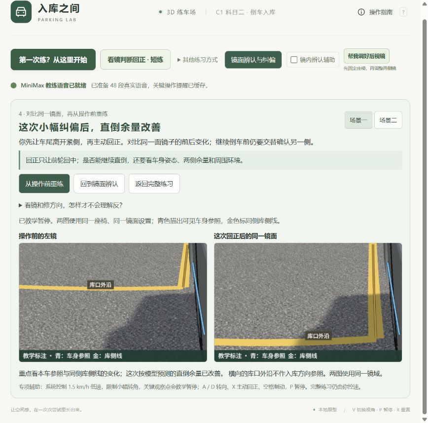
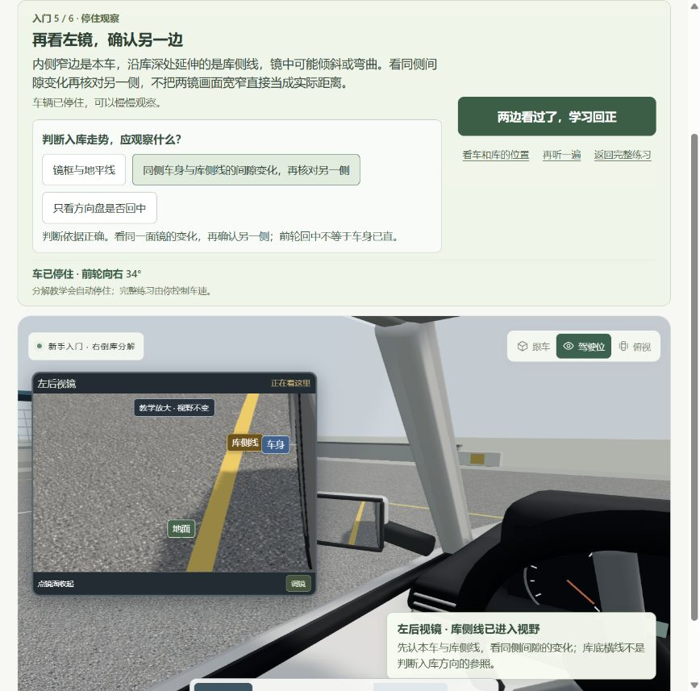
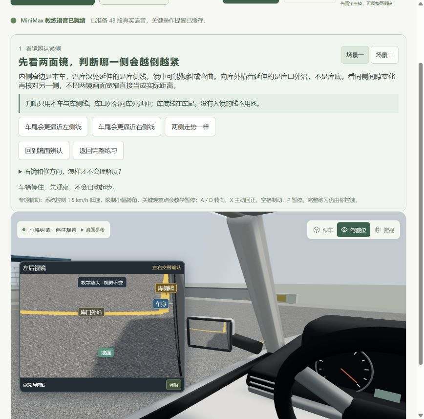

# 2026-10-24 后视镜与纠偏教学检查

本轮目标：核对镜中本车、真实库侧线 / 库底线与倒车转向之间的关系，修复容易让新手形成错误判断的提示，同时保留原有示范、MiniMax 带练、短练、复盘和重练。

## 本轮起始截图

1. [左镜观察起点](01-start-left-mirror.png)：驾驶位与实体镜、教学放大一致，但库侧线和库口外沿同为黄色，文字却统称“黄色纵线”；镜中 L 的横段位于库口两侧外沿，不是远处的库底线。车身只有内侧窄轮廓，原“车身”标签盖在细边上，容易把相邻黄线当作本车。
2. [切换右镜](02-same-pose-right-mirror.png)：切换后教学放大关闭，需要再按一次放大；对正在比较两镜的新手形成额外跳转。两镜视角不同，直接比较画面里的宽窄不能代表等比例的实际余量。

以上为本轮现场保存并打开检查的截图。旧轮截图不作为本轮审查证据。

## 确认的问题与修正

- **方向关系和适用条件**：低速自行车模型的转向符号核对正确。从顺直倒车开始，方向盘与车尾轨迹弯向同侧，车头向另一侧外摆；已有斜角时车尾不会瞬间横移。本专项只覆盖车尾带小夹角斜入，原“左侧紧就右修”遗漏了姿态前提。新题目改问继续直倒的逼线趋势，操作按钮明确控制方向盘，并同步说明车尾逐渐变向、车头反向外摆。车身已经平行但整体偏边不套用本题单次修正。
- **地面线冒充车身参照**：旧镜面对比把 y=0.030 m 的地面投影画为蓝色“车身朝向”，并只判断孔径。新辅助改在真实车身侧面 y=0.65 m 上描出可见段，与库侧线均执行遮挡检查；不把隐藏轮胎或库角移入镜中。
- **黄线的身份**：库侧线只取左右真实纵向边线；库底线只取 BAY.back 横线；库口外沿只取 BAY.entrance 两侧、位于库宽以外的实存边线，不虚构开放库口中间的横线。分别标注当前可见的参照，起点不可见的库底线不标出。不以屏幕中的横、竖命名世界物体。凸面镜中的斜度、弯曲和两镜像素宽窄都不能直接当成车身角度或实际距离。
- **可辨认性门槛**：看到单个线点不等于能看清走势。新增连续可见段的长度 / 屏幕跨度检查，保留原 lineVisible 兼容字段；辨认题需要足够侧线参照，库底线不能替代侧线。
- **观察连续性**：教学放大开启时直接切换左 / 右镜保留放大。回到正前或主动收起仍关闭放大。原接手与重练保留观察状态的逻辑继续使用。

## 外部原则核对

[深圳交警《时常留意后视镜，倒车时胆大心细最重要》](https://szjj.sz.gov.cn/m/YD_JTAQ/YD_AQCS/content/post_4451076.html) 明确按车尾需要的行进方向转动方向盘，并要求观察车头外摆及左右环境。本轮用它核对一般运动和观察原则，不把其中点位、操作幅度作为 C1 统一考试口令。

[DVSA 驾驶教学标准](https://www.gov.uk/government/publications/keep-a-record-of-your-pupils-driving-lessons/how-to-record-your-pupils-driving-lessons-and-a-summary-of-the-skills-they-need) 要求理解不同镜型的作用、覆盖范围和盲区，采用全方位观察。此处仅用于交叉核对镜面解释，不作为中国考试评分依据。

## 音频

通过用户已指定的外部 MiniMax 配置更新 5 个语音 key，不在项目或浏览器存放密钥；没有自动重试或强制覆盖旧文件。后续确认起点横线为库口外沿后，重新录制其中 2 段开场 / 重练文稿，共 7 次成功请求。最终 5 段均通过 FFmpeg 完整解码，旧活动清单引用的 48 个文件与首轮生成的 5 个文件 SHA-256 逐个核对并保留。

活动包仍为 48 段，8,702,208 字节、538.740 秒，speech-2.8-hd / male-qn-qingse。精确文本、路径、时长、SHA 与解码结果见 [生成记录](audio-generation.json)；生成前活动清单见 [旧清单](manifest-before.json)。

## 证据边界

本轮核对模型方向、物体身份、遮挡及学习流程。有限凸面镜的场景取色仍使用虚拟视点近似，尚未完成真实 C1 教练车的镜面曲率、眼位与像素标定；不能据此声称与某辆实车完全一致。辅助 1.5 km/h、小幅转角、观察点教学暂停仍仅用于专项理解。

自动化和最终页面验证见 [验证记录](verification.md)。本轮全量 207 项测试通过，另有最终镜面标注子集 11 项通过。

## 修正后的流程与健康状态

1. **认镜：通过。** [左镜物体身份](03-new-left-references.png) 与 [切右镜保留放大](04-right-references-keeps-zoom.png) 现场检查了车身、库侧线、库口外沿的实际对应。起点库底不可见，不显示其标签。默认用户窗格中，标签比原先更大；车身标签带短引线，不覆盖内侧细轮廓。新手在 [左右镜判断](11-beginner-readable-both-mirrors.png) 都有足够侧线时能正常继续，而不是被新增门槛卡住。
2. **操作与观察：通过本轮专项模型验证。** 左右两题都完成真实 MiniMax 自然讲解、本人 A / D、观察点教学暂停、X 回正及镜面对比。原有短练也完成示范、接手、本人判断、[四镜对照](09-original-short-drill-comparison.png) 和出错前重练；刻意选择的左镜与教学放大始终保留。新手六步最后达到 [回正完成](12-beginner-complete.png)。输入时长仅用于记录验收，不是实车操作点位。
3. **复盘与重练：通过。** 最终构建在 [同镜前后双图](10-final-capture-identifies-mouth-edge.png) 中，青色只描可见的真实车身侧面；金色只描同侧库侧线；可见横向外沿另标“库口外沿”，不让学员误把横段作为入库方向参照。实体镜与教学放大的镜域继续共用。页面最终留在 [静止观察起点](13-final-observation-ready.png)，不会自动起步，浏览器 error / warn 日志为空。

最终构建：`index-CpzwbeL6.js` / `index-wg3w6d9l.css`。207 项全量测试在最后修改后再次全部通过。未做手机真机、屏幕阅读器专项或完整真实考试车辆校准，不能据截图声称完整无障碍合规或实车一致。

