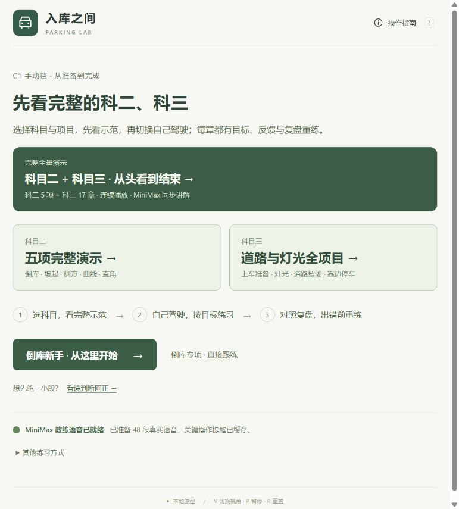
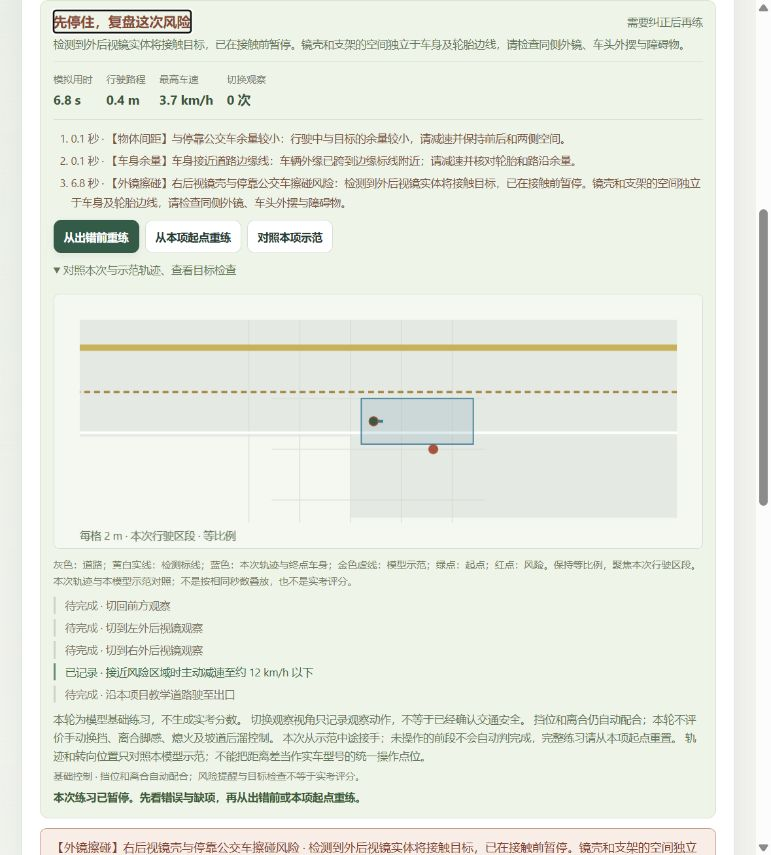
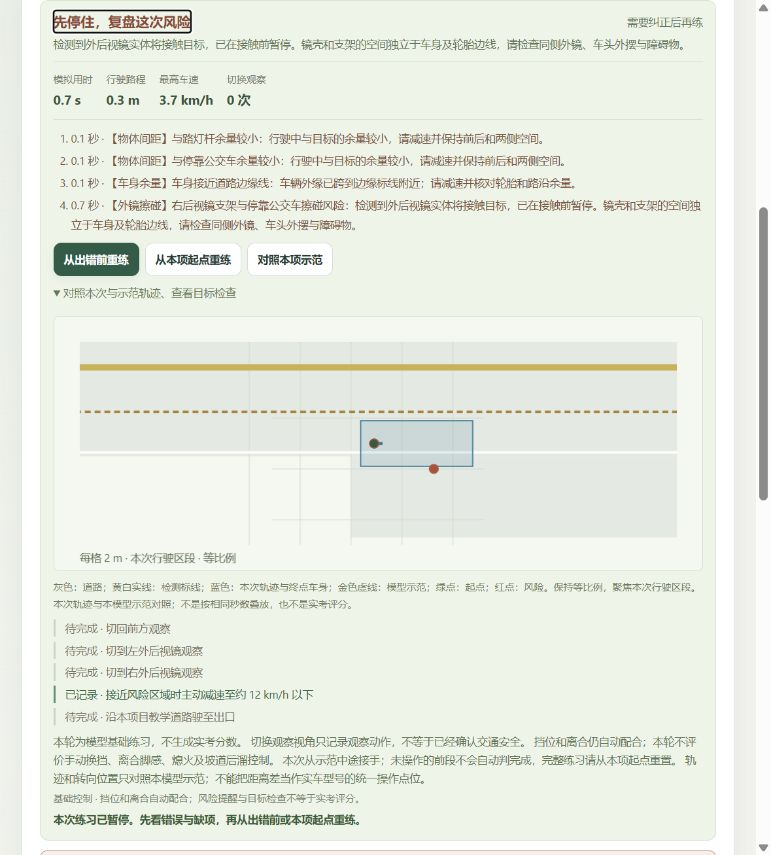
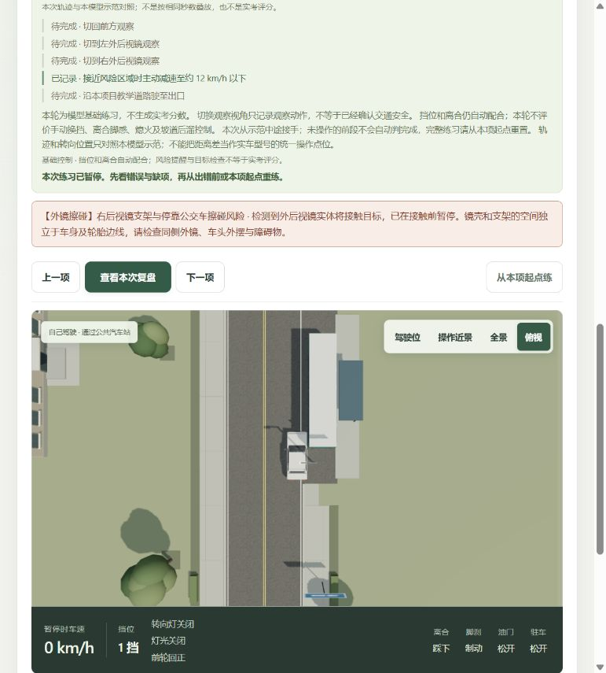
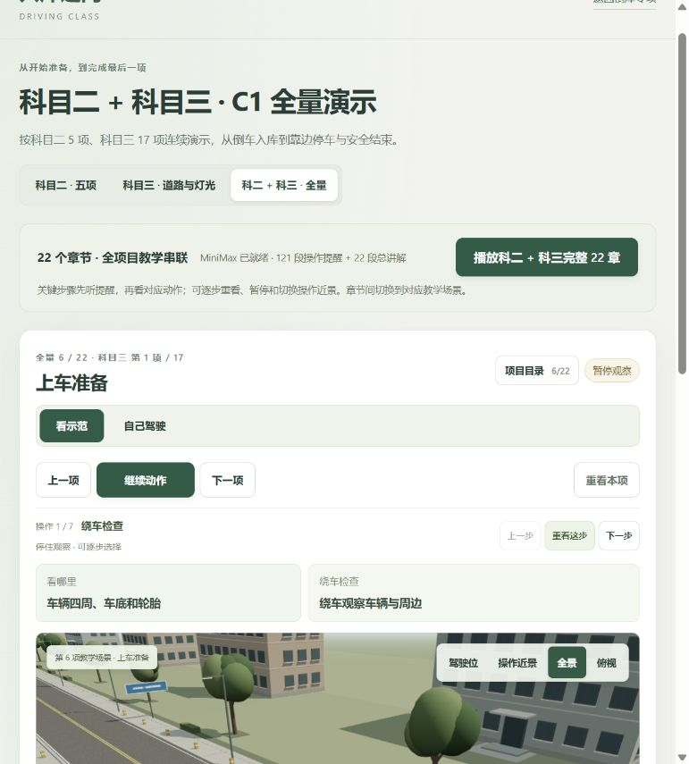
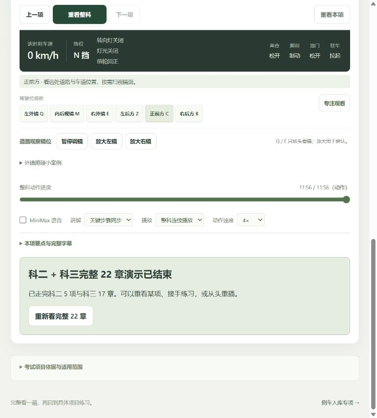
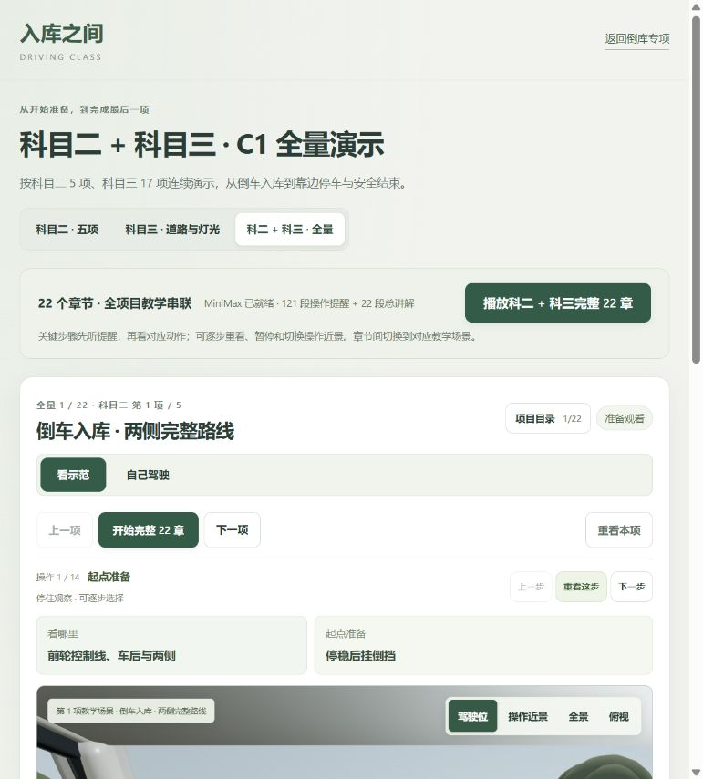

# 外镜擦碰与全量演示入口 · 2026-10-25

本轮增加镜壳、镜框和支架的独立实体擦碰检测，提供科二 5 项接科三 17 章的完整 22 章演示。原单科示范、MiniMax 讲解、驾驶、复盘重练和倒库专项保留。

## 体验入口

首页新增显著的“完整全量演示”卡片，进入 `courses.html?course=all`。练习页模式切换旁也可直接启动全量。完整播放入口从头连续播放，不因上次选择每项暂停而只播首章；原单独科二、科三入口仍可用。

镜面工具下方打开“外镜擦碰小案例”，选择镜壳或支架案例，先看右镜，继续驾驶后轻按 W。这里是预设危险净空，保留原章节目标，不代表建议这样通过。

## 判定分开

| 项目 | 行为 |
| --- | --- |
| 外镜擦碰 | 读取实际镜背、四段镜框、两段支架，两侧共 14 个凸体；检查实际高度、朝向、坡度与连续运动。`mirror-contact` 保留左右侧、部件、目标及三维接触位置。 |
| 车身越界、触库线 | 保留原车身包络及道路/库线判断，没有把整车加宽成外镜宽度。 |
| 轮胎压对向实线 | 保留轮胎接地区判断，镜子伸出车身或从漆线上方经过不等于轮胎压线。 |

包围盒只作快速排除，最终接触由实际凸体决定，保留圆角空隙。低于附件的路沿、高处物体和漆线不作为镜壳碰撞；调镜只改变镜片视野，固定镜壳不跟镜片旋转。极窄间隙叠加俯仰/偏航的漏检耗时、毫米障碍被扩大导致误报均已修复并固化测试。附件风险恢复本帧已验证安全的位置。算法与检测边界见[物理验证](physics.md)。

## 实际页面验证

1. 镜壳案例：车身侧面与公交车约有 20cm 间距，前进约 0.4m，独立报告右后视镜壳风险，归零暂停并复盘。没有车身碰撞、车身越界或轮胎压实线的阻断；物体间距和边缘漆线余量提示合理保留。实际点击错误前重练，恢复车辆并保留 E 右镜方向。
2. 支架案例：车身侧面仍有约 10cm 间距，前进约 0.3m，独立报告右后视镜支架风险，正常暂停、分类和复盘；俯视可见车身与公交的空间关系。
3. 全量入口：首页卡片、练习复盘里的全量按钮均可用。先选择“每项结束暂停”，再点顶部完整播放，会恢复连续模式。原 MiniMax 操作前讲解正常。
4. 跨科与结束：实际从科二末项自动进入科三并继续灯光；定位准备章显示全量 6/22、科三 1/17、全景和道路镜位。跨章后 URL 跟随当前章节；末项显示全量 22/22，正常进入完整演示结束状态。

核对衔接和结束时使用过 4 倍静音和时间轴定位，不宣称人工连续听完全部 121 条提醒。22 章顺序、1 倍/4 倍全部提示无重复遗漏及原采样器引用由自动回归覆盖。

## 检查与交付

- 全量 `npm test`：**367/367 通过**，日志 `tests.txt`；含安全 23 项、实际附件几何 5 项、全量播放 7 项，以及擦碰部件进入复盘/重练的集成回归。
- 全部 22 章原示范开启真实 14 附件后无阻断误报；合理余量提示不当作考试扣分。
- 最终构建通过：课程 `courses-OI6shRwh.js` / `courses-DLLpignh.css`；倒库 `main-BbHd-yYb.js` / `main-CvPaUAhB.css`；共享 `driver-view-DAj2XKP5.js`。原 697.42kB 共享包提示保留，没有提高阈值。
- `npm run speech:verify`：191 段 SHA-256 通过，27,569,676 字节、1,702.62 秒；本轮未新增或替换语音、未改凭据。
- 最后浏览器 error/warn 为空。交付页在完整演示起点、MiniMax 开启、1 倍速、连续模式，0 km/h / N 挡准备状态。

本轮精细几何只针对本车外镜总成。其他目标仍用登记的三维盒体/圆柱，不是全场景所有物体的逐三角形碰撞；不模拟镜壳折叠、破损和悬架形变，未实车标定，不输出完整实考评分。离合和挡位仍由基础模式自动配合。截图均为本轮实际页面并已查看，没有生成或编辑假截图。
