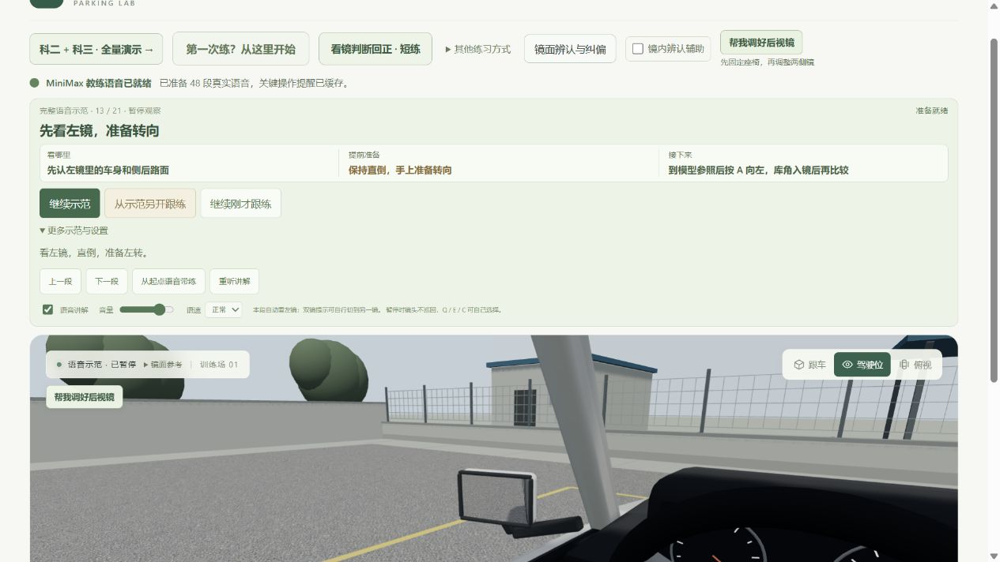
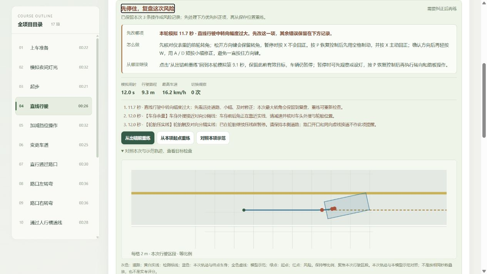
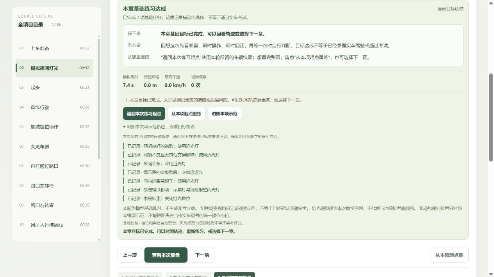
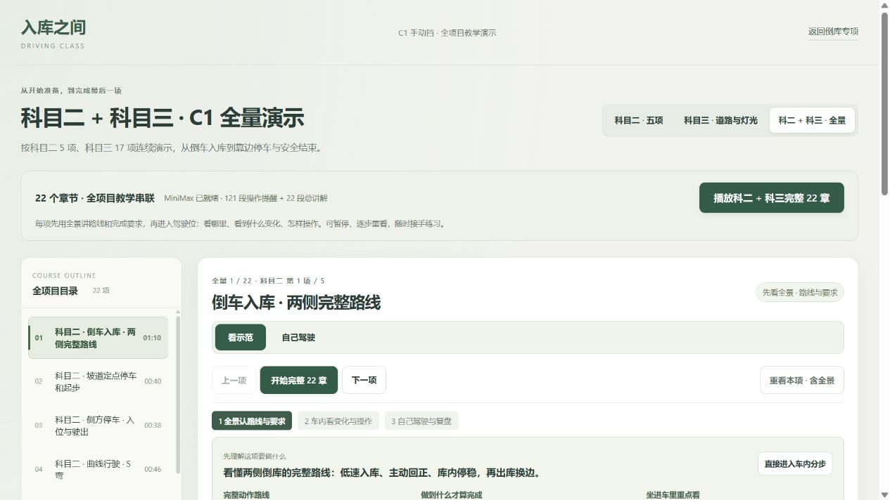

# 新手完整练习流程复查 · 2026-10-25

本轮按“听讲解 → 看镜示范 → 自己操作 → 看复盘 → 重练或返回练习”检查。实际使用本地预览页面操作，结合生产代码测试；保留科二、科三 22 章、原倒库专项、MiniMax 音频、手动观察与复盘功能。

## 1. 听讲解：修正观察方向冲突

**结果：已修正本轮发现的冲突。** 部分步骤在语音要求确认前方时立即切向外镜或操作近景。重新核对 121 步的讲解与动作阶段：起步、回轮、左转和掉头准备等先看前方；必要的后方检查放在对应操作前；车头外摆通过前风窗观察。

“当前镜头”现在对应实际观察方向；整步观察要求另保留在“本步观察与注意”，避免把整步要求误当成正在显示的镜头。原 MiniMax 文件未改动，不是逐字强制对齐，而是按讲解与动作阶段协调视角。

实际页面验证左转讲解显示前方，与字幕一致。证据：[讲解与视角](03-after-voice-camera.png)、[页面文本](03-after-voice-camera.txt)。该截图来自中间构建，后续修改未改变此行为。02 截图捕获较晚，不能作为原错误镜头的视觉证据；原冲突通过页面状态和代码确认。

## 2. 看镜示范：留够时间，手动选择优先

**结果：已修正快速播放和原倒库暂停选段问题。** 多处观察的动作按实际到下一段讲解的时间计算速度上限，避免 4× 下盲区画面一闪而过；当前减速原因在速度控件旁显示。讲解语速不随动作倍率变化。

生产代码集成测试使用真实讲解触发点，覆盖有声、无声及 0.5× / 1× / 2× / 4×。左转和掉头的必要观察在动作阶段各保留至少 1 秒。手动观察或关闭跟随后不强制限速或切镜。

原倒库完整语音示范新增分段主观察方向跟随，并修正暂停选到左倒库时“文字是左镜、实体画面仍是右镜”的问题。现在选段即切换实际眼位与镜面焦点；同一段手动改看另一侧后，继续播放不会抢回。

实际页面验证：左转选择 4× 时 DOM 显示“本步观察动作约 2.5×”；原倒库暂停选择第 13 / 21 段确实显示左镜，再手动改右镜、播放、暂停均保持手动观察。

09 是修复前问题证据，10 是修复后证据。11 截图显示最终前方画面，速度说明位于折叠区域下方，数值通过页面 DOM 核实，不能从截图本身断言已显示速度说明。

## 3. 自己操作：解释暂停与回正

**结果：原控制保留，操作前提更明确。** 实际练习发现，新手可能在暂停时反复按 X，以为方向盘失灵。状态和复盘现在说明：暂停时可观察、设灯；按 P 继续后，转向和踏板才响应。

对“大幅转向”的复盘补充：松开方向键会保留前轮转角；恢复控制后可先刹车再按 X。X 回中的是前轮，车身朝向仍需对照道路、小幅修正，不会自动把车摆正。

实际按 W、A 触发大幅转向及压线风险，确认风险前暂停；重练后按 P、刹车与 X，再短距离行驶可无新错误。未行驶完直线章节全程，不据此宣称整章已完成。后续沿原斜向继续行驶仍可能压线，这是车身朝向未修正的真实模型结果，不应因按过 X 而豁免。

## 4. 看复盘：先改哪项、怎么做、从哪里继续

**结果：已形成明确的纠错说明。** 新卡片分别解释优先错误、具体观察和按键动作、实际保存的重练位置。多项错误优先说明与重练快照对应的第一项，其他记录保留，不再由最后一项错误带偏。

未完成目标与操作错误分开说明；已完成则引导下一章或重做。没有足够几何证据时不凭空指定左右纠偏。长时间练习只保留近期快照时，按钮说明实际模拟时间，不宣称回到整章起点。

该截图来自最终功能构建；之后只补充了“X 回中前轮，不自动摆正车身”的文字，并通过 9 项复盘专项复核和重新构建。

## 5. 重练与返回：保留进度和观察位置

**结果：已走通代表性闭环。** 灯光答错后复盘明确说明回到第几题，保留之前答对的题；新增显式“关闭灯光”按钮。实际完成“选错 → 看改法 → 返回原题 → 七题全部完成”。

原倒库复盘拖动查看历史后关闭，恢复进入复盘前的位置，不截断已录轨迹；只有明确选择出错前重练才回退训练。去看另一段语音示范再返回，会恢复原练习状态、镜位、观察方向与历史，并保持暂停。

实际录制轨迹共 49 帧，复盘拖到第 7 帧再关闭后恢复第 49 帧；看示范并切段后返回仍保留 49 帧。还修正返回时底部按钮文案与暂停状态不一致的问题。新练习会清理旧返回点，避免恢复到另一轮。

## 自动检查与交付

- 全量测试：492 / 492 通过，见 [test-final.log](test-final.log)。
- 最后仅补充回正说明，复盘专项：9 / 9 通过，见 [final-copy-test.log](final-copy-test.log)。
- 最终生产构建成功，82 模块。课程 `courses-BWgI3kp_.js`，原倒库 `main-CSgGP5Op.js`，见 [build.log](build.log)。
- 原 191 段 MiniMax 音频校验通过，共 27,569,676 字节、1,702.62 秒，见 [speech.log](speech.log)。本轮未请求生成、替换音频或读取密钥。
- 原倒库与课程浏览器检查未发现 console warning / error；最终入口已加载最新构建，MiniMax 开启、自动观察开启、1×、全量 22 章开头停住。
- 入口：[完整 22 章演示](http://127.0.0.1:4312/courses.html?course=all)，点击“播放科二 + 科三完整 22 章”即可开始；可随时切“自己驾驶”。

## 尚存边界

这次实际操作覆盖全量入口、左转观察、直线错误与重练、灯光完整七题、原倒库回看和示范返回；没有在浏览器手动驾驶完全部 22 章，也没有重新逐段听完 191 段音频。全章语义和时序覆盖依赖自动检查，不能替代真实学员测试。

这是教学原型：固定脚本与步骤视角不能证明学员已经看见危险；镜面与车辆仍为工程参考，尚未用指定教练车实测标定。本轮未修改考试标准或将练习目标包装成考试评分。

构建仍有约 710 kB 的共享 3D chunk 警告，首次加载和弱设备性能仍有优化空间，未通过提高警告阈值隐藏。完整自动观察以分步计划为基础，后续仍可通过更多实际学员反馈优化停留时间与讲解节奏。
