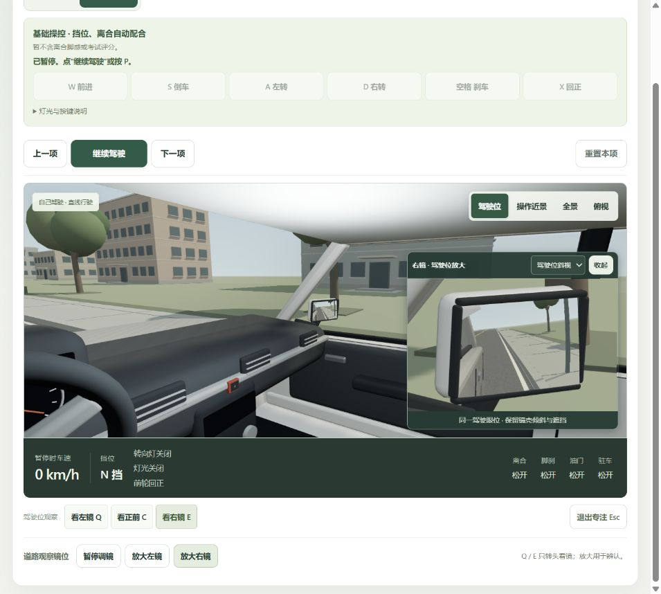
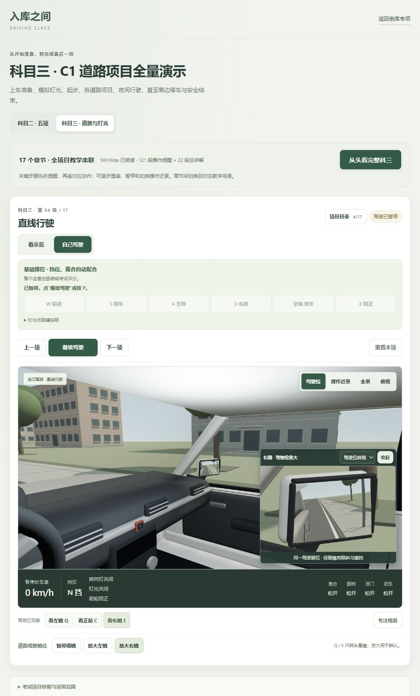
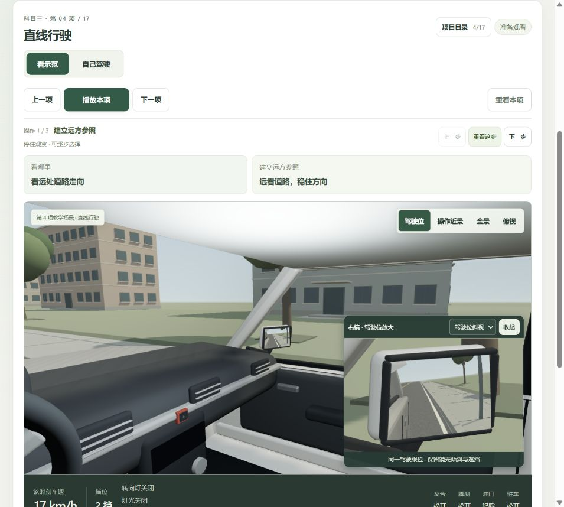
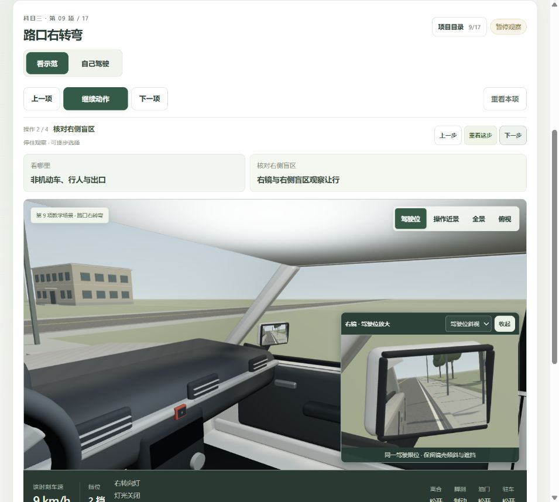
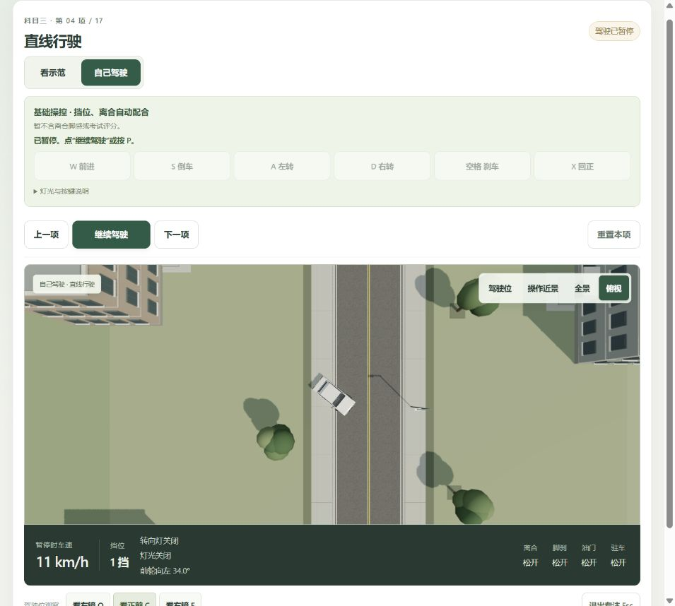

# 全体验只读审查 · 2026-10-24

本轮仅检查、复现和保存证据，没有修改产品源码、课程、语音或镜位设置。检查结束恢复到科三直线行驶、自己驾驶、0 km/h / N 挡、暂停、右镜驾驶位斜视放大。

## 判断

现有版本适合认识流程、体验方向和空间关系。目录基本覆盖 C1 科二五项及科三道路项目，真正欠缺的是：道路环境对操作的响应、可执行的安全观察、按项目练习与反馈，以及 C1 完整操作链。295 项已有检查通过不能代替实车标定或教学有效性验收。

## 按步骤观察

### 1. 当前后视镜与自己驾驶

镜框斜视、车身参照与后方道路已比此前清楚；Q/E 换侧、驾驶位放大／展开的区分也明确。仍有问题：放大可在 C 看前方时长期同时显示，缺少独立观察训练；没有车内后视镜或肩后观察，不能把点一次 Q/E 当作完成盲区确认。

### 2. 页面整体与练习入口

手动模式清楚写明自动配合挡位、离合，没有隐瞒其基础模式属性。但本章完成目标、过程提示、达标条件和复盘缺失；项目要点也随手动模式隐藏。顶部整科说明、操控面板和导航占据较多高度，实际驾驶画面靠后；镜位、显示方式、章节、模式等选择尚未围绕一个当前任务收敛。

### 3. 从手动切回示范

直线行驶提示“看远处道路走向”，但保留的主视角仍朝右镜。保留观察方向本身是已有需求，应增加“看提示位置”入口或显眼的观察引导，而不是无说明地强制改视角。暂停时显示“该时刻车速”是演示快照，不应误报为实际车辆仍在运动。

### 4. 右转弯的盲区要求

本步明确要求观察非机动车、行人与出口，并提示“右镜与右侧盲区观察让行”。实际只有前方、左镜、右镜三种固定朝向，无肩后观察或自由转头；场景也缺少与该决策对应的右侧动态骑行者。应补观察动作及真正可能出现的冲突，再检测观察时机与让行决策。

### 5. 实际偏离道路复现

从直线行驶 0 km/h、N 挡初始状态，A 约 650 ms 后松开保持转角，再 W 约 6 s。车辆已越出车道、骑上路沿；界面未提示偏离或风险，随后由检查者按 P 暂停。俯视截图显示车身跨上人行道，HUD 仍为暂停时 11 km/h、前轮左转 34°。

源码只约束路线外围矩形，不检测道路边缘、库线或交通对象。另有独立函数复现：公交前方自选 x=-5.15、z=10、0/N，W 3.5 s 后 z=19.427、5.312 m/s，已进入公交几何范围而无停止原因。后者为代码复现，未冒充浏览器操作证据。

## 优先处理

1. **P1：道路和交通风险反馈。** 先补道路边缘、库线、车与人碰撞／接近判断及清楚的风险原因，不必一开始就做整套实考扣分。
2. **P1：把安全观察变成可做的动作。** 加车内后视镜、左右后方转头检查；增加追近车辆、并行盲区车、右侧骑行者和公交遮挡行人等情境。辅助观察与独立观察训练分开。
3. **P2：风险事件与练习目标关联。** 手动模式仍把 t=startTime+elapsed 给场景，行人和车辆按示范时间运动。人行横道起点停车 15 s 后行人已过完；需要按到达区域与当次任务生成情境，保留合理的实时交通变化，避免等待即可错过所有训练问题。
4. **P2：补每章最小训练闭环。** 明确本次练什么、何时完成、哪里错、为什么错、如何从错误前重练。原倒库专项已有镜面对比和复盘，整科自己驾驶尚未连接这些能力。
5. **P2：逐项区分能看与能练。** 手动模式没有离合、手动挂挡、驻车／熄火、解带下车；灯光控件也不足以完成全部模拟灯光任务。坡道只有高度与俯仰变化，没有后溜和熄火模型。这些已声明的能力边界不能当成隐藏 bug，但也不能算完成了相应 C1 跟练。
6. **P2：简化当前任务与观察提示。** 常态优先展示“本次目标／当前观察／下一步动作”，把设置收纳；小字与小控件需进一步检查键盘、触屏及对比度。
7. **P2/P3：明确分段演示与实车标定。** 当前通用模型的眼位、镜面曲率、转向参照未对应指定教练车型，近物体还有凸面镜渲染拟合误差，应以趋势、夹角和足够余量教学，不能按像素换算实车厘米。

## 项目依据与验证范围

[公安部令第 172 号官方正文](https://jtgl.beijing.gov.cn/jgj/jgxx/flfg/gabgz/543498902/index.html)第 33、34 条对应科二、科三基本项目，未发现当前基础目录缺项。第 34 条规定小型汽车道路实考里程不少于 3 km；当前章节是独立场景，独立采样动作路径合计约 1365.8 m、489 s，不是完整实考路线。页面底部折叠区已有边界说明，但主要入口应直接标明“全项目分段教学”，并区分通用原则、本模型参照及当地车型／考线适配。

本轮验证了当前桌面窗口的手动／示范切换、右转观察提示和道路偏离行为，并核对相关源码。没有做实车对照、方向盘踏板外设、手机全流程或完整辅助技术验证，不声称全面无障碍合规。没有新增或重生成音频，也没有操作私人配置文件。
