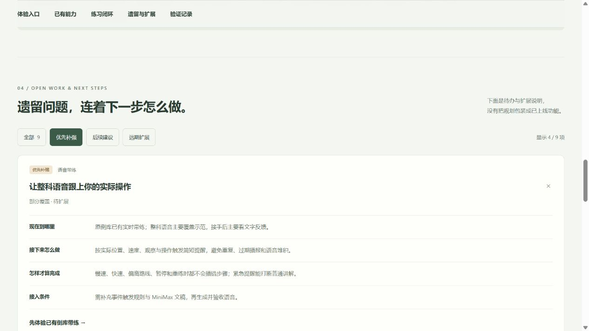

# 项目进展网页交付 · 2026-10-25

## 已完成

- 新增 [项目进展网页](http://127.0.0.1:4312/progress.html)，由 Vite 第三个页面入口构建。页面不加载 Three 或练车场景。
- 首页和科二科三页顶部接入“项目进展”，新标签打开，不离开当前练习。
- 整合完整 22 章、单独科二 / 科三，以及每章 44 个示范 / 驾驶链接。
- 新增五个倒库直达链接：`?entry=beginner`、`voice`、`practice`、`judgment`、`correction`。使用现有控制器；未知参数不触发训练。
- 汇总六项已实现能力、六个建设阶段和五步练习闭环；逐项说明当前边界。
- 九项遗留与扩展分为优先补强、后续建设和远期扩展。每项有现状、下一步、完成条件、依赖和当前相关入口；未增加尚不存在的功能按钮。
- 四份原始验收文字通过 raw 导入打包，可在网页内展开阅读；两张既有证据图随构建发布，不依赖预览服务器访问源码 notes 路径。

## 核对结果

- `npm test`：492 / 492 通过，见 [test.log](test.log)。
- `npm run build`：成功，93 个模块；保留共享 3D chunk 超过 650 kB 的现有提示。
- `node scripts/verify-project-progress.mjs --base=http://127.0.0.1:4312`：成功，见 [entry-check.log](entry-check.log)。核对实际课程的 22 章 ID、标题与顺序、44 个 URL 参数、五个专项白名单及非法参数、九项扩展信息、两个新标签入口、四份记录与两张图片、构建页及六个静态资源；九个本地 HTTP 响应与构建文件字节一致。
- 本轮未生成或替换语音；191 段 MiniMax 数量沿用最近已校验基线。页面将 492 测试与人工覆盖明确标注为训练验收基线。

## 实际浏览器验收

1. 页面能展示 22 章、191 段音频、五专项的首屏概览。
2. 展开完整目录，44 个链接实际生成。点击“直线行驶 · 自己驾驶”进入正确科目、章节和手动模式。
3. 五专项分别打开：新手定位、倒库语音示范、语音跟练、回正判断、镜面纠偏；欢迎页隐藏、对应训练面板可见，浏览器无 warning / error。
4. 遗留列表可筛选：优先补强显示 4 / 9，展开语音项能读到现状、下一步、验收与依赖。
5. 直接访问 `#saved-progress` 会展开对应事项并显示全部九项，支持保存该事项链接。
6. 四份记录正文长度分别为 2851、2885、2019、4368 字符；两张证据图完成加载。
7. 点击原倒库页的“项目进展”实际新开进展页，原训练页保留。
8. 桌面视口没有横向溢出，最终页面控制台没有 warning / error。

窄屏布局已实现 CSS 响应式适配；本轮未做真机或窄视口运行验收，不把桌面检查当成移动端通过。

## 页面证据

## 交付边界

本次是进展信息、导航与现有专项直达接入。整科实时语音、整科风险判断题、因果复盘、实车标定、完整 C1 仿真、练习持久化、设备优化、当地考线与理论题库均按各自当前状态列为待扩展；未在本轮宣称已经实现。

仅更新本地预览与静态构建，未进行远程发布。没有清理磁盘、迁移其他项目、接触 ReflectFlow 数据或读取任何密钥。
