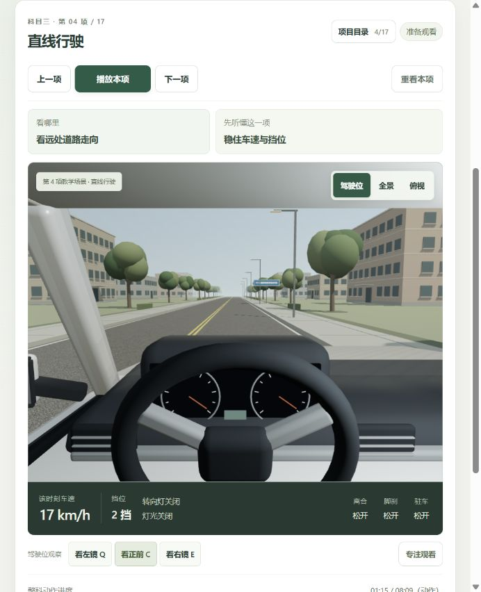
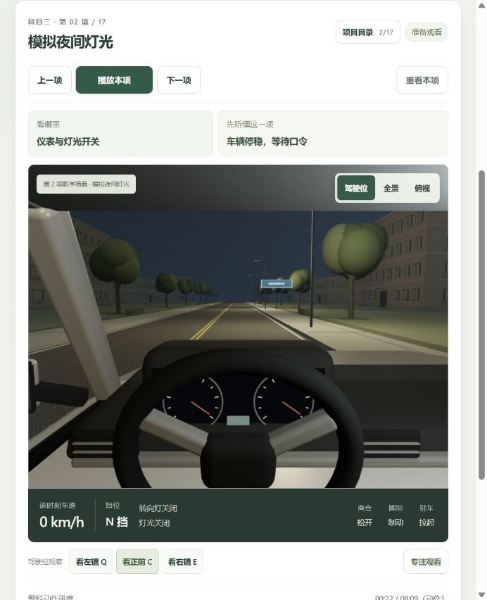

# 当前版本够用程度复核

2026-10-24，回应“现在已经够用并完善了吗？还有哪些问题？”。本轮只检查和记录，没有修改产品源码。使用当前生产包 `courses-BXIk86Im.js`；没有把上一轮截图用作本轮现场证据。

结论：可以用于认识科二科三项目、预习步骤、切换视角观察；还不能认定为完善、可靠的全科训练与考试模拟。发现动作数据一致性问题，应先修正，避免错误教学印象。

## 页面检查步骤

1. **驾驶位准备页：基础可用，训练深度不足。** 科三第4项ready，MiniMax22段就绪；车辆等待播放。页面的播放、观察提示、驾驶位与车辆状态可见。当前窗口中方向盘占据较多画面，常态镜片细节很小；看镜需要主动切换视角。没有凭截图断言眼位或镜面完成实车标定。

2. **模拟灯光章节：章节可到达，操作演示有缺口。** 从目录进入第2项，仍为ready，0km/h、N挡、脚刹和驻车状态可见。提示“仪表与灯光开关”，但当前驾驶舱缺少清楚的灯光拨杆/开关操作示范，页面只有播放器与观察控制。完整功能边界另由代码核实。

截图能够证明可见界面，不能单独证明物理运动、教学正确性、实车镜域、操作熟练度或完整无障碍合规。本轮未重做全部章节连播、移动设备或真人学员验证。

## 需要先修的可复现问题

### 轨迹运动、车速和踏板不同步

`sampleChapterPose` 对位置、speed分别线性插值，布尔状态继承前一关键帧。以1×播放、前后0.001秒位置差分独立复算：

|章节及章内时间|位置差分速度|HUD数据速度|其它状态|
|---|---:|---:|---|
|人行横道14.1秒|9.72km/h|0.18km/h，界面取整为0|brake=true、clutch=true|
|坡起2.05秒|6.30km/h|0.027km/h，界面取整为0|clutch=true|

人行横道14–20秒已重新向前运动，仍沿用离合踩下与脚刹制动提示。这属于软件数据一致性错误，不能归结为车型差异。

证据：`src/exam-courses.js:157`、`:262`、`:269`；`src/full-courses.js:208`、`:213`。

### 变道/超车时方向盘与前轮未转动

`lanePoses`、`overtakePoses` 从轨迹生成heading，未生成steer，继承默认0。变道章6.5秒，朝向变化约4.493°/秒而前轮转角为0。渲染器直接使用steer设置前轮和方向盘，因此会出现转向动作与车辆运动矛盾。

证据：`src/exam-courses.js:11`、`:141`、`:164`；`src/course-scene.js:442`。

上一轮227项测试通过证明当时测试覆盖的行为通过；未覆盖以上运动/操纵一致性，不代表教学已准确或系统已完善。

## 教学与功能缺口

1. **操作级示范不齐。** 上车准备7秒后绕车人物隐藏，开关门、调座椅镜面、系带主要换文字提示；灯光按固定关键帧切状态，缺逐条语音口令、拨杆动作、学员响应。需把概括性章节做成可观察的动作链。
2. **语音未与关键动作同步。** 当前每章完整讲解先播完，再推进动作；动作阶段cues只改文字，未在打灯、转向和回正前逐条播报。原倒库带练的提示能力未完整推广到全课程。
3. **全科跟练闭环未完成。** 全课程页主要沿预设姿态播放，按键只控制播放/观察；倒库以外不能逐项接手驾驶、获得错误判断、与示范对照或从错前重练。旧倒库专项中的已有闭环仍存在。
4. **看镜及风险判断能力不足。** 全课程仅左右镜和正前观察，缺过肩盲区观察及观察完成检测。路口信号和交通人物多数按固定教案编排，缺来车变化、等待/让行选择及对应错误分支。
5. **C1动力与实考适配仍缺。** 挡位、离合、制动主要是预设姿态元数据；没有完整的油门/发动机驱动、熄火和后溜反馈。场景为独立教学位置串联，未形成当地实测连续考线；眼位、镜面曲率、踏板脚感还需真实车型数据与教练验证。

前四项及动力一致性的主体是可实现的软件和教案工作。车型测量、脚感、当地考线才需要额外实车数据；不应把所有缺口推给实车标定。

## 建议推进顺序

先统一轨迹、速度、方向与踏板数据并补充回归检查；再完善可见的操作链、逐动作语音和盲区观察；随后把接手、判断、复盘、重练扩展到其余项目；最后结合真实教练车、路线和学员完成验证。外观细节可在这些能力稳定后继续提升。
