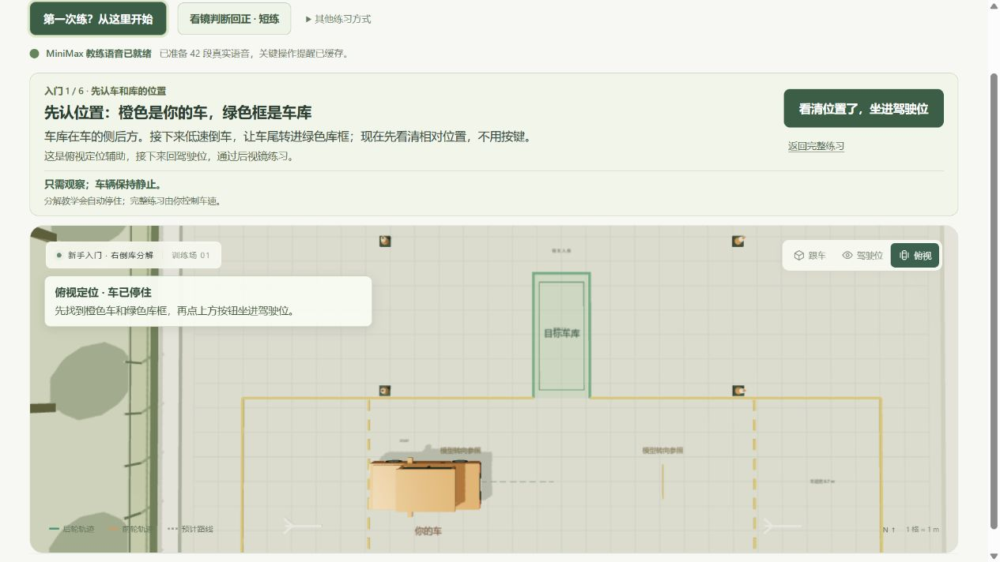

# 场景真实感与练车迁移评审

日期：2026-10-24。本轮仅评审，**尚未实施场景重建**。截图证据只使用本目录当前 `01`、`02`、`03`，代码用于解释画面或操作机制，不引用旧图证明当前效果。

## 当前三步状态

### 01 · 先认车和库的位置

**健康度：入门定位可用，真实场地感较弱。** 车、目标库和下一步按钮清楚，先观察再进入驾驶位的顺序合理。但纯色地面、均匀网格、绿色填充和尺寸字占据场景，整体更像工程示意图。它能交代相对位置，尚不能证明用户能在真实路面上辨认参照。

### 02 · 驾驶位看正前

**健康度：明显不足，应优先修正。** 方向盘只剩上半圆可见，仪表台是大块平板，细直立柱和大面积橙色平台难以被识别为轿车门窗、A 柱和机盖。两侧后视镜是屏幕卡片，缺少与车门、窗框的安装关系。用户难以建立“我坐在这辆车里”的空间判断。

### 03 · 认识右后视镜

**健康度：辨认教学已有改善，观察动作的迁移仍不足。** 车身、地面标记和“库线还未进入镜子”说明能消除寻找不存在参照的困惑；放大也明确注明视野不变。但镜面仍悬浮在车体之外，转头后主要看到简化棚架式窗框和场外树木。学员能读懂卡片，不等于已经掌握实车中找镜、换镜、判断边线的动作。

## 四项最高优先级问题

### P0 · 统一车内外几何，先修可信的驾驶位

这既是外观问题，也是观察参照问题。`src/main.js` 中车舱由盒体组成，驾驶位隐藏外部 cabin 后另显示 cockpit；仪表块的 z=1.73 与方向盘中心 z=1.72 接近，几何相交与截图中方向盘被吞没的现象一致。门板、窗框、A 柱、仪表台没有形成可信的同一辆车。

**下一轮验收：** 同一辆车的内外窗框位置一致；正前、向左、向右观察时，一眼能分辨方向盘、仪表台、门板与 A 柱。方向盘不得穿入仪表台，座椅范围内不出现近裁剪或窗框穿帮。先保证这些与观察有关的形状、尺寸和遮挡，再增加缝线、按钮等细节。

### P1 · 常态镜回到车辆实体，教学放大作为明确辅助

当前镜面已有有限凸面镜、眼位变化与遮挡逻辑，问题主要是表现层：常态镜框固定在屏幕两侧，与车门上的真实安装位置脱离。正确的反射计算仍需可信的镜壳、窗框和视线关系来承载。

**下一轮验收：** 常态镜固定在车辆实体位置，转头、调整座椅后保持一致的空间关系；仅教学放大使用浮层，并保留“视野不变”说明。放大前后使用同一镜面图像与光学参数，不扩大 FOV 来强行显示库线。改变眼位会改变镜中构图，不暗中重调镜片；保留一键推荐与手动微调。外观照片只辅助建模，**不能作为眼位或镜面视域标定**。

### P1 · 优先真实地面与涂线，而非堆环境装饰

三张图中的大面积纯色材质、多面体树和统一色调强化了“代码示意场景”的感觉。更影响练习的是路面、线边与车身的材质和明暗关系。当前标线还是立体盒：路面上表面约 y=0.025 m，部分线盒中心 y=0.065 m、厚 0.025 m，上表面高出路面约 5.25 cm；它应表现为涂层，而非凸起物。

**下一轮验收：** 默认晴天、干地，先做真实尺度的水泥或沥青颗粒、适量接缝与磨损、车轮接地阴影及可辨认的漆线边缘。标线贴合路面，不抬高几厘米，也不产生闪烁。普通练习默认去掉网格、绿色填色和尺寸字；它们作为可选教学辅助保留。目标库使用场地实际涂线表达，墙、标牌和路障只承担定位或边界作用，不先增加大量树木、车辆和天气特效。

### P1 · 把真实操作与撤去辅助后的判断接上

`src/vehicle.js` 当前以 W / S 直接决定前进或倒退，A / D 向最大转角变化，X 按固定速率归零；`src/beginner.js` 的 D / X 步骤还代管低速倒车。这适合讲清方向与路线，但未覆盖 C1 的方向盘、挡位和踏板配合。认镜及交替看镜步骤目前点确认即可通过；已有回正短练能检验局部时机，但不能据此认定已经获得独立倒库能力。

**下一轮验收：** 保留现有简化入门，同时把辅助低速、自动暂停和快捷回正明确标出；逐步加入持续微调方向、独立低速控制的进阶操作。标签逐步撤去后，让用户独立辨认车身、库线是否入镜、两侧余量，再在小幅变化的起点完成同类短练。反馈解释观察依据与操作结果，不只奖励按完 D / S / X。保留现有分步示范、MiniMax 语音、短练与复盘，不以新场景替换已有训练功能。

## 外观参考与验证边界

- 本轮外观对照参考[供应商页面中的倒库场地照片](https://www.bjlg.com/news/hydt/1426.html)：灰色水泥路面、接缝裂纹、白标线、围墙标牌与路障提供材质和环境尺度线索。该页老照片只作外观参考，**不是现行考试规范或车辆眼位标定依据**。
- 截图可见小字和较多依赖颜色区分的内容，存在可读性风险；尚未通过对比度测量、键盘完整导航、读屏或色觉测试，不能声称无障碍已全面验证。
- 本报告提出下一轮验收目标，不表示上述重建或进阶操控已经实现；没有修改源码、README、项目元数据或 catalog。
