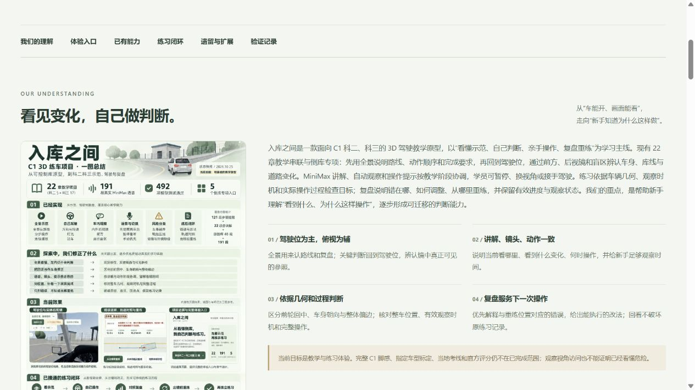
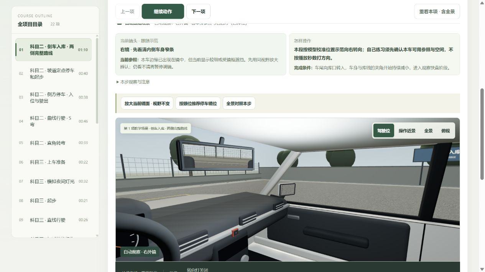
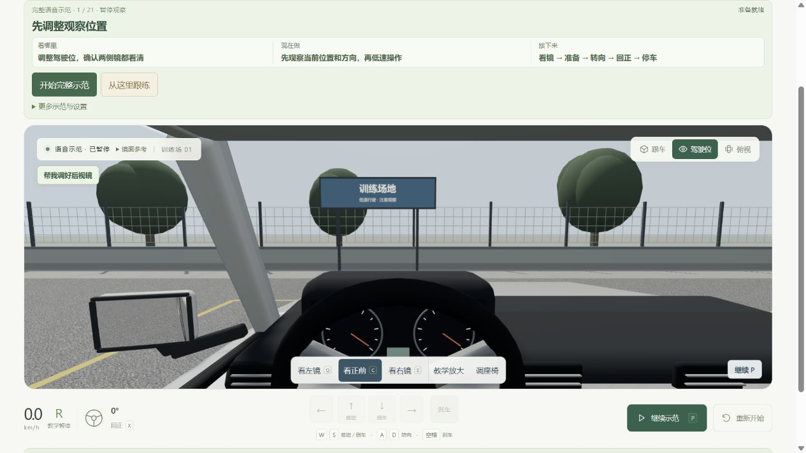

# 012 · 入库之间 · 公开发布记录

2026-10-25 已部署到 GitHub Pages。发布在独立工作区基于最新远端 main 完成，只加入项目 012 与对应目录索引，没有将原工作区其他未提交项目带入。

## 公开入口

- [练车首页](https://yydshly.github.io/1020_codex_project/projects/012-parking-lab/)
- [我们的理解、引导图与完整进展](https://yydshly.github.io/1020_codex_project/projects/012-parking-lab/progress.html#understanding)
- [科二科三完整 22 章演示](https://yydshly.github.io/1020_codex_project/projects/012-parking-lab/courses.html?course=all)
- [生成的项目引导图原件](https://yydshly.github.io/1020_codex_project/projects/012-parking-lab/images/project-summary-20261025.png)

## 提交与部署

- 功能及网站提交：`8435379b662389967eb43156780bfc1de5c9febe`。
- [仓库检查成功](https://github.com/yydshly/1020_codex_project/actions/runs/40164652964)。
- [Pages 构建和部署成功](https://github.com/yydshly/1020_codex_project/actions/runs/40164686908)。
- 根目录汇总完整摘要，封面改用用户认可的生成图；首页增加理解入口，进展页补充完整理解与四项原则，保留全量、单章和五个倒库专项入口。
- 在独立目录重新构建当前 web，而非发布原工作区积累的历史哈希文件。Vite 使用相对 base；通用 Pages 流程发布已提交静态产物。

## 我们整理的理解

以驾驶位观察、自己判断和纠错重练为主线。全景用于认路线，关键判断回到前方、镜面与盲区中的可见参照；语音、镜头与动作按阶段一致；前轮回中、车身朝向和整体偏边分开理解；目标根据整车几何、有效观察时机和完整过程判断。复盘优先解释与回退位置对应的错误，说明怎么改，回看和示范返回保留原练习。

22 章教学、191 段真实 MiniMax、五个倒库专项、风险分类和复盘闭环已接通。整科实时带练、看镜后的风险判断、镜面与操作因果复盘、实车标定、完整 C1 操作、记录保存及设备优化仍按各自状态列为后续任务。

## 验证结果

- 项目模型和回归测试 492 / 492，通过；根目录 12 个项目检查、8 项 Python 测试及站点构建通过。
- 活动 MiniMax 191 段、27,569,676 字节、1,702.62 秒，本地校验通过；未重新生成音频。
- 22 章、44 个示范 / 驾驶链接、五个专项、九项扩展、说明文字和证据资源检查通过。
- 本地嵌套路径及线上浏览器均加载正常：理解页和原引导图可读，课程显示 MiniMax 就绪并实际触发讲解，原倒库显示 48 段语音就绪。检查时未发现浏览器 warning / error。
- 线上核对 211 个唯一目标：三张应用页面、13 个构建资源、引导图、manifest、191 段活动音频、站点封面及根目录。应用资源与本地发布副本按原始字节和 SHA-256 核对；音频另符合 manifest 的哈希和字节数。根目录按 CRLF/LF 规范化比较，并检查完整摘要与引导图链接。
- 批量核验第二轮记录了四次瞬时网络请求失败；这些资源首轮已通过，之后对这四项串行复核再次全部通过。保留原始失败记录及补充核验，未把请求失败隐藏为成功。详见 [批量记录](release-20261025-resources.json) 和 [四项补充复核](release-20261025-retry.json)。
- 引导图原件与线上图及站点封面一致，SHA-256：`88F6B3CA6B32DFF2F21D475E6F0A6B88022162E3910A6ACEBE40B65A605E6334`。

## 线上页面证据

## 当前边界

工程教学原型，非当地考线、完整理论题库或官方评分；镜面与车辆未按指定教练车实测标定，挡位离合自动配合。观察访问不代表看懂危险；练习记录主要在页面内存，刷新会丢失。自动测试和代表性人工流程不等于全部章节及实车验收。约 709 kB 的共享 3D 包体积提示仍保留，移动端和弱设备尚待专项验证。

本次未做磁盘清理、数据迁移或 ReflectFlow 操作，没有发布 .env、私有配置、依赖目录或密钥。生成引导图保持原件，图内界面为基于既有截图的视觉摘要，实际效果以网页为准。

