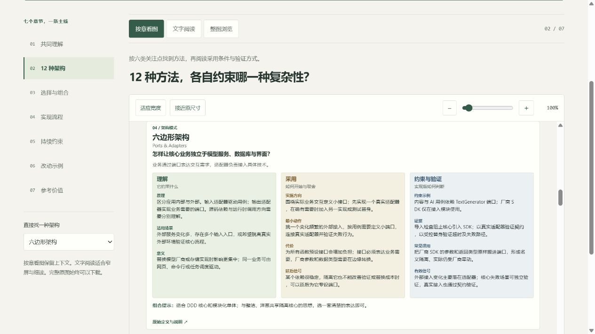
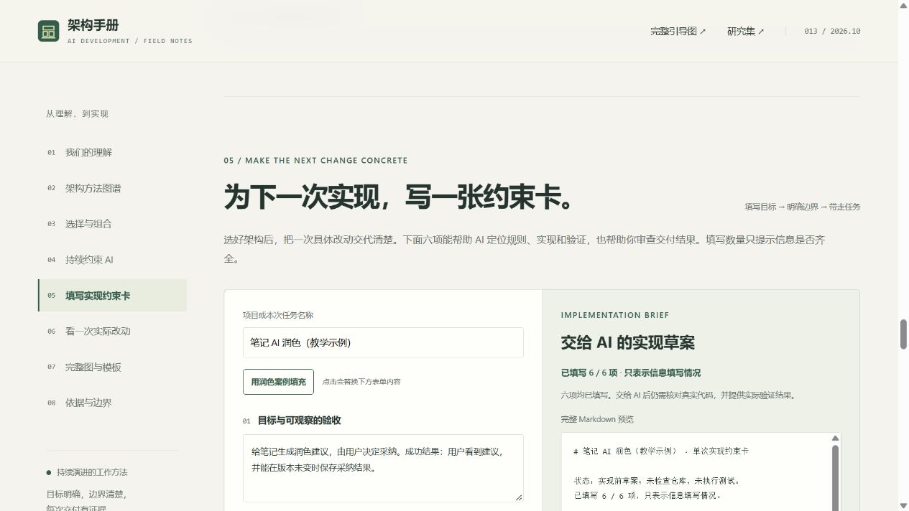

# 013 · AI 开发架构手册 · 代码是基石，需求是目标

> 代码是基石，需求是目标。我们的探索是在 AI 持续实现需求的过程中，把控概念、规则、模块边界和依赖，使代码能够长期承载产品。

需求决定要达到什么，代码承载业务规则和持续变化。架构帮助我们选择组织代码的方式；项目指令、实际依赖、自动检查与交付证据，把这些选择落实到每一次 AI 实现。

本手册按六类问题整理十二种方法：DDD；分层与垂直切片；六边形、整洁与洋葱；模块化单体与微服务；插件式与事件驱动；CQRS 与事件溯源。先识别项目压力，再选择能解释采用理由的最小组合。

读完希望获得四种能力：**会选择、会组合、能约束、可验证**。快速图建立全貌，详细手册说明场景、原理、价值、代价和落地动作，任务卡与模板帮助执行。定义有原始来源；组合和案例属于本次讨论的原创归纳，需要在真实项目检验。

## 网页入口

- [在线手册](https://yydshly.github.io/1020_codex_project/projects/013-ai-architecture-compass/) · [在线一图速览](https://yydshly.github.io/1020_codex_project/projects/013-ai-architecture-compass/overview.html) · [在线详细引导图](https://yydshly.github.io/1020_codex_project/projects/013-ai-architecture-compass/guide.html)。
- [一图速览](web/overview.html)：独立生成的快速引导图、原图查看与下载、精炼文字解读，以及六类方法的阅读入口。
- [研究手册](web/index.html)：共同理解、12 种方法与对比、选择与组合、持续约束、任务约束卡、教学改动、资料与模板。
- [完整引导图查看器](web/guide.html)：按章看图、文字阅读、整图浏览，七章导航与架构直达；缩放保持阅读位置，完整原图可下载。
- [快速引导图 PNG](assets/architecture-overview.png) · [完整 SVG 引导图](assets/architecture-guide.svg)。
- [来源与证据范围](notes/sources.md)。
- [实际验证记录](notes/verification.md)。


快速图适合先理解整体关系；完整 SVG 保留所有章节细节，可在查看器中逐章阅读。

## 我们的共同理解

需求定义目标，领域模型沉淀理解，架构约束组织代码，运行证据检验行为。今天的代码也是下一轮 AI 的上下文；每实现一个需求，都在检验代码底座。

关注点包括核心概念是否一致、规则是否有归属、跨模块协作是否明确、依赖是否受控、真实需求变化时结构能否调整。

## 收录方法

| 层面 | 方法 |
| --- | --- |
| 业务建模 | DDD |
| 代码组织 | 分层、垂直切片 |
| 依赖控制 | 六边形、整洁、洋葱 |
| 部署与边界 | 模块化单体、微服务 |
| 协作与扩展 | 插件式、事件驱动 |
| 数据与状态 | CQRS、事件溯源 |

各条目说明关注问题、原理、场景、落地方向、价值、代价、一条可落实约束、验证证据及组合关系。不同方法并非互斥选项。

每种方法还说明“不适用或延后信号、最小落地动作、常见误用、有效性信号”。采用前判断理由，采用后检查收益。

完整图以“目标 → 模型与边界 → 代码 → 证据 → 调整”为主线。架构按六类问题分组，每张卡片分为“理解、采用、约束与验证”三列。查看器提供七章定位和十二种方法直达；手机默认文字阅读，文字与图共享架构资料。



## 网页交互

- 从独立快速图理解六类问题、十二种方法与实现闭环，按需跳转到详细条目。
- 以关注点筛选并搜索 12 种方法，展开详细解释。
- 选择最多 3 种架构，按相同维度并排比较；提供核心隔离、事件与状态、互补组合三组预设。
- 选择笔记、数字人、工具工作台、简单工具预设，或自定义 9 类项目压力。
- 依据公开规则生成候选组合及约束，复制或下载 Markdown。
- 填写目标、规则、责任边界、失败场景、计划验证和重审条件，生成可预览、复制、下载的 AI 实现任务卡。
- 切换 AI 润色教学示例，观察规则归属、越界与失败验收。
- 下载架构说明、ADR、AI 工作指令、任务卡和交付审查记录共五份模板。

选择器不调用模型、不扫描代码；重要数据不会自动触发微服务或事件溯源，单一外部接入或后台任务也不会直接触发模块化单体。模块化候选需要单独标明多个独立业务责任。独立部署、CQRS 和事件溯源均为条件性评估，不能用勾选代替真实架构决策。

任务卡区分实现前计划和执行后证据：填写六项不等于验收通过。输入仅保留在当前页面，刷新后不保留，离开前可复制或下载。



## 构建和运行

Python 3.10+，无第三方依赖。HTML/CSS/JS 均为静态文件，无远程字体和外部脚本。

```powershell
python projects/013-ai-architecture-compass/src/build.py
python scripts/projects.py sync
python scripts/projects.py check
node --test projects/013-ai-architecture-compass/tests/decision-model.test.cjs
python -m http.server 8013 --bind 127.0.0.1 --directory projects/013-ai-architecture-compass/web
```

直接预览为 http://127.0.0.1:8013/ 。返回研究集链接需要仓库级站点构建；该命令只服务本子项目。

源码分工：

- `src/catalog.json`：方法、流程、组合和约束的统一内容源。
- `src/page.html`：网页结构模板。
- `src/partials/`：架构对比、实践说明与任务约束卡的页面片段。
- `src/build.py`：生成静态正文、图查看器及来源说明。
- `src/build_guide.py`：使用同一内容源生成完整 SVG 和章节位置。
- `src/build_viewer.py`、`src/guide.html`：生成引导图查看器与同源文字阅读内容。
- `web/guide.js`、`web/guide.css`：章节/模式切换、架构定位与保持中心位置的缩放，以及独立阅读布局。
- `web/overview.html`、`web/overview.css`：一图速览与可访问文字解读，无需 JavaScript；`architecture-overview.png` 为独立生成的速览图。
- `web/decision-model.js`：不依赖页面的推荐规则、任务信息状态和 Markdown 生成。
- `web/app.js`：筛选、对比、选择器、任务卡、复制下载与教学切换。
- `tests/decision-model.test.cjs`：使用 Node 内置测试运行器验证条件性建议与任务证据边界（需支持 `node:test` 的 Node 版本）。
- `web/style.css`：响应式布局和打印样式。
- `web/templates/`：可下载起步模板。

修改内容源后重新构建，网页与图同步更新。静态手册本身采用简单的数据驱动生成与本地交互，不声称实现了教学中介绍的 DDD 或微服务。

## 验证边界

本次交付的是整理手册与浏览器本地交互。示例中的版本冲突、正文保存、索引重试和模型失败均为预期行为，没有运行真实笔记应用。目标项目中的包边界、测试与 CI 需要另行接入并验证。

发布入口和实际检查见 [发布记录](notes/release.md)；不把本地构建完成等同于 GitHub Pages 已上线。

## 来源与许可

整理日期：2026-10-23。定义参考 Eric Evans、Martin Fowler、Alistair Cockburn、Robert C. Martin、Jeffrey Palermo、Jimmy Bogard、Eclipse、Michael Nygard 和 OpenAI 官方资料，链接见网页及来源记录。

正文为原创归纳，详细 SVG 为代码生成图示，快速 PNG 为本项目专门生成的引导图，不复制上游图片或代码。相关商标与原始资料权利归各自持有人；本仓库尚未统一指定开源许可证。

[返回总索引](../../README.md)
