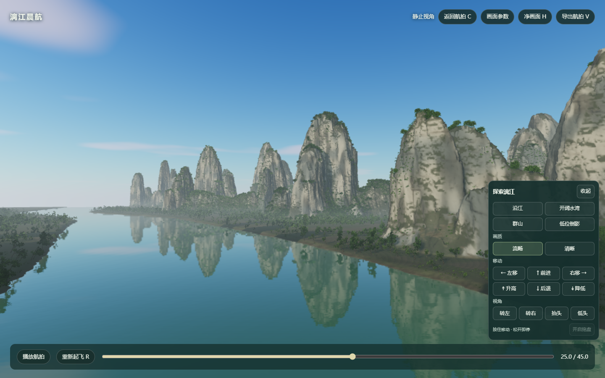

# 可编程世界：公开发布摘要

原作 Na Pali 以代码生成海岸地形、侵蚀、森林、海浪、天空与光照，再用航线和镜头形成完整风景作品。我们参考其创作方法，制作老街窗景、独立船坞车站和漓江晨航：分别用于停留观察、呼船靠泊及去留叙事、沿江航拍与自由驾驶。原作完整实时驾驶依赖专用本机运行服务，公开版提供作者画面、原理、来源及本机运行说明。

沉淀的流程是“确认约束 → 固定模板 → 有界求解 → 独立验证”：先确认构图、尺度、观看位置和允许改变的范围；固定素材版本、seed与已验证模块；只在有限参数、候选次数与计算预算内比较；以未参与调参的机位、连续路线、实际操作和性能独立验收。现有场景、参数和检查脚本可以复用，完整自动拟合管线尚未实现，三个后期乘船方向仍是候选。

## 公开入口

- [研究摘要与作品](https://yydshly.github.io/1020_codex_project/projects/014-programmable-worlds/#research-summary)
- [完整总览图](https://yydshly.github.io/1020_codex_project/projects/014-programmable-worlds/map.html)
- [四步制作流程](https://yydshly.github.io/1020_codex_project/projects/014-programmable-worlds/#controlled-process)

## 发布方式与范围

采用既有 GitHub Pages。保留独立于其他未提交项目的发布副本，只提交014、该目录入口与依赖白名单构建能力。研究长图及静态参考以原字节归档在Git仓库，通过公开原始文件地址显示；没有重新生成或替换认可的效果图。

运河两作的模型、缓冲与49张光照图采用无损传输包：51个资源534,297,167→287,089,669字节，全部回读逐字节验证；解码后原模型和float16光照像素不变。M8的51份场景源码、几何与生态保持原字节，通过逐文件白名单保留必要Three.js/Mediabunny运行文件，仍排除其他node_modules依赖。

本机构建与发布镜像约995.94MB，低于十进制1GB；16个目录项目检查与15项构建单测通过。历史17.52GB完整研究资料、原作GPU运行桥、旧场景与本地缓存保留在工作区，不整包上传。本次结果见下方；既有历史验收只对应当时版本与范围。

## 已完成的公开发布与实际验收

- [Pages工作流40362250453](https://github.com/yydshly/1020_codex_project/actions/runs/40362250453)成功，部署提交为 `7c3148838c92ebe2431dd4221654422a97f1e7d2`；同提交自动检查通过。
- 公网摘要完成10项静态检查：原作/我们的成果/四步流程、原作本机限定、五图切换、三张未来参考解码、桌面及390窄屏、完整阅读图解码与缩放章节操作。SVG/PNG下载仅做HEAD200检查，未把大文件下载当成阅读页加载条件。
- 公网漓江完成4项有限运行检查：实际生成、群山机位、流畅档与上升按钮按放；操作后确认新增完成帧，随后释放。原作未伪装成在线实时服务。
- 运河发布副本完成4项实际检查：A加载、河岸机位与暂停恢复；B加载、呼船后实际靠泊与栈桥展开。此次地点为本地仓库前缀暂存服务，不称作公网完整流程或性能验收。
- 第一轮M8已经就绪并静止在2帧，旧QA错误要求额外空闲帧而超时；已修正谓词并单独复验公网M8，没有重跑已通过的运河，也不把旧失败记录改成成功。
- 阅读图采用与原PNG逐像素一致的3.43MB无损WebP，从Pages同源加载；原始SVG/PNG固定在首个归档提交 `0e430bf7f464582764c32db17f7765bc800f4b15`，没有重绘认可的图。

[浏览器验收与边界](published-browser-acceptance-20261027.json) · [源文件及二进制响应核对](published-resource-verification-20261027.json)

公网资源核对115项全部通过：64项页面、代码与阅读图逐字节一致（包括51份M8），51个无损二进制仅核对HTTP200与响应尺寸，完整二进制内容由浏览器加载器的SHA校验保证；不把HEAD检查写成已下载全量文件。
