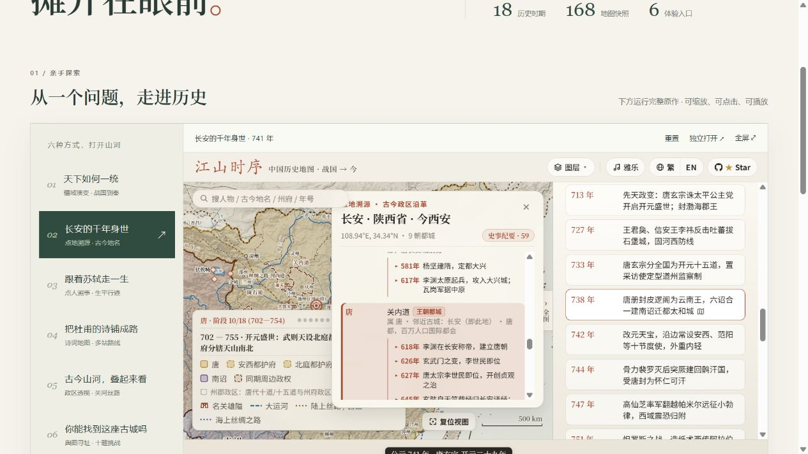

# 015 · 江山时序 · 在地图上读中国历史

> 完整体验历史地图，拆解八个源码工程方法；用同一个时序核心运行物流与项目迭代，沉淀数据契约、行为测试、迁移指令与项目执行手册。

[能力展示入口](web/index.html) · [源码与迁移实验](web/engineering.html) · [实现与指令手册](web/playbook.html) · [可缩放完整引导图](web/guide.html) · [上游仓库](https://github.com/DeanChensj/jiangshan-map) · [作者在线版](https://deanchen.me/jiangshan-map/)

| 项目资料 | 内容 |
| --- | --- |
| 当前阶段 | 原作展示、源码模式研究与独立迁移实验；整库二次开发与联动三维另见 016 |
| 研究状态 | 研究中 |
| 固定版本 | [`53059f1c7fed305807b19365857a5f135daf3ac6`](https://github.com/DeanChensj/jiangshan-map/tree/53059f1c7fed305807b19365857a5f135daf3ac6) |
| 研究日期 | 2026-10-24 |
| 上游许可 | GNU GPL v3.0，见 [LICENSE](LICENSE) 与 [NOTICE](NOTICE.md) |
| 页面形式 | 原生 HTML / CSS / JavaScript；完整原作在同源 iframe 中运行 |

## 实际运行预览



[手机端实测](assets/acceptance-mobile.png) · [详细验收记录](notes/verification.md)

## 先亲手体验六项能力

| 入口 | 展示内容 | 可以做什么 |
| --- | --- | --- |
| 天下如何一统 | 秦灭六国的阶段地图 | 从前 230 年推进到前 221 年，比较各政权疆域与关键事件 |
| 长安的千年身世 | 741 年长安的「点地溯源」 | 查古今地名、历代行政归属和当地历史事件 |
| 跟着苏轼走一生 | 「点人溯事」生平与行迹 | 逐站切换人物事件，观察年份、地图与年号同步变化 |
| 把杜甫的诗铺成路 | 763 年诗中的五站归乡路线 | 查看剑外、巴峡、巫峡、襄阳与洛阳的空间关系 |
| 古今山河，叠起来看 | 1415 年应天府与图层面板 | 切换历史政区、现代省界、省名、山川与关河丝路 |
| 你能找到这座古城吗 | 古地名寻址挑战 | 根据历史线索落针，按距离检验空间印象 |

展示页额外提供：年份与地名输入、韩愈／杜甫／苏轼三组路线预设、中文逗号兼容、跨年数量校验、地名解析校验、可分享的场景链接、重置与全屏入口。表单直接使用原作 `atlasAPI.resolvePlace` 检查名称，再通过原作 URL 参数打开地图。页内六项体验运行本地收录的原作文件，不依赖作者网站嵌入。

原库还提供 AI Agent 调图协议、浏览器查询 API 与 GeoJSON 导出脚本，展示页保留相应源码／文档入口。本阶段没有运行 GeoJSON 导出或接入外部大模型。

## 实现思路、规划与可复用指令

[打开网页手册](web/playbook.html)。手册收录效果实现机制、AI 开发角色与运行依赖的区别、五阶段规划及每阶段的动作、产物、通过条件和个人用途。资料与作者开发流程有明确来源边界，规划与模板标为我们的实践整理。

页面提供六项需求填写器，生成自己的首版指令；可分别复制首版实现、资料核对、视觉修改、交互同步、性能排查、交付验收六组模板，或下载全部 TXT。另有反馈句式与手动验收清单，方便以后做类似项目时查阅。

[手册桌面实测](assets/acceptance-playbook-desktop.png) · [手册手机实测](assets/acceptance-playbook-mobile.png)

字段内容和勾选状态不作持久化保存，刷新恢复样例。本手册没有连接大模型；生成指令是本地文本组合，按用户填写内容更新。

## 源码方法与技术沉淀

[打开技术研究页](web/engineering.html)。按照“源码证据 → 通用原理 → 迁移验证 → 技术资产”组织，收录八项方法：阶段快照、统一状态入口、坐标与图层分离、实体解析、过期请求保护、按需加载、URL 协议、一份数据派生多种玩法。每项包含固定版本代码链接、适用边界和掌握标准。

其中时序与状态规则已重新实现为 [temporal-core.mjs](web/lab/temporal-core.mjs)，不依赖原库控制器、DOM 或 Three.js。同一套界面与核心切换“物流流转”和“项目迭代”两份虚构数据，支持事件与节点选择、时间阶段、图层开关、自动推进与 URL 恢复。[数据文件](web/lab/datasets.mjs)定义实体、事件、阶段和归一化流程坐标。

当前小核心验证的是阶段与线性事件，不含真实物流分支、项目并行依赖、权限或实时服务。名称解析、异步加载、几何压缩与出题仅完成模式研究，尚未提炼为通用模块。016 属于整库集成扩展，本页用于检验方法迁移；两者不混称为从零重建。

四组指令分别覆盖源码拆解、最小迁移、完整项目扩展和沉淀评审。主题输入仅在本地组合文本，不调用 AI。[核心行为测试](src/check-temporal-core.mjs)覆盖阶段边界、数据校验、多入口一致性、同时间事件、状态隔离及非法 URL 不改变状态。

接入新主题的最小流程：

```js
import {createExplorer} from './lab/temporal-core.mjs';
const explorer = createExplorer(myDataset);
const unsubscribe = explorer.subscribe(view => render(view));
render(explorer.getView()); // 订阅不会自动通知初始状态
explorer.dispatch({type: 'SELECT_EVENT', id: 'event-001'});
// 离开视图时：unsubscribe(); explorer.destroy();
```

数据约定：阶段 `[from,to)` 连续覆盖 `min` 至 `max + 1`，本页使用整数小时／天；日期先转为统一数值刻度。实体与事件 ID 分别唯一，事件按时间非递减排序并引用有效实体。实体允许暂无事件；节点入口选择该实体的首个事件，其他事件从列表选择。`route` 与 `labels` 是本实验预设图层，不是可注册任意图层的框架。`encode()` 返回查询串；`restore()` 严格校验参数，失败不修改已有状态。页面适配器另外需要 `unit` 和 `description`。

[浏览器验收记录](notes/verification-engineering.md) · [源码方法桌面实测](assets/acceptance-engineering-patterns.jpg) · [迁移实验桌面实测](assets/acceptance-engineering-desktop.jpg) · [手机实测](assets/acceptance-engineering-mobile.jpg)

## 快速运行

需要 Python 3.10+；静态网页无需 npm 安装或构建。从本仓库根目录启动：

```powershell
python -m http.server 8015 --bind 127.0.0.1 --directory projects/015-jiangshan-atlas/web
```

打开 `http://127.0.0.1:8015/`。技术研究与迁移实验为 `http://127.0.0.1:8015/engineering.html`；原作独立入口为 `http://127.0.0.1:8015/upstream/`；研究引导图为 `http://127.0.0.1:8015/guide.html`；实现与指令手册为 `http://127.0.0.1:8015/playbook.html`。首页“返回项目研究集”链接用于正式站点的项目子路径，在这种仅服务单项目的预览中会回到服务根路径。

用于仓库 GitHub Pages 的静态目录已准备好：`web/`。元数据已接入总索引；公网发布仍需按[仓库部署说明](../../docs/deployment.md)完成提交、推送与手动部署。

## 原理与结构

原库通过年份选择历史阶段与疆域多边形，用墨卡托投影和 SVG 绘制地图；地名词典、生平事件与政区沿革建立时间和空间关联。疆域按关键历史阶段的预设快照切换。

```text
年份 / 地名 / 人物
    → 历史阶段 + 地名位置 + 人物事件
    → 疆域 / 政区 / 山川 / 路线图层
    → 地图视图 + 沿革卡片 + 时间轴
```

| 文件 | 作用 |
| --- | --- |
| `web/index.html`, `style.css`, `showcase.js` | 新增能力展示与场景入口 |
| `web/playbook.html`, `playbook.css`, `playbook.js` | 实现机制、规划、可填写和复制下载的指令模板 |
| `web/engineering.html`, `engineering.css`, `engineering.js` | 源码模式、迁移实验、技术资产与迁移指令 |
| `web/lab/temporal-core.mjs`, `datasets.mjs` | 独立时序状态核心及两份业务数据 |
| `src/check-temporal-core.mjs` | 核心规则与跨领域行为验证 |
| `web/upstream/` | 固定版本的上游运行代码、数据、资源与来源文档 |
| `web/upstream/SOURCE.json` | 上游版本、原始与本地 SHA-256、修改标记 |
| `web/capabilities.json` | 由实际数据包生成的数量记录 |
| `src/vendor_upstream.py` | 从固定版本本地 checkout 复现集成文件 |
| `src/check_runtime.cjs` | 校验集成文件哈希、快照引用、脚本语法与入口资源 |
| `src/build_guide.py` | 生成独立 SVG 研究全图 |
| `notes/verification.md` | 实际验收记录、范围与限制 |

数据包实数：18 个历史时期、168 个快照键（其中 166 个被时期／阶段引用）、468 条编年事件、113 个历史人物档案和 7 条预设人物旅程。1405 是各朝代城池点位记录之和，不能当作去重城市数。上游部分宣传文本中的数量与当前包不完全一致，以 [capabilities.json](web/capabilities.json) 的固定版本统计为准。

## 完整引导图

[放大浏览与下载](web/guide.html) · [SVG 原图](assets/jiangshan-guide.svg) · [生成源码](src/build_guide.py)


图中区分原作能力、我们的理解、当前交付与后续方向；保留各步骤的动作、产物、判断条件和个人用途。SVG 自包含、可缩放，无外部图片依赖。

## 验证与复现

从仓库根目录执行，需要 Node.js 22+ 与 Python 3.10+：

```powershell
node projects/015-jiangshan-atlas/src/check_runtime.cjs
node projects/015-jiangshan-atlas/src/check-temporal-core.mjs
python projects/015-jiangshan-atlas/src/build_guide.py
python scripts/projects.py check
```

首次取得固定版本源码后可重新集成：

```powershell
git clone https://github.com/DeanChensj/jiangshan-map.git .cache/jiangshan-upstream
git -C .cache/jiangshan-upstream checkout 53059f1c7fed305807b19365857a5f135daf3ac6
python projects/015-jiangshan-atlas/src/vendor_upstream.py .cache/jiangshan-upstream
node projects/015-jiangshan-atlas/src/check_runtime.cjs --write-stats
```

脚本只接受固定 commit，不执行清理、删除或运行其他应用。

## 理解与下一步

这个库把分散的历史知识组织成可探索的空间体验。对个人的参考价值是复用已有地图与定位能力，把精力集中在一个具体的阅读困惑和有来源的叙事内容上。

下一阶段可以选择一首诗、一座城或一位人物做专题。独立内容站、教学效果与商业化属于待验证方向；本阶段不把它们作为已实现功能或需求成立的证据。

历史边界为示意性近似。杜甫的路线来自诗中表达，不作为实际行程证明。本文未对全部历史资料重新校勘；参见上游[数据校勘约定](web/upstream/CONTRIBUTING_ZH.md)。

[返回总索引](../../README.md)
