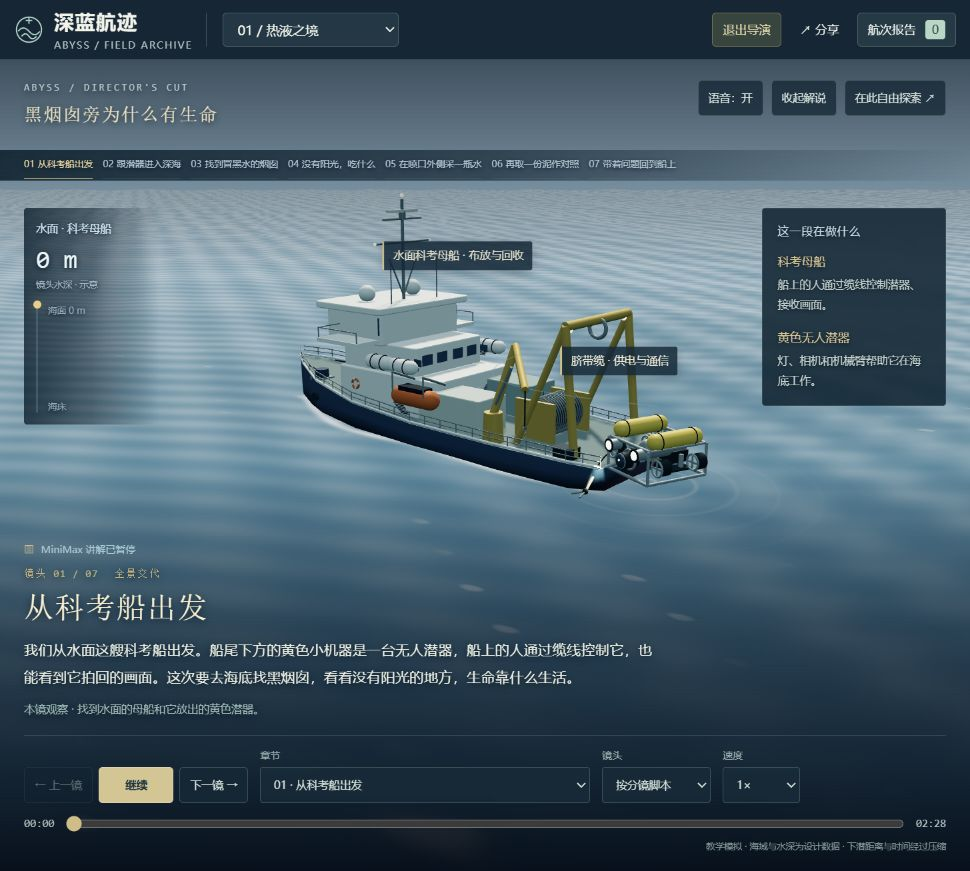
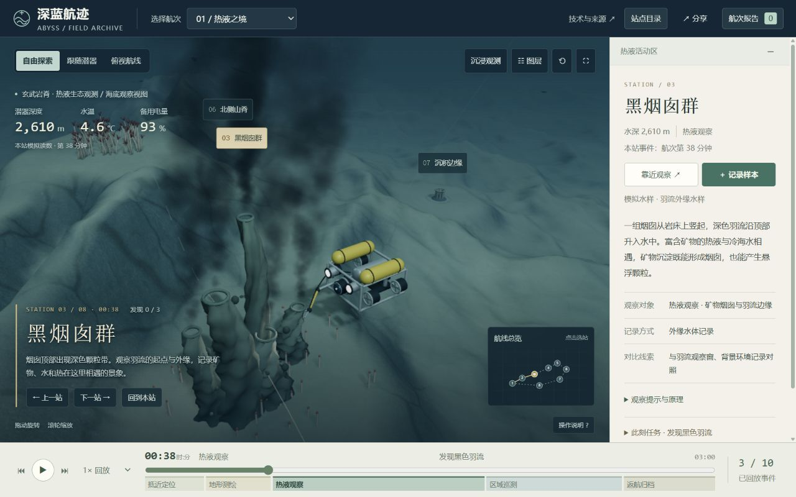
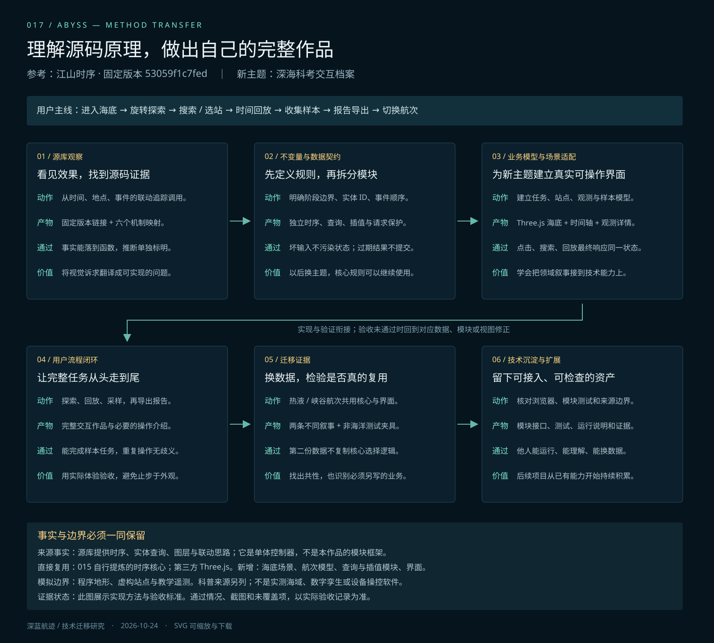

# 017 · 深蓝航迹 · 深海科考交互档案

> 从历史地图研究出发的独立深海流程演示实验：完整三维现场、导演、自由驾驶与讲解提示，共用九个纯核心。地图叙事与动作流程差别较大，当前不足以证明源库核心地图能力已迁移；下一目标为“中国铁路网络演进”。

[一图总览](web/overview.html) · [进入作品](web/index.html) · [完整研究档案](web/research.html) · [历史地图集成说明](web/integrations/atlas/integration-source.html) · [方法、来源与完整引导图](web/method.html) · [核心接入指南](web/core/README.md) · [两航次全流程验收](notes/verification-full-voyages.md) · [当前可见提示验收](notes/verification-visible-cues.md) · [驾驶验收](notes/verification-piloting.md) · [来源与许可](NOTICE.md)

## 能力、原理与扩展摘要

**源库是什么：**江山时序把年份解析为历史阶段快照，用统一地理坐标、SVG矢量图层与晕渲／浮雕底图绘制疆域、城池、水系和行迹；地点、人物和事件关联地图、时间轴与内容卡。用户可看疆域演变、查城池沿革、沿人物或诗词路线读史、比较古今图层并落针寻址。它适合延伸地方史、人物行旅、文化路线和交通网络等地图叙事；源库主体不是Three.js真三维。

**我们的效果：**015直接集成原作，新增体验入口、源码方法和指令手册；016继续复用54份上游输入，新增Three.js现代高程、三维叠加、2D/3D状态同步和路线编辑。017另行实现热液、峡谷两条各11章深海教学航次，以状态与事件组织场景、以预生成MiniMax音轨的媒体时间驱动讲解提示，提供设备与原理动画、同类采水、导演、自由驾驶和自由镜头。研究档案汇总真实效果、代码、来源和验收，并接入独立地图展品。

**可以如何扩展：**地图线可先拆分投影、地形、图层、标注和镜头接口，再用于铁路等第二地图实例；流程线可把导演、提示、观察与操作规则用于设备教学、实验操作或巡检培训。两条线都需要新的资料、主题对象和业务适配。九个纯核心主要为我们自行编写，不能全部算作源库移植成果；深海流程也不足以证明核心地图叙事已经通用化。中国铁路网络演进保留为后续验证目标，当前暂不启动。

完整说明见[发布摘要：源库能力、我们的效果与可扩展方向](notes/publish-summary.md)。

## 一图看完整探索

[打开可放大总览图](http://127.0.0.1:8017/overview.html) · [高清PNG](web/assets/exploration-overview.png) · [自包含SVG](web/assets/exploration-overview.svg)。一张图串起源库效果、研究线索、三阶段实践、真实截图、修正、复用边界、铁路后续目标和价值。图文来源及生成方式见[总览图说明](notes/exploration-overview.md)。

## 阶段状态：已归档

2026-10-25，当前阶段收口，现有运行入口、源码、资料、模块与验收记录继续保留。中国铁路网络演进作为后续扩展目标，暂不启动。详见[阶段归档记录](notes/stage-archive-2026-10-25.md)。

## 研究修正与后续扩展

[网页最新总结与铁路目标](http://127.0.0.1:8017/research.html#next-project) · [完整目标与规划](notes/next-project-railway.md)。明确区分完整地图集成、通用模块复用与核心地图能力迁移。下一项目仍在地图叙事范围内，用车站、区段、开通事件和来源验证第二实例；当前只登记目标与规划，尚未开发，首版线路与年代范围待资料核验。

## 从源库到独立作品的研究档案

[打开研究档案网页](http://127.0.0.1:8017/research.html)。源库能力与固定源码依据、源作实际效果和版本预览、015／016／017三种不同的复用方式、探索中的失败与修正、九个核心合同、六组主题指令、两航次逐章证据和完整文档库集中在同一入口。档案支持图库筛选／放大、全文搜索、网页原文与代码阅读、复制／下载指令；无需模型接口，表单不持久化。

研究资料按固定白名单发布到 `web/research/`，图片以内容哈希去重并保留工程相对路径。源库在线历史截图与固定版本预览分开标注；旧验收保留当时范围。015／016原项目入口仍使用各自的8015／8016服务；017研究页另有完整历史地图展品，归档图文和这个本地集成展品只需8017。深海主场景不导入研究图文或地图运行时，不增加深海启动时的地图加载。

### 研究页中的完整历史地图展品

打开[研究页地图展品](http://127.0.0.1:8017/research.html#atlas-demo)，或[独立地图入口](http://127.0.0.1:8017/integrations/atlas/?view=3d)。它把016当前完整地图运行时打包到 `web/integrations/atlas/`，在研究页的独立同源 iframe 中运行，不依赖8016服务。展品直接收录54份上游地图引擎、历史数据、样式与资源，以及016新增的路线编辑、同状态三维地图、现代DEM和本地Three.js模块；不是重新编写了原库，也没有把地图地形渲染器接进深海 `scene.js`。

父页适配器 `web/atlas-demo.js` 管理地图入口、预设、状态读数和实例生命周期；`web/integration-assets/atlas-bridge.mjs` 在 iframe 内校验同源父窗口与会话、转发白名单命令并回传实际状态；`atlas-api-suffix.mjs` 在构建时追加到集成副本的016适配器，访问原有控制器、三维视图与暂停接口。原016文件不修改；集成副本的 `atlas-terrain.js` 增加恢复时保留镜头的选项，并取消尺寸改变触发的自动对焦。所有输入与产物哈希、派生修改、许可和数据例外见[集成文件清单](web/integrations/atlas/integration-source.json)与[来源页](web/integrations/atlas/integration-source.html)。

从工作区根重建并检查（Node.js 22；检查不替代真实浏览器交互验收）：

```powershell
node projects/017-abyss-expedition/src/build-atlas-integration.mjs
node projects/017-abyss-expedition/src/check-atlas-integration.mjs
node projects/017-abyss-expedition/src/check-atlas-integration.mjs --base-url=http://127.0.0.1:8017/
```

构建使用固定白名单，不下载资源、不改源016、不删除原文件；旧微缩演示、原始高程瓦片和私有配置不打包。35份专题HTML副本仅移除原站统计脚本，保留作者与资料外链；原库古琴播放器5首Wikimedia音轨没有缓存，点击播放音乐仍需联网。地图、三维、历史数据和时间轴均从8017同源加载。此处记录集成结构与静态/HTTP校验边界，浏览器实际操作结果另见当轮验收记录。

研究总结源文件为 [源库研究](notes/archive-source-research.json) 与 [探索沉淀](notes/archive-exploration.json)。修改总结或项目文档后，从工作区根目录重新发布并验证：

```powershell
node projects/017-abyss-expedition/src/build-research-content.mjs
node projects/017-abyss-expedition/src/build-research-library.mjs
node projects/017-abyss-expedition/src/check-research-library.mjs
node projects/017-abyss-expedition/src/check-research-site.mjs --base-url=http://127.0.0.1:8017/
```

`build-research-library`只读取015／016／017明确列出的README、来源说明、研究文档与截图；不扫描项目外的配置、缓存或私人数据。它不删除旧发布文件或原始素材。页面中下载的是原文与媒体索引JSON，图片可分别打开原图。

前轮对照源作者在线作品调整布局、镜头、岩面、羽流与生态对象，并加入自由驾驶与不同地形；[画面对照](notes/quality-comparison.md)与[驾驶验收](notes/verification-piloting.md)保留各自范围。此前将环境讲解拆为55个递进画面提示，覆盖见[画面提示验收](notes/verification-environment-cues.md)；当前的可见区域选择、独立观察窗与主动对准另见[可见提示验收](notes/verification-visible-cues.md)。此前设备版保留各十一章、二十二段 MiniMax 音轨和八组设备讲解，范围见[设备体验验收](notes/verification-equipment.md)；二十章原理、采样和总结见[学习体验验收](notes/verification-learning.md)，更早的音画同步见[配音版验收](notes/verification-narrated.md)。深海主场景没有把源库历史素材用作场景资产；研究页地图展品的直接集成范围见上文。不以功能通过宣称艺术质量已经对齐。

本轮两片均从出发到返航完整实播两轮，22章画面、采水近景、手动操作与窄屏补查见[两航次全流程验收](notes/verification-full-voyages.md)；原始证据为[连续几何检查](notes/full-voyage-geometry.json)与[51条浏览器DOM记录](notes/full-voyage-browser.json)。自动检查、完整播放和局部复验各有覆盖边界，旧验收记录保留原始范围。

## 边驾驶边听：完整海洋环境导览

自由驾驶带有独立的“海洋环境导览”。点“听环境总览”后，默认连续播放六段 MiniMax 讲解；不退出驾驶、不选择航次事件，旁白与切段也不自动接管主镜头。可展开选段、暂停、倍速、拖动本段进度，并查看完整文本、观察提示与 NOAA／WHOI 资料。需要改变观察角度时，主动点“看清当前对象”；收起后仍保留当前对象与播放控制。

| 热液之境，约3分钟 | 峡谷回声，约3分18秒 |
| --- | --- |
| 热液岩脊与峡谷的区别 | 当前是深海峡谷，区别于热液裂隙区 |
| 深海冷水与局部热流 | 黑暗、通常寒冷、高压与生命 |
| 裂隙和地下热液循环 | 岩壁、台面、泥沙与水流搬运 |
| 黑烟、热水与矿物烟囱 | 海洋雪、水流与珊瑚海绵食物 |
| 微生物与部分管虫的供食 | 附着表面、栖息地与灯光观察 |
| 采水、拍照与待检验问题 | 配对采水、照片与回船分析 |

新增12条独立环境音轨（378.432秒），原22章导演与设备音轨保留。位置标签按教学地形的粗分区和离底关系生成；不能把“最近站”当成已经到达，也不能把模型Y换算成实测水深。最新覆盖见[环境导览验收](notes/verification-environment-guide.md)。

实现分层：`web/data/environment-guide.mjs`保存主题文本与资料；`web/environment-guide.js`复用既有导演时钟、语音播放器与音频缓存，并把用户主动对准／恢复镜头的请求交给场景，界面不选择航次事件；`web/core/environment-location.mjs`是本主题的位置说明辅助函数，换主题需另行适配，不计为新增通用核心。生成和校验命令为`src/generate-environment-narration.mjs`与`src/check-environment-narration.mjs --decode`，沿用项目外部私有配置与哈希缓存。

### 讲到什么，就提示看哪里

12段环境讲解包含55个递进画面提示，每段4–5项。适配器读取真实相机投影与 `viewOffset`，先减去导览卡片、驾驶台等UI占用，再从剩余区域选择能看清的目标。岩壁使用真实地形交点、贴合法向的金圈和局部面高亮；水流在可见水体中画短流线与箭头，海洋雪用缓慢下沉的颗粒说明方向。流线和颗粒均为教学示意。

珊瑚、海绵、管虫等仍保留原站位和原位高亮。远处或被遮挡时，独立三维观察窗复制同站的原有几何，展示部件、开口或附着关系，标题与距离说明对应站点；不移动原实体、主镜头或潜器，也不凭空在当前海床添加一群生物。主画面的方向提示保留站点位置关系。

“画面提示”可以单独关闭，语音继续播放。点击本段提示按钮只定位相应讲解时刻并暂停，拖动语音进度回算当前提示。另有“看清当前对象”主动对准镜头，操作后可点“回到我的镜头”；驾驶输入会回到原镜头，手动拖动则转为独立观察。全过程保留自由驾驶，不推进航次事件或写个人报告。

`computeCueLayout()` 是可复用的纯布局计算，输出避开UI的像素矩形与归一化区域；`cue-lens.mjs` 是共享场景几何的独立三维观察适配器；`getEnvironmentCueStatus()` 汇总目标可见性、临时对准状态和观察窗状态，供界面明确说明当前看什么。这些渲染适配器与九个纯核心分开计数，换主题时仍需提供实体、几何、地形及相机安全规则。布局和观察窗检查分别运行 `src/check-cue-layout.mjs`、`src/check-cue-lens.mjs`，实际页面覆盖以[可见提示验收](notes/verification-visible-cues.md)为准，不由模块检查推断浏览器全流程通过。

时间依据来自未改动的本地 MP3：离线检测到并匹配了122处停顿锚点，再按标点和段内文字权重估算提示时刻。停顿是真实音频分析结果，停顿与标点的对应仍是启发式匹配，段内时刻为插值估计；这不是逐词强制对齐，也没有逐词误差保证。`src/build-environment-cue-timing.mjs` 只处理本地文件，不调用网络或重新生成语音。

新增第九个纯核心 `narration-cues.mjs` 管理精确文本锚点、可选时间锚点和无状态的媒体时间查询；有非海洋仓库流程测试。海洋主题的目标、形态和动画仍由适配器实现，源库没有直接提供这些三维能力。新增浏览器与几何覆盖见[画面提示验收](notes/verification-environment-cues.md)，此前[环境导览验收](notes/verification-environment-guide.md)保留原范围。

## 为什么选择深海，以及如何把现场讲清楚

选深海是为了检验时间、实体、事件与空间路线的方法能否跨主题迁移：科考航次能够把站点、观察、对照与返航组织成一条任务线，也能检验三维尺度、遮挡和机位安排。前版优先证明了模块可迁移，母船、潜器、海床之间的关系与调查目的交代不足；本轮补上水面母船、水柱、脐带、近底潜器、采样设备及海床环境，并把调查顺序写成可观看的镜头脚本。

源库以 SVG 和浮雕底图组织历史地图。深海主作品学习其时序与空间联动方法，独立建立 Three.js 场景；研究页地图展品另外集成016的地图三维扩展。选题与叙事设计见 [场景意图](notes/scene-intent.md)。水柱的垂直距离为压缩示意，用来建立上下关系，不表示真实深度比例。

## 自由驾驶与独立镜头

点击“自由驾驶”，或在导演中接管潜器，可以离开预定航迹自由移动。进入驾驶时暂停航次时钟和解说，隐藏原航次遥测；驾驶台显示模型位置、离底高度、航速和最近站点。附近站点按钮只打开介绍，不移动潜器，也不写入个人报告。驾驶中切换航次保留手动驾驶与视角类型；结束驾驶后回到原航次观察流程，不自动继续播放。

| 控制 | 动作 |
| --- | --- |
| W / S | 沿潜器朝向前进 / 后退 |
| A / D | 左转 / 右转 |
| Q / E | 左移 / 右移 |
| R / F | 上升 / 下潜 |
| 空格 | 按住急停 |
| 1 / 2 / 3 | 跟随潜器 / 前向视角 / 独立镜头 |

屏幕上的八个方向按钮支持长按。跟随视角可拖动绕潜器观察；独立镜头可自行旋转、平移和缩放，驾驶按键仍控制潜器。打开菜单、弹窗、切到其他窗口或页面隐藏时会清空操纵输入。

链接用 `pilot=chase|cockpit|orbit` 保存视角类型，用 `pose=v1:x,y,z,heading` 保存潜器位置与朝向；非前向视角还可附带 `cam` 保存观察镜头。打开链接后潜器停在恢复位置，不自动移动或恢复音轨。驾驶数据与航次分钟、预定航迹和个人采样记录分开。

自由区域为横向 ±580 模型单位，整机半径为边界预留空间，带海床、固体道具与顶部高度保护；遇到陡壁可主动上升或移开。热液场使用低岩脊与裂隙，峡谷场使用高谷壁与弯曲深槽，两者采用不同的真实三维几何。它们是教学场景，驾驶并非真实动力学仿真。

`pilot-core.mjs` 是本工程新增的第八个纯模块，源库没有驾驶功能。它提炼的是可复用的运动、边界与高度场约束，键盘、触摸、相机和报告由浏览器及场景适配处理。接入示例见[核心指南](web/core/README.md#自由驾驶核心--pilot-coremjs)，实际覆盖见[驾驶验收](notes/verification-piloting.md)。

### 整机防穿透与安全恢复

本轮由中心点离底保护扩展为保守整机定向包围盒（OBB），覆盖机身、机械臂、瓶盖与小幅横滚；平移、升降和转向中途均做扫掠查询，转角受阻仍保留合法移动。固体道具从每个 mesh／InstancedMesh 实例提取独立世界 AABB，旧贴壁位置先尝试附近推离或安全回退，再以零速度接管。`pilot-core` 只接收 `terrainEnvelope`、`isPoseBlocked` 和 `bodyRadius`，几何工作在 [collision-world.mjs](web/rendering/collision-world.mjs) 与 [collision-assets.mjs](web/rendering/collision-assets.mjs)；这些适配器不计为新增纯核心。包围盒可能保守遮住复杂模型的空隙，不宣称精确网格刚体碰撞。

从工作区根目录运行以下四项，分别检查驾驶约束、碰撞查询、实际模型包络与真实场景整合；它们不代替本轮浏览器驾驶或完整影片重放：

```powershell
node projects/017-abyss-expedition/src/check-pilot.mjs
node projects/017-abyss-expedition/src/check-collision-world.mjs
node projects/017-abyss-expedition/src/check-collision-assets.mjs
node projects/017-abyss-expedition/src/check-collision-integration.mjs
```

## 导演模式

无深链接参数进入作品或切换航次时，先停在水面母船的导演开场，点击继续才播放解说，也可退出自由探索。热液片围绕三个问题展开：黑色烟囱是什么、没有阳光的生命靠什么、怎样取样调查。十一章依次建立现场、认识设备与下潜，解释地下热液循环、黑色颗粒与烟囱形成、微生物与部分管虫的食物关系，演示近处和远处的同类采水，再整理已知机制、模拟观察与待分析问题后返航。峡谷片用同样的调查结构解释岩壁、珊瑚和海绵栖地，并比较台面侧与深谷侧水样。两条航次各十一章，共二十二段配音。

影片秒数独立于航次分钟。每镜通过既有事件 ID 选择对应观察时刻，再由镜头规划器安排建立现场、靠近、环绕、特写、对照或拉远。接入配音后，每镜时长为 `Math.max(shot.duration, Math.ceil((audio.duration + 1) * 10) / 10)`，即保留原分镜时长，或为实际音轨加一秒并向上取至 0.1 秒；当前清单计算得到热液 311.2 秒（5:11.2）、峡谷 298.5 秒（4:58.5）；旧字幕版、十四章配音版和二十章学习版的片长仅属各自历史版本。片内时间不能解释为真实潜航耗时。

导演模式支持自动播放、暂停、进度拖动、选章、临时更换当前景别和放映速度、语音开关与重试、收起解说，以及“在此自由探索”。十一章调查导航说明当前要做什么，环境水深剖面帮助区分水面、下潜途中与海底。语音开启时以实际音频播放位置推进影片时钟；缓冲或播放受阻时镜头等待，暂停、跳章、拖动和倍速与音轨同步，关闭语音后可继续字幕放映。放映期间启用完整地形、航迹、喷流和语义标注，退出恢复普通探索的原选择。导演不自动写入个人航次报告；取水演示会保留本轮临时记录，当前也不导出视频。概念词典可随时查阅；原理镜头按语音进度自动分步，也可点击步骤暂停观察，再恢复自动。

导演链接用 `film=shotId` 保存章节，打开时暂停在本章起点；它不保存片内秒数、自由相机 `cam` 或会话内更换的景别。`context=0/1` 保存普通探索中的物体语义标注开关；导演过程中启用语义标注，退出后恢复原勾选。普通探索的相机安全恢复规则保持不变。

### 潜入时带哪些设备，如何支持工作

设备章紧接母船开场。人留在船上，ROV 是无人遥操作潜器。影片按八组职责依次高亮同一套潜器部件，也可在“设备清单”页签逐项查阅：

| 设备组 | 支持的工作 |
| --- | --- |
| 灯光与相机 | 照亮目标、拍摄海床，把画面交给船上操作员 |
| 声呐与环境传感器 | 通过回声辅助判断目标与距离；保留位置线索和环境读数，不能据此化验水体成分 |
| 推进器 | 前进、转向、在目标旁悬停 |
| 固体浮力材料与耐压舱 | 承托机体、保护电子设备；黄色浮力体不是氧气瓶 |
| 脐带缆 | 由船端送电和传令，从潜器回传视频与状态 |
| 机械臂与夹爪 | 按操作员指令夹持工具、接触目标和操作适合的样品 |
| 随身采水瓶 | 封存水样，并与编号、站位、深度和时刻相连 |
| 母船控制台、绞车与吊架 | 人员综合画面与数据控制潜器，管理缆线并布放、回收 |

在设备章选中任一步后，可点击“运行设备 4秒”，单独查看声波、通信方向、推进器、机械臂或瓶盖动作；影片与语音保持暂停，完成后由用户继续。场景用 `setEquipmentDemoTime(seconds|null)` 单独传入演示时间，不推进影片或写入个人记录。声波、通信粒子和部件放大是解释工作方式的视觉示意。

潜器后部的小瓶架是随身设备；后续 A／B 站的较大采水架是本演示提前布放的海床设备，有各自的布放和回收过程。画面分别说明两类装置的职责，机械臂不托举大型采水架。

### 亲自做一次同类采样演示

在近处 A 站和远处 B 站观看关盖演示，也可暂停后点击亲自采水；完成取样瓶关闭动作后才生成本次演示的样本卡；两瓶均为水样，显示站位、模拟水深、时刻与编号。对照表需两份同类样本齐全后解锁，化学成分仍标为待分析，画面和模拟遥测不能充当实验结论。

这组演示记录只属于当前学习会话，重新播放会清空，不自动写入浏览器保存的个人航次报告。结尾按“已知原理 / 本轮记录 / 待分析”整理：科学常识来自所列来源，本轮记录只说明用户实际完成的演示操作，未知成分需要后续分析。普通自由探索中的个人采样与 JSON 报告仍由原有业务流程管理。

### 配音的生成与加载

解说使用 MiniMax `speech-2.8-hd`，音色 `male-qn-qingse`，通过[官方同步语音合成 HTTP 接口](https://platform.minimax.cn/docs/api-reference/speech-t2a-http)预生成 MP3。`src/generate-narration.mjs` 调用 `src/minimax-tts.mjs`，把每章旁白、文件、实测时长与校验信息写入公共音频清单；前端校验音轨文本与当前旁白一致后再加载。

生成器通过 `--env-file` 读取位于项目之外的私有配置文件，传入路径必须是绝对路径；已有进程环境配置优先。密钥只供生成阶段使用，网页只加载项目内 MP3 和公共清单，不包含密钥，也不会在播放时直接请求 MiniMax。需要重新生成时，从工作区根目录执行下列命令，并将占位符替换为已有外部配置的绝对路径：

```powershell
node projects/017-abyss-expedition/src/generate-narration.mjs --env-file "<私有配置文件的绝对路径>" --dry-run
node projects/017-abyss-expedition/src/generate-narration.mjs --env-file "<私有配置文件的绝对路径>"
```

`--dry-run` 只核对输入与待生成章节；正式生成默认复用已校验的匹配缓存，`--force` 才重新生成选中音轨。CLI 不接收密钥值，完整参数见 `--help`。



[配音版水下现场](assets/narrated/03-underwater.jpg) · [前轮喷口环绕](assets/director/17-director-layers.jpg) · [前轮采样设备](assets/director/15-fixed-water-sampler.jpg) · [前轮手机导演模式](assets/director/14-mobile-director.jpg)

## 作品与体验

面向对深海探索感兴趣的普通用户。选择一条教学航次，在可旋转、缩放的三维海底查看科考站、跟随潜航器移动、查询观测记录，收集样本后导出报告。时间轴、任务阶段、站点、航迹和遥测由同一状态驱动。

无深链接参数打开 `/`，或从普通探索切换航次时，进入该航次导演开场并暂停，不自动出声；驾驶中换航次则保持手动模式与视角类型。带明确 `time`、`event`、`cam`、`film` 或驾驶参数的分享链接仍按链接恢复；`film` 链接暂停在对应章节起点，驾驶链接恢复为静止状态。“开始站点导览”从航次起点逐站推进，由用户点击控制。

左侧目录收进抽屉，场内保留当前事件叙事、前后事件按钮与小航线图；沉浸观测可隐藏右侧记录。选站点、任务事件、剖面或前后事件时，时间、详情与镜头动作统一；俯视模式保留全局观察，开始播放时其他模式默认切为跟随潜器。每站仍提供“观察对象、记录方式、对比线索”。

记录至少两个样本后，可在航次报告中选择两个已记录样本，比较站点、事件时刻、水深和观察内容；三项记录达到本航次发现目标。导出的 JSON 包含样本、站点、事件、观察说明、记录时的航次时间、来源和分享链接。记录保存在当前浏览器，两条航次相互隔离；分享链接不会携带个人采样记录。

“热液之境”围绕热液烟囱与化能合成环境；“峡谷回声”围绕峡谷地貌与冷水生态。两条航次共用状态核心、界面与场景适配器；数据中的 terrain 类型选择适配器内的热液或峡谷地形与物体生成规则，站点、事件与任务内容来自各自 JSON。总览、跟随和俯视提供不同观察方式，图层开关用于理解路线、站点与环境之间的关系。

航次、站点、数值遥测和样本均为虚构教学数据。海底是程序三维几何，不是图片替身，也不是实测 DEM 或真实海域复原。遥测温度表示模拟 ROV 周围海水；电量表示模拟备用电量。科普依据单独保存为 [sources.json](web/sources.json)，与教学数据区分。



[管虫群落实测](assets/quality/15-vent-life.jpg) · [海绵群落实测](assets/quality/16-sponges.jpg) · [窄屏布局实测](assets/quality/14-final-mobile.jpg) · [前轮样本比较与报告](assets/polish/04-report.jpg)

## 快速运行

需要 Python 3.10+，现代浏览器及 WebGL 2；静态网页不需要 npm、外部 API Key 或大模型调用。Three.js 模块已保存在项目内。从工作区根目录执行：

```powershell
python -m http.server 8017 --bind 127.0.0.1 --directory projects/017-abyss-expedition/web
```

打开 [本机作品](http://127.0.0.1:8017/)。技术说明为 [本机方法页](http://127.0.0.1:8017/method.html)。请通过 HTTP 服务打开，直接使用 `file://` 不能正常载入模块和 JSON。

## 技术如何迁移

方法参考 [DeanChensj/jiangshan-map 固定版本 53059f1c7fed](https://github.com/DeanChensj/jiangshan-map/tree/53059f1c7fed305807b19365857a5f135daf3ac6)。源库通过时间选择历史阶段，以地点与事件连接地图、路线、列表和详情。原库主体为 SVG，并非本作品的三维引擎。

| 源库机制 | 通用理解 | 新作品中的实现 |
| --- | --- | --- |
| 年份对应历史阶段 | 连续时间区间明确归属 | 航次分钟对应任务阶段 |
| 选中人物事件推动多个视图 | 操作走统一状态入口 | 场景、列表、搜索、时间轴同步 |
| 地名解析后查询与定位 | 名称解析与渲染分离 | 稳定 ID、站点名及别名索引 |
| 快照加载完成后检查当前选择 | 过期响应不能覆盖最后一次选择 | 航次切换使用 latest-task |
| 多图层共用投影空间 | 坐标协议与渲染解耦 | 归一化站点坐标用于三维与路线 |
| URL 表达要打开的状态 | 输入协议能复现任务 | 恢复航次、时间、事件、四个图层，以及相机位置、观察目标、模式和画面呈现 |

原库是单体控制器，没有本项目这些独立模块；模块拆分是我们的工程提炼。深海主场景未导入原历史数据、地图控制器、样式或布局；研究页地图展品则明确直接复用这些内容，并保留原始归属和逐文件清单。

## 可复用模块与数据流

```text
点击 / 搜索 / 时间轴 / 链接
          ↓
实体索引 → 时序状态核心 → 任务阶段、事件、实体
                              ↓
                  轨迹插值 → 3D / 详情 / 遥测
航次 JSON → 最新请求保护 ──────┘
```

| 文件 | 职责与边界 |
| --- | --- |
| [temporal-core.mjs](web/core/temporal-core.mjs) | 直接复用 015 中自行编写的时序核心；阶段、事件、订阅、图层和 URL 编解码，无 DOM 或海洋依赖 |
| [entity-index.mjs](web/core/entity-index.mjs) | 新增通用实体名称与别名查询，未知输入不强行匹配 |
| [track.mjs](web/core/track.mjs) | 新增通用关键帧线性插值，无 Three.js 依赖 |
| [latest-task.mjs](web/core/latest-task.mjs) | 新增通用异步结果保护，只提交最新任务的结果 |
| [camera-state.mjs](web/core/camera-state.mjs) | 新增独立相机状态校验、版本化编解码与容差比较；位置和目标量化至 0.1，不依赖 DOM 或 Three.js |
| [director-core.mjs](web/core/director-core.mjs) | 第六个通用核心；镜头播放、暂停、进度、选章与完成状态，不调度计时器或操作相机、URL、记录 |
| [learning-core.mjs](web/core/learning-core.mjs) | 第七个纯核心；临时采样会话、同类样本配对门槛、冻结快照与生命周期，无 DOM、渲染或个人存储依赖 |
| [pilot-core.mjs](web/core/pilot-core.mjs) | 第八个纯核心；独立运动、边界与注入的整机／固体查询约束、冻结状态和位姿编解码，无 DOM、渲染、时钟或存储依赖 |
| [narration-cues.mjs](web/core/narration-cues.mjs) | 第九个纯核心；精确文本锚点、可选声学时间锚点、冻结计划与媒体时间查询，不调度播放器或修改场景 |
| [missions.mjs](web/data/missions.mjs) | 两条航次的轻量清单 |
| [director-shots.mjs](web/data/director-shots.mjs) | 两条航次的十一镜头教学脚本与原理类型、角色说明与任务线；影片秒数独立于航次分钟 |
| [vents.json](web/data/vents.json)、[canyon.json](web/data/canyon.json) | 阶段、站点、事件、观测、样本与遥测关键帧 |
| [observation-notes.json](web/data/observation-notes.json) | 各站的观察对象、记录方式与对比线索；静态教学内容，不由运行时 AI 生成 |
| [scene.js](web/scene.js) | 本次独立编写的 Three.js 海底、设备、标注、路线与相机适配器 |
| [terrain.js](web/terrain.js) | 热液低脊裂隙与峡谷高壁曲槽的不同程序几何、岩面 PBR、等深线和站点邻域缓坡；为驾驶提供同一高度场 |
| [hydrothermal-plume.mjs](web/rendering/hydrothermal-plume.mjs) | Three.js 主题视觉模块；喷流粒子的出生、扩散与消退，不是流体仿真 |
| [benthic-life.mjs](web/rendering/benthic-life.mjs) | Three.js 主题视觉模块；根据调用方随机源与落地高度创建管虫或海绵群落 |
| [shot-camera.mjs](web/rendering/shot-camera.mjs) | 纯机位规划；把景别与镜内进度转为位置、目标及视场，仍按当前现场尺度组织镜头 |
| [rov-system.mjs](web/rendering/rov-system.mjs) | `createRovSystem()` 供科考现场和教学镜头共享潜器几何、部件分组、锚点、高亮、剖视与确定性动作；`createRovControlStation()` 提供放大的船端教学工作台 |
| [expedition-context.mjs](web/rendering/expedition-context.mjs) | Three.js 主题组件；母船、水柱、海床环境与采样设备的解释性几何 |
| [director-ui.js](web/director-ui.js) | 浏览器适配层；调度影片时钟、字幕与控制面板，把镜头帧交给场景，处理普通回放互斥与退出 |
| [pilot-ui.js](web/pilot-ui.js)、[pilot.css](web/pilot.css) | 驾驶输入与仪表适配；键盘、屏幕长按、三种镜头、失焦停机和附近站只读入口，不保存样本或推进航次时钟 |
| [learning-ui.js](web/learning-ui.js) | 浏览器学习适配；词典、自动与手动步骤、采水动画衔接、临时样本卡、对照与三栏整理 |
| [learning-content.mjs](web/data/learning-content.mjs) | 主题教学内容；概念词典、设备清单、八组设备职责、原理步骤、调查问题、采样站位和已知／待分析信息 |
| [learning-world.mjs](web/rendering/learning-world.mjs) | Three.js 主题解释组件；共享潜器的设备高亮、声呐与通信示意，以及热液剖面、矿物沉积、食物关系、栖地与对照的分步视觉表达，不是科学计算模型 |
| [narration-player.mjs](web/rendering/narration-player.mjs) | 音频媒体适配层；以实际播放位置推进影片，处理缓冲、暂停、定位、章节、倍速、开关与重试 |
| [environment-cue-tracks.mjs](web/data/environment-cue-tracks.mjs)、[environment-cue-timing.mjs](web/data/environment-cue-timing.mjs) | 12章55个精确语句提示及本地停顿辅助估时；目标实体保持原位，不包含相机动作或报告写入 |
| [cue-layout.mjs](web/rendering/cue-layout.mjs)、[cue-lens.mjs](web/rendering/cue-lens.mjs) | 避开UI的可用画面区域和同站几何的独立三维观察窗；属于渲染适配层，不增加九个纯核心的数量 |
| [environment-cues.mjs](web/rendering/environment-cues.mjs)、[cue-labels.mjs](web/rendering/cue-labels.mjs) | Three.js 主题视觉与投影标记；表面框选、示意流线、下沉颗粒、实体光环和遮挡／画外指路 |
| [collision-world.mjs](web/rendering/collision-world.mjs)、[collision-assets.mjs](web/rendering/collision-assets.mjs) | 整机 OBB 的地形净空、固体相交、扫掠与恢复，以及逐 mesh／instance 世界 AABB 快照；几何适配资产，不计为新增纯核心 |
| [generate-narration.mjs](src/generate-narration.mjs)、[minimax-tts.mjs](src/minimax-tts.mjs) | 生成阶段的 Node.js 工具；读取外部私有配置，调用 MiniMax，保存 MP3 与公共清单；不进入网页运行时 |
| [app.js](web/app.js) | 业务界面、逐站导览、任务收集、样本比较、报告和 URL 与模块集成 |

最小接入示例：

```js
import {createExplorer} from './core/temporal-core.mjs';
import {createEntityIndex} from './core/entity-index.mjs';
import {interpolateTrack} from './core/track.mjs';

const explorer = createExplorer(dataset);
const index = createEntityIndex(dataset.entities);
const renderCurrent = view => render(view, interpolateTrack(dataset.frames, view.state.time));
const unsubscribe = explorer.subscribe(renderCurrent);
renderCurrent(explorer.getView()); // subscribe 不自动触发初始通知

const entity = index.resolve('站点别名');
const event = dataset.events.find(item => item.entityId === entity?.id);
if (event) explorer.dispatch({type:'SELECT_EVENT', id:event.id});
// 离开视图：unsubscribe(); explorer.destroy();
```

时序契约：阶段连续且采用 `[from,to)`，从 `min` 覆盖至 `max + 1`；事件按时间排序并引用有效实体。实体与事件 ID 分别唯一，实体坐标为两个 0–1 数值。这里使用分钟刻度，支持小数分钟的连续回放；其他业务应先决定自己的时间刻度。route / labels 为当前核心的预设图层，不是任意图层插件框架。`encode()` 返回查询串；非法 `restore()` 不改变既有状态。

业务页面将相机位置、观察目标和模式存入版本化 `cam` 参数，坐标量化到场景单位的 0.1；`look` 保存“地形测绘／潜器观察”。四个图层均写入链接：route / labels 由时序核心保存，terrain / plumes 由业务层的 `fx` 参数保存。只有符合场景安全条件的位姿会按该精度恢复；旧贴地、山后或超出探索边界的镜头会调整并提示。播放不会自动恢复，采样记录仍属于本浏览器。

相机通用协议允许位置与目标距离 10–2500；当前海底适配器采用更窄的 48–1040 范围，并施加俯角、目标位置及地形视线保护。镜头过渡有确定终点；自由操作仍受场景限制。协议不保存投影或焦距，换场景须重新定义坐标、尺度和安全约束，不能把协议合法等同于任意场景均适合观看。

轨迹模块在线性关键帧间插值，适用于过程回放；它不计算流体运动、真实路径规划或机器人控制。实体查询和插值核心可以用于设备巡检或项目流程，海底地貌、样本规则与科考叙事仍属于主题适配器。

通用核心现在为九个：导演时钟与时序核心分别管理影片秒数和航次分钟；学习核心管理临时采样会话，驾驶核心管理独立位姿，语句提示核心按媒体时间查询当前提示。镜头、字幕、原理步骤、采样动画和场景对象由适配层处理。`hydrothermal-plume.mjs` 接收喷口位置、高度、纹理、随机源与主喷口标记；`benthic-life.mjs` 接收 `random`、`count`、`groundHeight`，由调用方负责地形贴合。实体的 `appearance: 'tube-worms'` 或 `'sponges'` 选择对应群落外观。母船、水柱和设备仍是 Three.js 主题组件；纯函数 `shot-camera.mjs` 也保留当前场景的尺度与构图约定。这些模块可以组合使用，不会只凭任意主题 JSON 自动生成合适场景。

模块的输入输出、适用边界与生命周期见 [核心接入指南](web/core/README.md)。复用核心并不意味着任意新主题都只需换一份数据；新领域的坐标、视觉对象与业务规则仍需对应适配器。

## 完整引导图

图保留早期方法迁移路线；新增驾驶与语句提示以当前九模块表及核心指南为准。

[网页阅读与放大](web/method.html#map) · [原始 SVG](web/assets/method-map.svg)



## 验证与复现

需要 Node.js 22+。从工作区根目录执行：

```powershell
node projects/017-abyss-expedition/src/check-core.mjs
node projects/017-abyss-expedition/src/check-camera-state.mjs
node projects/017-abyss-expedition/src/check-director.mjs
node projects/017-abyss-expedition/src/check-learning.mjs
node projects/017-abyss-expedition/src/check-learning-content.mjs
node projects/017-abyss-expedition/src/check-pilot.mjs
node projects/017-abyss-expedition/src/check-terrain.mjs
node projects/017-abyss-expedition/src/check-narration-cues.mjs
node projects/017-abyss-expedition/src/check-cue-layout.mjs
node projects/017-abyss-expedition/src/check-cue-lens.mjs
node projects/017-abyss-expedition/src/build-environment-cue-timing.mjs --dry-run
node projects/017-abyss-expedition/src/check-delivery.mjs
python scripts/projects.py check
```

既有核心检查覆盖两条实际航次、非海洋测试夹具、时间边界、实体查询、轨迹插值、URL 恢复与异步请求乱序；015 时序核心逐字节复用另作校验。新增驾驶和地形检查分别覆盖运动与约束、两类几何的高度场；命令结果和浏览器实际覆盖以[本轮驾驶验收](notes/verification-piloting.md)为准，不由旧版结果推断通过。

此前驾驶轮次的浏览器覆盖 390×844 与 1029×871 CSS 视口；实际按键与屏幕长按验证了离开航迹移动、海床／边界／顶部制动、静止位姿与独立镜头的刷新恢复、导演暂停后接管及驾驶中切航次。这里不表示物理手机测试，也未重放两条完整影片，细节以驾驶验收记录为准。当前高亮可见性与观察窗的验证另见[可见提示验收](notes/verification-visible-cues.md)，不沿用此前结果作当前通过声明。

相机状态检查通过：三个模式的往返编解码、量化、坐标与距离边界、非法字段和数值、输入不可变、冻结快照及容差比较。这些模块检查不代替浏览器中的实际镜头恢复验收。

导演时钟的行为检查覆盖时间边界、暂停、选章、完成、非法操作原子性、冻结数据与后台 delta 保护，并使用非海洋流程夹具验证复用。二十二段 MiniMax MP3 已完成生成、解码与旁白逐章匹配检查：新增两段设备配音，原二十段复用已校验缓存。设备章在热液和峡谷片中分别占 50.6／51.1 秒。学习核心及内容检查分别覆盖临时会话、同类配对和章节／概念／站位契约；这些检查不能代替浏览器中的共享潜器、设备清单、独立四秒演示、原理动画、采水、音画联动、退出和窄屏验收。最新实际覆盖以[本轮设备体验验收](notes/verification-equipment.md)为准，未记录通过的路径不作通过声明。旧版的[二十章学习验收](notes/verification-learning.md)、[导演验收](notes/verification-director.md)与[配音版验收](notes/verification-narrated.md)保留其原始范围。

前轮浏览器重新查看源作者在线概览、阶段事件和人物路线，并验证新版完整八站导览，目录／事件／剖面／前后事件同步，旧贴地链接的安全恢复，以及两航次、管虫与海绵的不同外观。1280px 窗口的画布约 980px，970px 窗口的画布约 700px；自由旋转检查的相机极角范围约 0.12–1.16 弧度（相对目标的竖直向上方向计），窄屏无页面水平溢出，新运行检查未出现 warn/error。截图和四步验收见 [最新效果对照](notes/quality-comparison.md)。这些结果不等于已经达到源库的艺术质量或全部设备兼容性。

前一轮的两样本比较、三样本真实导出、手动／跟随镜头分享和额外图层恢复记录保留在 [前轮验收](notes/verification-polish.md)，不冒充本轮新增实测。

下列是 [首版验收记录](notes/verification.md)保留的浏览器流程：

- 真实拖动旋转、滚轮缩放和总览／跟随／俯视切换；站点、搜索、时间与阶段保持同步。18 分钟“地形测绘”之后的下一事件正确到达 38 分钟。
- 四个图层可切换且保留业务选择；未知检索给出无结果反馈。
- 峡谷连续播放约 39 秒推进到 118.4 分钟，本段未出现控制台 warn/error。
- 刷新恢复热液航次 38 分钟、黑烟囱、俯视模式与关闭的路线；不自动恢复播放。
- 真实收集三个样本并导出 JSON，核对 `goal.complete=true`、3 个样本和 3 个来源记录；两条航次的采集记录相互隔离。
- 1280×720、1440×960 桌面及 390×844 CSS 窄屏视口均无页面水平溢出；窄屏完成站点选择与采样。这里是浏览器响应式视口检查，不是物理手机设备测试。

[验收计划](notes/acceptance-plan.md)保留原始标准；未执行的异常服务或硬件路径不因主流程通过而视为已验证。

## 适用范围与下一步

当前作品用于探索式科普与技术迁移验证。它没有真实海底数据库、实时设备连接、流体仿真、多用户任务协作或物理准确的采样过程。两条航次证明数据替换与方法迁移，不能据此宣称已经有通用数字孪生平台。

扩展为巡检、教学或其他交互作品时，可复用九个纯模块，再定义新领域的实体、事件、证据与完成规则。驾驶核心需要连续高度函数、边界和起始位姿；导演需要脚本与机位；语句提示需要新旁白的精确引用和对应目标，已有声学锚点只能用于匹配的文本与音轨。相机移动和画面呈现仍由场景适配器负责，需要分支工作流或多人权限时另行扩展业务模型。

## 来源与许可

- 深海方法研究：江山时序固定版本，源库代码 GPL-3.0；深海主场景未导入其历史数据、地图代码或016地形渲染器。
- 研究页地图展品：直接集成54份上游文件与016三维扩展，新增桥与父页适配器；代码GPL-3.0／GPL-3.0-only，Three.js MIT，CHGIS V6／Hartwell数据的原始学术、非商业条款继续适用，现代DEM另保留来源。见[集成声明](web/integrations/atlas/INTEGRATION-NOTICE.md)。
- 直接复用：015 自行提炼的 `temporal-core.mjs`，GPL-3.0-only；保留原文件。
- 第三方运行库：Three.js 0.180.0 与 OrbitControls，MIT，见 [许可](web/vendor/three/LICENSE)及 [来源清单](web/vendor/three/source.json)。
- 新增代码、界面与程序几何：GPL-3.0-only，完整文本见 [LICENSE](LICENSE)。科普内容为基于所列来源的简短中文整理，无机构照片、视频或受限海图复制。详情见 [NOTICE](NOTICE.md)。

[返回总索引](../../README.md)
