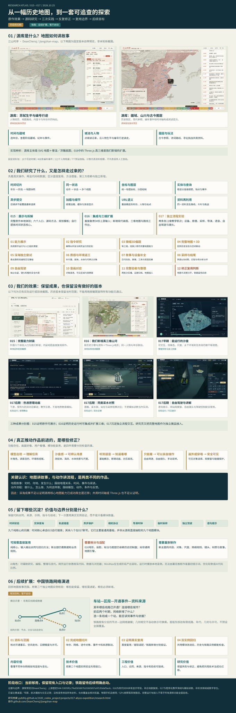

# 一图总览：源库、三阶段实践、认识修正与后续目标

整理日期：2026-10-25。本图是阶段归档成果的完整图文汇总；中国铁路网络演进继续保留为后续扩展目标，暂不启动。

[打开可缩放的完整图](http://127.0.0.1:8017/overview.html) · [高清PNG](../web/assets/exploration-overview.png) · [自包含SVG](../web/assets/exploration-overview.svg)



## 一张图包含什么

1. **原作效果与实现形式。** 两张上游固定版本自带预览展示苏轼行迹、历史疆域与古今图层。明确源库主体为SVG与晕渲／浮雕底图，016真三维是我们的新增。
2. **源码研究与探索路径。** 八个实现线索、015—017三阶段，以及从能力展示、微缩3D偏题、完整地图到深海返工、音画对应、驾驶、验收和边界修正的十二步。
3. **我们的实际效果。** 六张本地历史运行或验收截图：015能力封装、016新增三维、017早期沙盘、热液原理、同类采水、自由驾驶与讲解。
4. **推动作品改进的修正。** 角色与目的、船体与水下线索、解释原理、主动操作、可见提示和碰撞保护；地图讲故事与动作讲流程分别评价。
5. **可复用资产及其限度。** 九个纯核心的归属、直接可用与需拆分适配的范围、新主题仍需制作的内容、AI开发与本地运行的区别。
6. **铁路后续目标与价值。** 有分支的节点—边网络、资料研究、完整小切片、真实复用证据、双实例回归，以及内容、技术、工程与研究四方面价值。

## 截图来源与表达边界

- 上游归属：DeanChensj / jiangshan-map，固定SHA `53059f1c7fed305807b19365857a5f135daf3ac6`。源库图片为该固定包自带预览，未混作本轮新截图。
- 其余六张均取自已有本地实际运行或验收图片，保留当时版本与范围。没有生成、虚构或替换画面；原始文件未改，图内缩略图只做等比缩放与JPEG编码。
- 016为现代DEM并有显示夸张，不是古地貌复原。017为程序化教学海域、模拟读数与原理示意，不是实测海域或数字孪生。
- 铁路小图明确标为概念示意，不含真实线路或新研究的数据。阶段归档不表示源库全部能力、全部内容或所有异常路径已验收。
- 九核心没有直接从源库控制器抽取；时间核心来自015自行提炼，其余八个在017新写。深海结果不足以证明核心地图能力已跨主题通用化。

## 生成与后续修改

图为2600×7825的单张长图。PNG固定渲染效果；SVG嵌入全部截图、保留图文对象，可独立保存，无需外部图片请求。SVG的中文字体使用Microsoft YaHei及系统后备，跨设备字体效果可能不同，分享时优先使用PNG。

生成脚本为 `src/build-exploration-overview.mjs`，依赖Sharp进行缩略图等比缩放和SVG栅格化；已有环境可直接用Sharp，或传入模块目录。输入截图、尺寸、原文件哈希与两种输出的哈希记录在 `notes/exploration-overview-manifest.json`。修改内容后重跑脚本，并以实际图像检查文字、截图、来源和状态。

```powershell
node projects/017-abyss-expedition/src/build-exploration-overview.mjs
# Sharp位于其他依赖目录时：追加 --node-modules <包含sharp的node_modules目录>
node projects/017-abyss-expedition/src/build-research-library.mjs
node projects/017-abyss-expedition/src/check-research-site.mjs
node projects/017-abyss-expedition/src/check-research-library.mjs
```

网页提供适合宽度、100%、放大／缩小、回到顶部和下载；放大后支持鼠标拖动与原生滚动。研究页中的入口明确标记为长图顶部预览，完整内容在独立阅读页或下载图中查看。

## 本轮检查

已核对八张原图的SHA与两种输出文件的SHA，HTTP返回字节与本地产物一致；SVG的八张缩略图全部内嵌。实际查看了整图及源库、结尾等分区，修正了标点孤行与铁路概念示意措辞。

浏览器已实际操作研究页入口、完整图载入、100%缩放、125%放大、缩小、鼠标拖动、适合宽度和回到顶部。100%时图宽2600，水平滚动留在图像容器内；390×844 CSS视口中页面滚动宽375，未出现页面水平溢出。下载文件通过HTTP字节核对，没有额外通过浏览器下载到系统目录。
