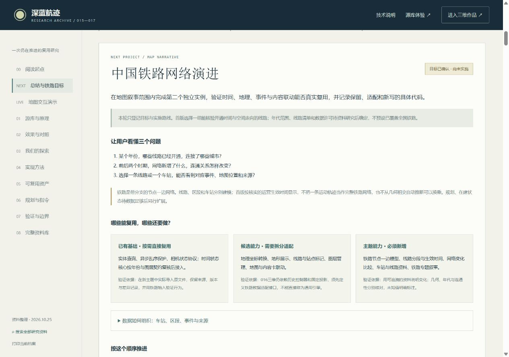

# 研究修正与下一项目：中国铁路网络演进

记录日期：2026-10-25。状态更新：当前阶段已归档；中国铁路网络演进保留为后续扩展目标，暂不启动。目标与规划继续保留，接续依据见[阶段归档记录](stage-archive-2026-10-25.md)。以下内容是拟定范围和验收标准，不代表已有铁路数据、模型或可运行成果。

## 为什么重新选择验证方向

江山时序的核心表达是地图叙事：用地点、年代、事件、疆域与路线说明“何时、何地、发生了什么”。深海作品主要是动作与流程说明：用设备、操作、任务条件与结果解释“做什么、怎么做、为什么这样做”。两者的内容骨架、渲染重点和交互难点相差很大。

此前深海实践保留了时序、实体选择和多视图联动等通用方法，但潜器驾驶、碰撞、采样动作、语音与几何高亮大多需要自行实现。因此，它不足以证明源库最有辨识度的地图叙事能力已经成功迁移。

当前需要分别记住三件事：

- 研究页已经集成完整地图运行包，证明了原作与016扩展可以被本地复用和接入网页。
- 017的九个纯核心中，时序核心来自015自行提炼的模块，另八个在017新写；这些文件没有从源库历史控制器直接抽取。它们可以有工程复用价值，但不能全部算作源库能力迁移的证据。
- 016三维地形仍依赖原地图控制器、历史状态和固定投影，需要先拆分适配边界，才能评估跨主题复用；目前不是替换JSON即可运行的通用三维地图框架。

深海作品继续保留为流程演示的独立技术线。下一次验证回到地图叙事范围，用第二个实际作品检查地图能力能否被保留、适配与扩展。

## 下一项目目标

项目主题：中国铁路网络演进。

面向第一次接触该主题的用户，让用户通过地图与年份理解：

1. 所选范围内哪些线路在什么时期出现，连接了哪些地点。
2. 新线加入前后，哪些站点成为连接点，网络结构怎样变化。
3. 同一地点在不同时期连接了哪些线路；点击一条线能读到哪些有来源的开通事件。
4. 地图上哪些形状和文字有资料依据，哪些是为可读性做的示意处理。

首版先选一组具有可核验开通资料的线路及相应年份范围，完成“选年份—看当年网络—点线路／站点—读事件与来源—前后比较”的闭环。线路名单、年代范围和数据规模待资料研究后确定，不预先声称覆盖全国全部铁路。

铁路网络是由节点与边组成的有分支图，需要明确连接点与线路分段。它不能用现有单条行迹路线或轨迹插值模块直接替代。首版不承诺列车时刻、实时运行、票务、实际可达性或旅行时间计算；几何相交也不能自动判定为可以换乘的连接点。

## 拟定数据契约

| 对象 | 必需信息 | 需要保留的边界 |
| --- | --- | --- |
| 站点／连接点 | 稳定ID、名称与别名、经纬度、所属范围、来源ID | 同名地点不合并；站点迁移、改名与建站年代分别记录；城市中心不冒充站址 |
| 线路与分段 | 线路ID、分段ID、端点ID、几何坐标、开通日期或有效时间、来源ID | 线路全线贯通和分段开通分开；缺少可用几何时明确标注示意连线 |
| 开通与变更事件 | 事件ID、日期及精度、类型、关联分段／站点、简短说明、来源ID | 未核实日期保持待核验，不由模型补齐；停用或改线仅在证据充分时加入 |
| 来源 | 发布机构、标题、原链接、获取日期、许可与使用限制、支持的具体事实 | 事实来源和几何来源可以不同；公开可读不等于可无限复制或再分发 |
| 时间视图 | 选择年份、可见节点／分段、选中对象、当前事件、图层状态 | 从同一份领域数据派生地图、事件卡与统计，防止各视图各用一套年份 |

“规划／在建／运营”可以作为后续状态扩展方案；目前没有确认这些状态的数据覆盖，不能直接当成首版已经具备的内容。首版优先呈现能核验的开通事实，对日期精度与缺失情况给出说明。

## 拟定复用边界

| 层次 | 候选资产与方法 | 下一项目需要完成的工作 |
| --- | --- | --- |
| 地图叙事方法 | 时间选择、事件与地图联动、地点卡片、图层、路线标注、语义URL | 将年份关联对象从历史政区／人物改为铁路分段／站点；按新任务重新设计阅读顺序 |
| 现有纯核心 | `temporal-core.mjs`、`entity-index.mjs`、`latest-task.mjs`、`camera-state.mjs` | 优先验证输入契约与实际需要；年份、图层及相机安全由铁路适配层提供，不为了使用九个模块而强行添加流程功能 |
| 待拆分的地图能力 | 016地形、经纬度转换、图层与标注管理、路线选择、镜头聚焦 | 审计与历史控制器的依赖，提取清楚的输入／输出；同时保留历史地图实例作为回归对照 |
| 新增铁路领域层 | 有分支网络、分段开通、节点连接、线路／站点查询与年份对照 | 制定网络拓扑和日期规则，并用分支、同名、分段及日期边界夹具验证 |
| 新内容与视觉适配 | 铁路线型、连接点层级、选中高亮、变化提示、事件解释与来源面板 | 根据铁路网络密度设计可读性，避免把历史人物路线换名后当作新作品 |
| 交付经验 | 按需加载、暂停恢复、状态分享、来源追踪、桌面与窄屏验收 | 在铁路作品中重新实测；历史项目通过不能代替新主题验收 |

上述地图资产仍是候选复用项。只有第二实例真正调用同一模块、替换清楚的适配输入，并通过两个实例的回归检查，才能把它登记为已验证的复用能力。

## 规划步骤与每步产物

1. **范围与资料审计。** 列出候选线路、时间范围、开通事实及几何来源，标明缺失与许可；据此确定首版覆盖，不先画一张看似完整的全国网。
2. **源实现依赖审计。** 对地图投影、地形、选取、图层、标注、时间联动建立“原实现—可保留代码—需拆分接口—铁路新逻辑”清单，说明哪些只是方法借鉴。
3. **完成一个可验证的小切片。** 选择含分段开通与连接点变化的有限网络，完成时间前后对照、线路与站点点击、事件解释和来源查看。资料不足时使用明确标识的测试夹具验证程序，不冒充历史事实。
4. **提取模块并双实例回归。** 用历史地图和铁路切片共同验证模块接口；记录共用文件、派生修改与主题专用部分，不复制整套历史控制器后重新命名。
5. **扩展与真实交互验收。** 在首版范围内补内容、布局、图层、URL恢复和异常提示，实际检查缩放、密集标注、选择、年份跳转、重访与窄屏。
6. **复用结论与交接。** 保存逐文件复用表、数据依据、可运行入口、检查命令和画面证据；分别报告集成成功、数据准确性、可读性和跨主题复用是否成立。

## 如何判定这次迁移成功

- 同一已核验开通事件，在时间轴、地图可见分段、事件卡与来源面板中一致；时间边界不会提前或滞后出现。
- 新分段的出现带来可解释的连接变化，网络分支与节点关系有明确数据依据；不以线条视觉相交冒充连接。
- 选择线路或站点后，相关对象高亮、说明与镜头清楚对应；用户可以退出跟随并自由缩放、旋转或平移。
- 分享和刷新恢复年份、选择与图层；暂停和页面尺寸变化不会意外清除用户选择或重置自由镜头。
- 历史地图与铁路作品实际使用同一份提取模块；改进共用模块后两个实例都能回归通过。
- 有独立的新主题内容、网络结构与阅读任务；不能以换名称、换配色或展示同一原作iframe作为迁移成果。
- 来源缺失、几何示意、数据覆盖、许可和未验证路径在页面可见。没有真实列车模型、驾驶或复杂动作也不影响地图叙事目标成立。

## 后续启动指令模板

以下指令留待下一项目正式启动时使用，本轮不执行：

```text
启动“中国铁路网络演进”项目。先阅读017研究档案中最新的复用边界修正、下一项目目标，以及015/016现有地图实现。

目标：在地图叙事范围内做出第二个独立实例，验证时间选择、地图图层、对象选择、事件说明与来源联动确实能够复用。不要把深海驾驶和采样流程作为本项目主线。

先审计资料，确定一组有可核验开通事实与几何来源的线路，以及有限年份范围；提交来源、许可、缺失与拟定数据契约，不预设已经掌握全国完整数据。铁路要建模成有分支的节点—分段网络，区分分段开通、全线贯通与实际连接点。

审计现有代码，逐项说明直接复用、提取适配、方法借鉴和新增实现。016地形仍依赖历史控制器，先确定接口边界；优先使用确有需要的纯核心，不要求九个模块全部出场。

先做一个真实可交互的有限网络切片，完成“选年份→看变化→点线路/站点→读事件与依据→前后对照”，保留自由镜头。切片成立后再扩展内容和提取共用模块；用历史地图与铁路两个实例回归证明复用。

交付可运行网页、来源与许可记录、逐文件复用清单和真实交互验收证据。明确区分测试数据、历史事实、示意几何、已实现功能和待办；不要用截图、功能数量或原作嵌入代替迁移验证。
```

既有资料：[可复用模块指南](../web/core/README.md)、[地图展品接入验收](verification-atlas-integration.md)、[完整研究网页](http://127.0.0.1:8017/research.html)。

## 网页归档与本轮检查

总结与目标已加入研究页的“总结与铁路目标”，并同步更新首页引导、模块说明示例和六阶段指令台；默认主题为中国铁路网络演进。完整说明支持网页内阅读，目标可以一键填入指令台，启动指令可复制。本轮未创建或开发新的铁路子项目。

实际浏览器检查：1280×900桌面与390×844 CSS视口；完整文档阅读、启动指令复制、目标填入指令台均已操作。窄屏文档滚动宽375，小于390视口，无页面横向溢出。这些记录是总结网页的检查，不是铁路作品的验收。




