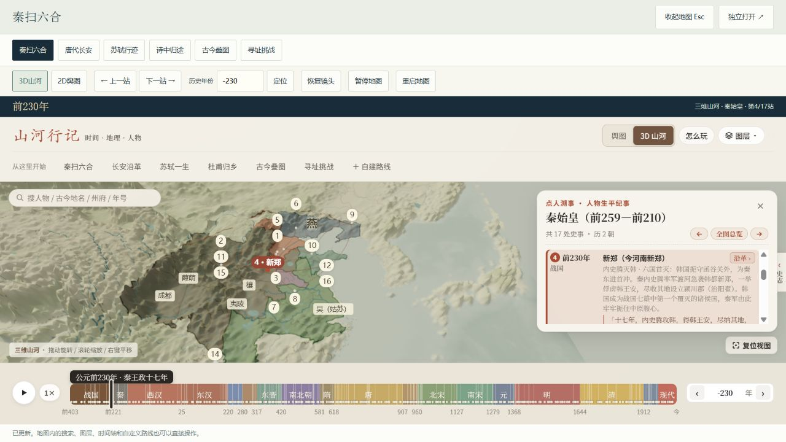
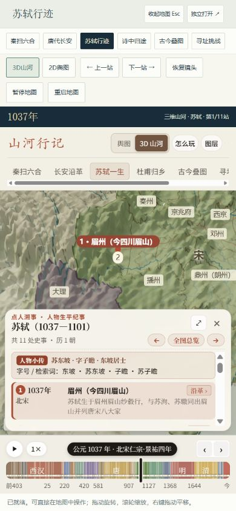

# 研究网页内的完整历史地图接入验收

2026-10-25。入口：http://127.0.0.1:8017/research.html#live-atlas 。本轮是完整功能集成，不是把历史渲染器迁入深海场景。

## 实际接入

- `web/integrations/atlas/` 是可重建的同源本地运行包，核心地图不引用8016服务。54份上游输入的原始SHA均验证；35份专题HTML副本只移除统计脚本，其余派生修改逐文件记录。包含原作许可、来源页和DEM、Three.js来源。
- 原作固定版本是 `53059f1c7fed305807b19365857a5f135daf3ac6`。历史控制器、SVG舆图、人物和地理资料来自江山时序；Three.js山河、现代高程与路线工作台来自016扩展。
- 当前包76个文件，含75份载荷与来源清单。父页面、消息桥和API是本轮新增；原016文件未改。研究页启动前不创建地图iframe。
- 自由驾驶、海底讲解和017主场景模块继续独立运行，没有导入此地图包。地图作为研究页中的独立交互展品加载。

## 浏览器实际操作

使用本地浏览器1280×720与390×844 CSS视口；这些尺寸不等于物理手机或所有浏览器兼容性。

1. 未启动时确认iframe数量为0；点击启动后出现真实地形、疆域、人物路线和史事卡，父页显示三维就绪。
2. 秦始皇前230年第4/17站，点击下一站到前228年第5/17站。苏轼入口到1037年全程11站；窄屏继续到第1/11站。
3. 杜甫入口763年显示5站，下一站进入第1/5站；长安入口741年；古今叠图1415年，八项图层均启用。原生图层菜单关闭现代省界后，状态从 `11111111` 更新为 `11011111`。
4. 寻址挑战使用原生二维舆图；实际落针后出现下一题按钮。切回三维退出挑战。挑战题目和年份由原作选择，不固定成同一道题。
5. 外层年份输入0给出无公元0年的说明；输入741成功定位。三维真实拖动与滚轮缩放改变镜头。
6. 手动暂停显示覆盖层，继续后保持旋转后的镜头；OrbitControls阻尼收尾有约0.01模型单位的变化。展开/收起地图后相机读数 `17.17,52.02,13.83` 保持；改变画幅更新投影而不重新对焦。
7. 跳到资料库后地图状态为paused；回到交互展品后恢复ready并能继续看到地形，镜头仍保持。只有一个地图iframe，后台暂停不会反复重建。
8. 原生自建路线输入“长安，洛阳，成都”和741年，成功生成三站；下一站进入第1/3站。切到二维后恢复镜头未清除路线；点击重启后保留二维、741年、三站路线和当前站，完整地图入口URL也同步这些语义参数。
9. 窄屏完成苏轼入口与下一站操作，文档宽390、滚动宽390，无页面横向溢出；完整地图自己的横向入口栏仍可滚动。
10. 本轮浏览器日志检查未出现warn/error。实际截图保留在下方。

## 修复与工程检查

- 正确读取原引擎的路线数组、人物中文名称和全程总览索引，避免显示第0站。
- 场景加载期间只保留最新待执行预设，避免旧异步回调覆盖新选择。
- 集成副本支持暂停/恢复保留镜头，取消仅因尺寸改变触发的对焦；原016未修改。
- 暂停同时停止年份、人物自动播放和用户开启的古琴音乐；恢复不会自行开始播放。
- 消息检查同源、iframe窗口和会话ID，动作使用白名单；无任意脚本执行或外部服务调用。
- 加载超时、WebGL上下文丢失有明确错误与显式重启入口，不做循环自动重载。页面缓存返回分支保留状态并恢复计时器。

通过以下检查：

```powershell
node projects/017-abyss-expedition/src/check-atlas-integration.mjs --base-url=http://127.0.0.1:8017/
node projects/017-abyss-expedition/src/check-research-site.mjs
node projects/017-abyss-expedition/src/check-research-library.mjs
node projects/017-abyss-expedition/src/check-delivery.mjs
```

集成检查包括75份载荷与输入哈希、75份HTTP响应字节、56条本地资源引用、91,333个DEM点、20个父页控件及8种桥消息动作。静态检查不能证明浏览器画质或生命周期；以上交互项另由实际浏览器操作确认。

## 证据与边界





完整接入不等于提炼出通用地图引擎。现代DEM有显示夸张，不是古地貌复原；精细二维功能与寻址仍使用原作SVG。可选古琴音频、作者专题的史料外链需要外网；没有缓存远程音频。本轮没有断开网络、故意丢失GPU上下文或强制BFCache命中，因此这些异常分支只有代码保护与静态检查，不声称已经实机注入验证。历史资料也未逐条核验。
